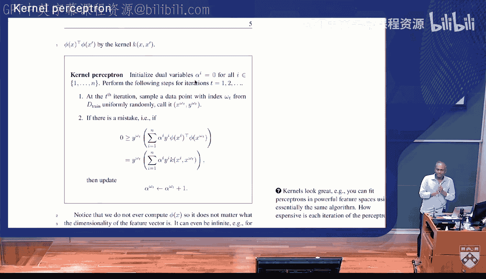
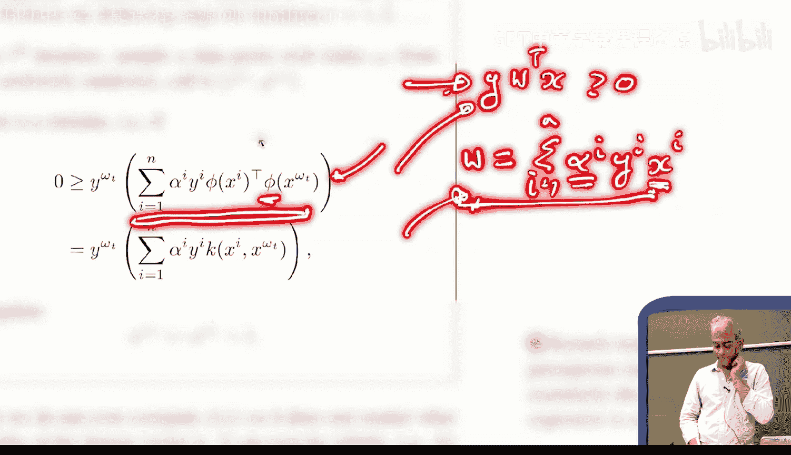
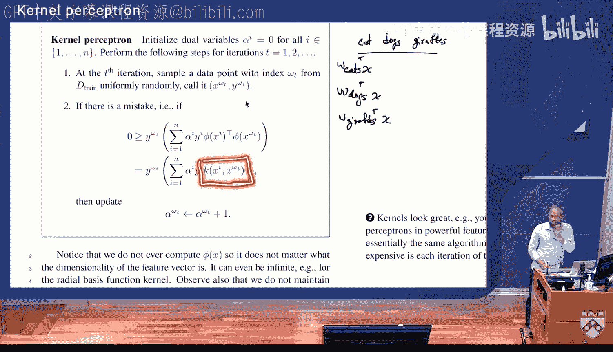
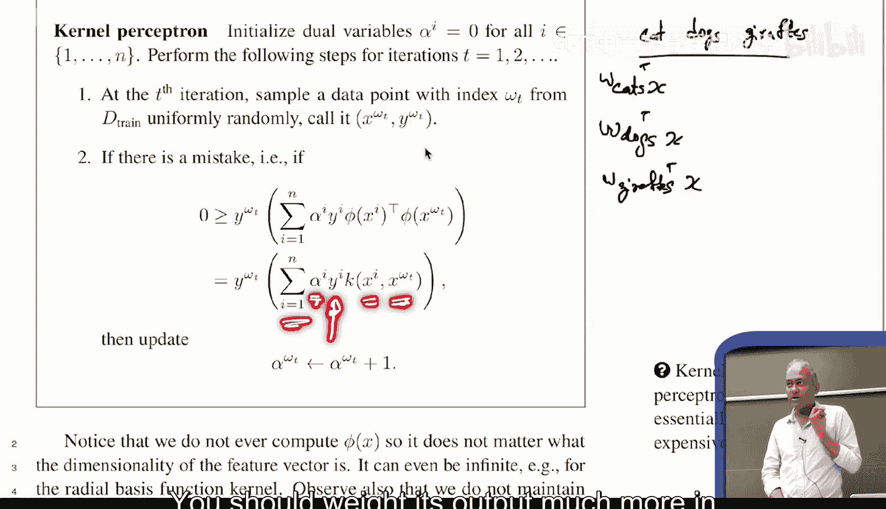
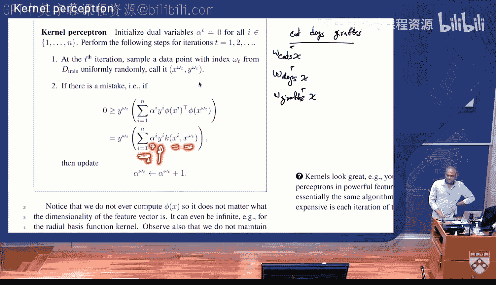

# 20：核感知机算法详解 🧠

在本节课中，我们将学习核感知机算法。核感知机与特征空间中的感知机在本质上完全相同，只是我们将以一种不同的方式来表达和实现它。

上一节我们介绍了感知机的基本原理，本节中我们来看看如何通过“对偶形式”和“核技巧”来构建核感知机。

## 算法初始化

在开始训练之前，我们需要初始化对偶变量。由于尚未对任何样本做出错误判断，因此所有初始值都应设为0。

**公式表示：**
`α_i = 0, for i = 1 to n`

## 迭代训练过程

在每一轮迭代中，算法会从数据集中随机抽取一个样本及其对应的标签。

假设我们的数据集为 `D`，当前迭代中抽样的样本记为 `x_ωt`，其标签为 `y_ωt`。

## 判断预测错误

如何检查预测是否错误？在标准感知机中，我们要求 `y * (w^T * x) > 0`。现在，我们的权重向量 `w` 由对偶变量和样本特征表示。

**权重向量公式：**
`w = Σ (α_i * y_i * x_i), i from 1 to n`

在每次迭代中，`α_i` 的值会更新，但基于当前的 `α_i` 值，我们可以得到当前感知机所维护的 `w`。因此，检查感知机是否犯错，就等价于计算以下求和式。

**预测判断公式：**
`Σ (α_i * y_i * <φ(x_i), φ(x_ωt)>)`

我们只是将 `w` 的表达式代入原判断式，并用特征映射 `φ` 后的内积来表示。如果该求和结果不符合符号要求，则判定为预测错误。

## 更新规则

如果检测到预测错误，我们需要更新模型。在对偶形式的感知机中，没有直接的权重 `w`，只有对偶变量 `α`。

因此，当出现错误时，我们只需将当前抽样样本 `x_ωt` 对应的对偶变量 `α_ωt` 增加1。

**更新公式：**
`α_ωt = α_ωt + 1`

这类似于在原始SGD感知机中更新权重 `w` 的操作。

## 算法运行与收敛

在下一轮迭代中，我们抽样新的数据点，再次计算整个求和式。如果发现错误，则再次增加对应 `α` 值。

随着迭代次数增加，部分样本的 `α` 值会不断增大。最终，当算法在所有样本上不再犯错时，`α` 值将停止更新，此时核感知机模型即训练完成。

这个算法的核心在于，我们无需显式地存储和计算高维权重向量 `w`，只需记住对偶变量 `α` 即可。

## 核函数的作用

这个算法被称为**核感知机**，原因在于我们使用了特征映射 `φ` 的内积。

我们可以将这个内积写成一个核函数 `K`。

**核函数定义：**
`K(x_i, x_j) = <φ(x_i), φ(x_j)>`

核函数接收两个输入，返回一个实数，用于衡量这两个输入之间的相似性。因此，实现核感知机时，我们既不需要权重 `w`，也不需要知道特征映射 `φ` 的具体形式，只需要能够计算核函数 `K` 即可。

以下是核感知机算法的核心预测步骤：

**预测公式（使用核函数）：**
`Σ (α_i * y_i * K(x_i, x_ωt))`

## 算法的直观理解

这个求和式捕捉了抽样样本 `x_ωt` 与训练集中所有其他样本 `x_i` 的相似性。

你对你新抽样图像的输出预测，是基于它与训练集中所有其他图像的相似度的函数。

让我们更细致地思考一下：例如，如果 `x_i` 与 `x_ωt` 非常相似，并且 `α_i` 的值很大（意味着过去在该样本上犯了很多错误），那么在预测 `x_ωt` 时，`y_i` 的贡献（权重）就会很大。

**核心思想：**
我们预测 `x_ωt` 的输出，表示为所有与 `x_ωt` 相似的图像的输出的加权和，权重则由过去在这些相似图像上犯错的次数（即 `α_i`）决定。

如果训练集中的某个图像与你刚抽样的图像非常相似，并且你过去在该图像上犯了大量错误，那么你就知道应该在这个求和式中更多地参考它的输出来修正当前预测。

---

本节课中我们一起学习了核感知机算法。我们了解到，核感知机通过对偶变量 `α` 隐式地表示模型权重，并利用核函数 `K` 在高维特征空间中计算样本相似性，从而避免了直接处理高维特征向量的复杂性。算法通过迭代抽样、核函数计算预测、判断错误并更新对偶变量的过程进行训练，最终得到一个基于样本相似性和历史错误进行预测的分类器。