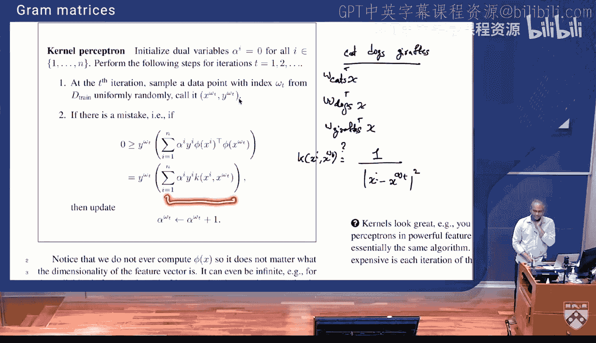
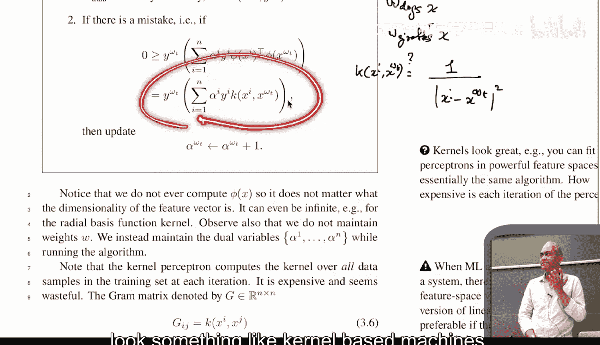
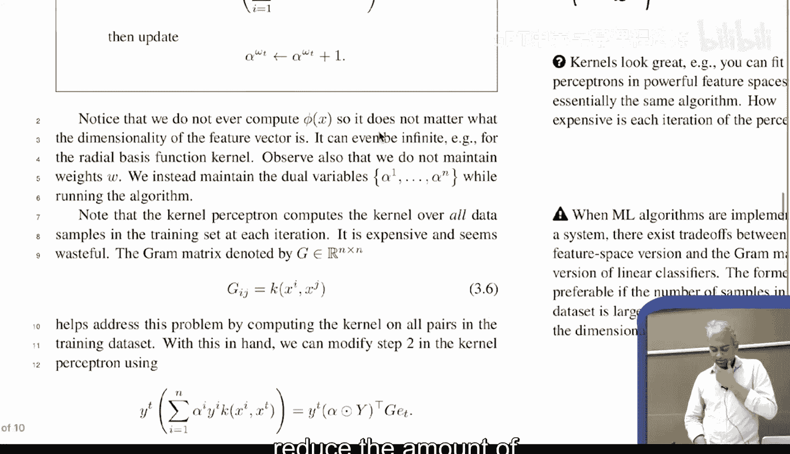
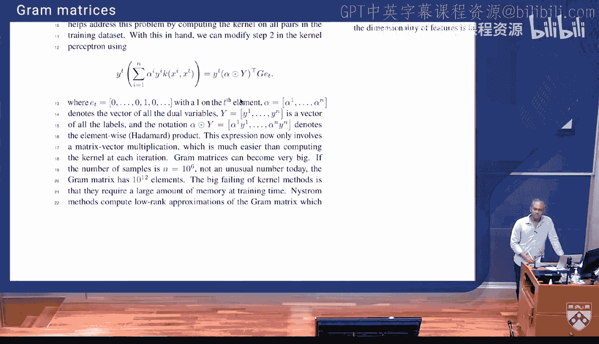

# 21：Gram矩阵 🧮

在本节课中，我们将学习Gram矩阵的概念。我们将了解它在核感知器算法中的作用，以及如何通过预计算Gram矩阵来优化算法性能。同时，我们也会探讨其计算上的挑战和一些优化方法。

## Gram矩阵的引入与定义

上一节我们介绍了核感知器的运行原理。本节中我们来看看如何优化其计算过程。

运行核感知器并不廉价，因为需要不断计算内积或核函数。但请注意，`x_omega_t`是训练数据集中的一个样本。如果能预先为所有样本对计算核函数值，就无需重复计算。

以下是具体做法：
1.  获取你的数据。
2.  预先计算所有样本对的核函数值，例如 `k(x1, x2)`, `k(x2, x3)` 等。
3.  之后，只需代入这些值，整个求和过程可以写成一个矩阵向量乘法。

其中，向量是阿尔法值（`alpha`）构成的向量，矩阵则是由所有核函数值构成的矩阵。

这个矩阵有一个名称，叫做**Gram矩阵**。

**Gram矩阵**是一个矩阵，其第 `i` 行第 `j` 列的元素是核函数 `k` 应用于第 `i` 个输入和第 `j` 个输入的结果。公式表示为：
`G[i, j] = k(x_i, x_j)`
因此，它就是一个包含所有核函数值的矩阵。

## Gram矩阵的应用与计算考量

正如之前所说，一旦计算出Gram矩阵（`G`），就可以将整个求和写成矩阵向量乘积的形式，其中矩阵是 `G`，向量是 `alpha * y`（此处 `y` 是标签向量）。

需要记住一个重要细节：阿尔法值（`alpha`）在每次迭代后都会变化，因为分类错误的次数在每次迭代后都可能更新。

必须认识到，Gram矩阵通常不是小对象。如果你有100万张图片，那么Gram矩阵中的元素数量将达到10^12（1万亿）个，这是一个非常庞大的数字。

因此，尽管核方法看起来像是基于线性函数的简单模型，但实际运行起来计算量非常巨大。事实上，直到大约2010至2012年，工业界中许多机器学习算法本质上都是基于核方法的变体。

## 优化技术与方法

为了减少计算这类求和（本质上是矩阵向量乘积）所需的浮点运算次数，人们发展了大量技术。

例如，可以将矩阵进行LU分解或其他因子分解，并随时间更新这种分解，等等。

这些方法通常被称为**Nyström方法**。你可以在维基百科或其他资料上阅读更多相关内容。

## 总结

本节课中，我们一起学习了Gram矩阵。我们了解到，通过预计算所有训练样本对的核函数值来构建Gram矩阵，可以将核感知器中的重复计算转化为高效的矩阵运算。同时，我们也认识到Gram矩阵可能非常庞大，计算成本高，并简要介绍了一些如Nyström方法之类的优化技术来应对这一挑战。