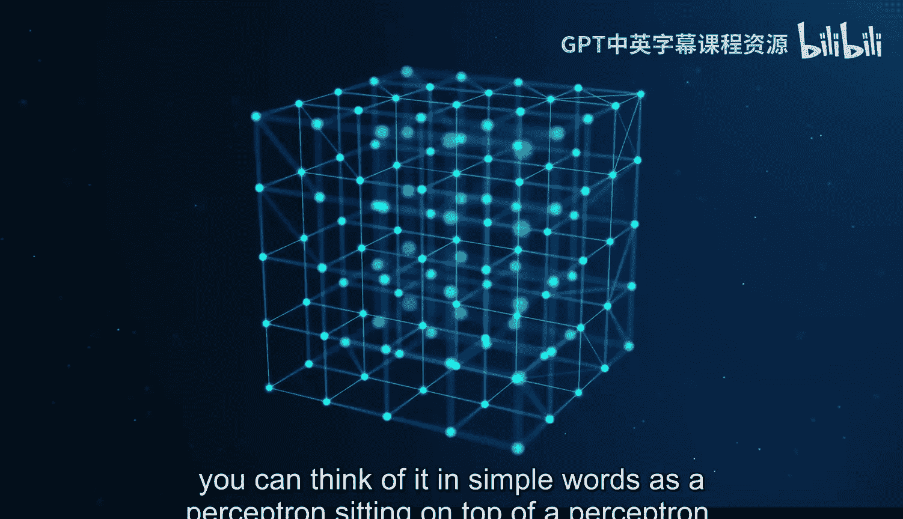

# 23：全连接网络入门 🧠

在本节课中，我们将要学习神经网络的一个关键发展——全连接网络。我们将从感知机出发，理解如何通过叠加多层感知机构建更强大的模型。

上一节我们介绍了感知机，它是一种单层神经网络。本节中我们来看看更复杂的结构。

## 从感知机到全连接网络

我们现在已经知道神经网络的基本形态是感知机，它是一种单层神经网络。

接下来我们将学习全连接网络。这些是比核方法更复杂的模型。

你可以简单地把它想象成一个感知机叠加在另一个感知机之上，然后再叠加一个，如此反复。每个感知机接收来自其下方一层的输入，对数据点（例如红点和蓝点）进行分类，其分类能力会比前一层略有提升，然后将结果传递给下一层。

这将是我们学习的第一个深度神经网络例子。

## 核心概念与结构

以下是全连接网络的核心运作方式：

*   **层级结构**：网络由输入层、一个或多个隐藏层以及输出层组成。
*   **全连接**：每一层的每个神经元都与前一层的所有神经元相连接。
*   **前向传播**：数据从输入层开始，逐层经过计算，最终得到输出。这个过程可以用以下公式表示：
    **`a⁽ˡ⁾ = σ(W⁽ˡ⁾ a⁽ˡ⁻¹⁾ + b⁽ˡ⁾)`**
    其中，`a⁽ˡ⁾` 是第 `l` 层的激活值，`W⁽ˡ⁾` 是权重矩阵，`b⁽ˡ⁾` 是偏置向量，`σ` 是激活函数。
*   **逐步优化**：每一层都学习从输入数据中提取更抽象或更复杂的特征，使得最终的分类或预测更加准确。

上图展示了全连接网络的结构。可以看到，信息从左侧的输入层流入，经过中间多个隐藏层的处理，最终到达右侧的输出层。每一层的神经元都与相邻层的所有神经元相连。

## 总结

本节课中我们一起学习了全连接网络的基本概念。我们了解到，全连接网络通过将多个感知机层叠起来，构建了深度神经网络的基础。每一层都接收前一层的信息并进行处理，使得网络能够学习数据中更复杂的模式和关系，从而完成比单层感知机更复杂的任务。这是理解现代深度学习模型的重要一步。