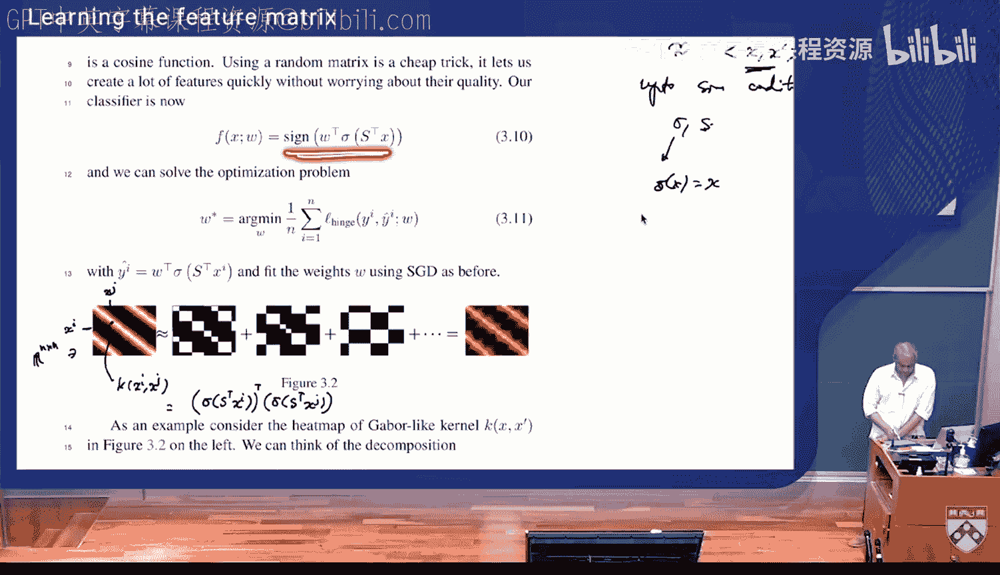
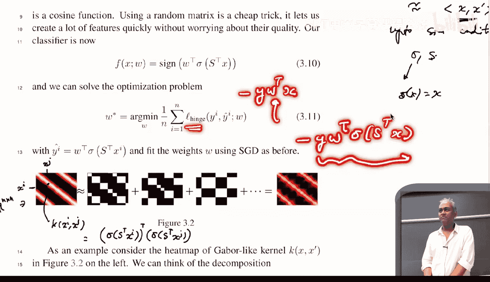
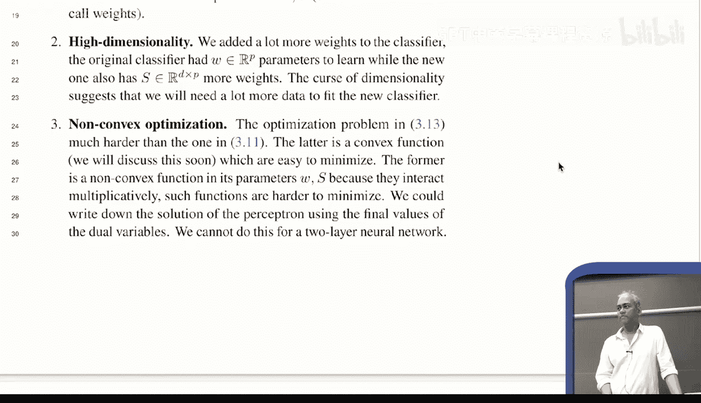
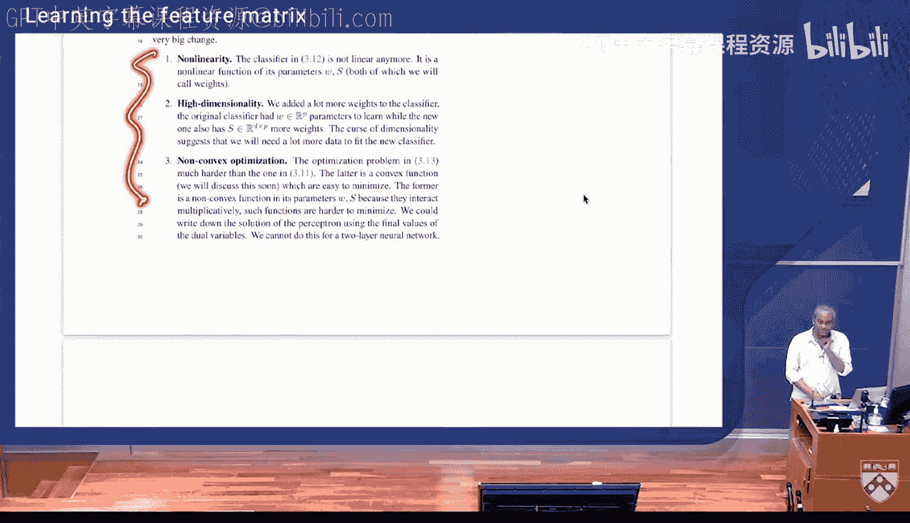

# 26：学习特征矩阵 🧠

在本节课中，我们将探讨一个核心概念：通过学习特征矩阵 `S` 来转换原始数据，以及这一选择如何从根本上改变了我们优化问题的性质。我们将看到，这个看似简单的步骤引入了非线性、高维度和非凸性，使得问题变得更加复杂。

---

上一节我们介绍了感知机的基本线性模型。本节中我们来看看，当我们决定不直接使用原始特征 `x`，而是通过学习一个特征矩阵 `S` 来生成新特征时，会发生什么。

我们可能只是做了一件非常基础的事情，但我们已经完全改变了问题。在这个新问题中，损失函数是权重 `W` 的线性函数。这一点对大家来说容易理解吗？如果你使用合页损失函数，你会得到 `-y * w^T * x`。

现在，你得到的是 `-y * w^T * σ(s^T * x)`。这里的 `σ` 代表一个非线性激活函数。整个表达式仍然是关于 `W` 的线性函数，因此求导是简单的。前提是 `S` 是固定的。

如果 `S` 不是固定的，那么这个函数就不再是关于 `W` 和 `S` 的线性函数了。这对大家来说明显吗？`W` 和 `S` 是相互乘在一起的。关于 `W` 的导数依赖于 `S`，关于 `S` 的导数也依赖于 `W`。因此，这是一个非线性函数。只有当 `S` 固定时，它才是关于 `W` 的线性函数。

仅仅因为我们选择学习 `S`，我们就从线性函数的世界进入了非线性函数的世界。非线性函数是比线性函数复杂得多的对象。

我们让问题变得更难了。我们引入了来自 `σ` 的非线性，所以即使不考虑 `S`，它显然也不是线性函数。但现在，由于 `W` 和 `σ` 以某种方式相互乘在一起，它更是一个非线性函数。所以，这是一个非线性函数，而非线性函数。

在参数数量上，如果 `W` 是一个 `P` 维向量（即原始特征维度是 `P`），那么 `S` 是一个大小为 `D x P` 的矩阵。因为我们总是进行 `s^T * x` 运算，而 `x` 是 `D` 维向量。所以 `S` 是一个有 `D * P` 个元素的矩阵。因此，我们现在需要拟合的参数总数是：`W` 有 `P` 个，`S` 有 `D * P` 个。根据 `D` 的值，这可能远大于 `P`。

我们通过选择学习 `S` 使模型变得更复杂。如前所述，如果你的函数有很多参数需要拟合，由于维度灾难，你需要更多数据来拟合这个函数。所以现在，因为你选择学习 `S`，你应该获取更多数据来拟合你的模型。这是一个高维问题，或者至少是一个维度更大的问题。如果你的 `S` 非常大，那么这就是一个高维问题，同时也是一个非线性问题。

目前对你来说可能不那么明显的是，它还是一个**非凸**问题。

以下是凸函数和非凸函数的直观对比：

*   **凸函数**看起来基本上像抛物线。抛物线很好，因为它只有一个最低点。当你沿着抛物线梯度下降时，你不可能掉到最低点以外的任何地方。
*   **非凸函数**看起来像这样（想象一个多峰的函数，有多个山谷和山峰）。例如，如果你从这个位置开始梯度下降，你可能会卡在这里，得到一个局部最优解。如果你从这里开始，则会下降到另一个地方。所以，根据你初始化的位置，你可能会得到不同的答案。这就是非凸函数的样子，它们比凸函数复杂得多。

对于凸函数，问题只在于你以多快的速度到达底部，没有其他玄机。但对于非凸函数，你能否到达全局最低点，还取决于你从哪里开始。因此，这类问题比最小化抛物线这类问题要复杂得多。所以，非凸优化是一个比凸优化复杂得多的领域，而我们在拟合感知机时做的就是凸优化。

我们通过选择同时学习 `S`，使问题变得复杂得多。正如他所说，我可以把这看作是一个两层神经网络。

第一层简单地是这些对象的名称，关于“层”是什么并没有特别的意义。`S` 是第一组参数，`W` 是第二组参数。

---

本节课中我们一起学习了通过学习特征矩阵 `S` 来构建模型的核心思想。我们了解到，这一做法将简单的线性分类问题转变为一个涉及非线性变换、更高维度参数空间以及非凸优化挑战的复杂问题。这实际上构成了神经网络中“层”的概念基础，其中 `S` 和 `W` 分别对应不同层的参数。理解这种复杂性的引入，是深入理解现代深度学习模型的关键一步。