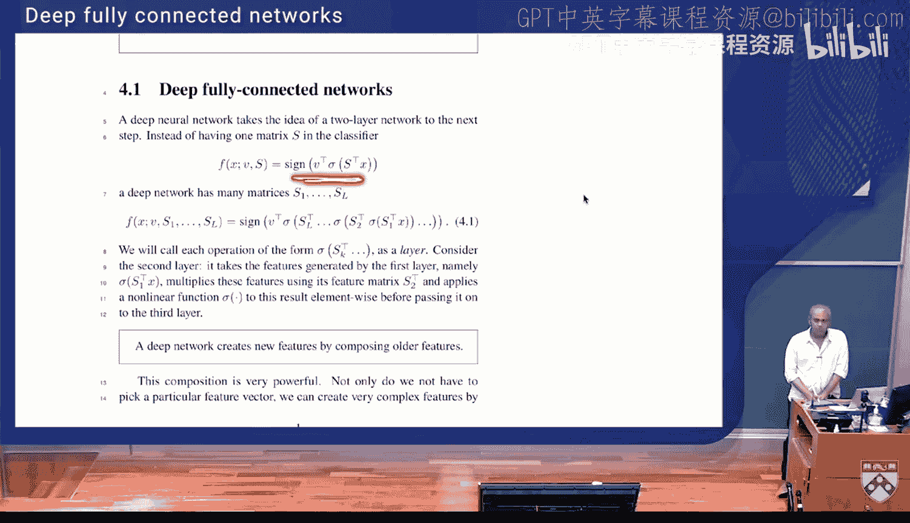
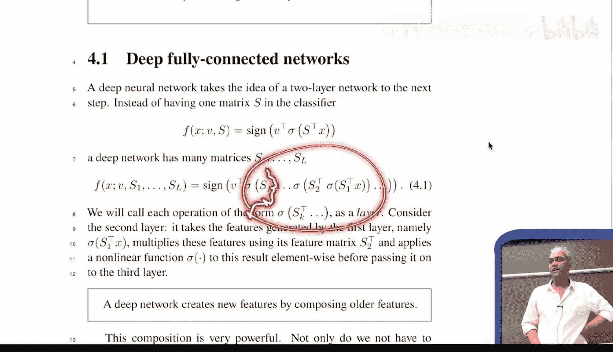

# 27：深度全连接网络 🧠

在本节课中，我们将学习深度全连接网络的基本概念。我们将从上一章的两层网络出发，扩展到具有多个隐藏层的深度网络结构，并理解其如何通过组合特征来构建复杂的模型。

---

上一节我们介绍了使用单个权重矩阵 `S` 和偏置向量 `b` 的两层感知机模型。本节中，我们来看看如何将这种结构扩展为多层，即深度全连接网络。

在本例中，我将选择将最后一层的权重标记为 `V`，而非 `W`。你马上就会明白这样重命名的原因。

与之前仅有两个参数（如 `S` 和 `V`）不同，你现在可以拥有许多这样的参数。你可以创建复杂的特征，这些特征是其他特征的函数。想象一下，`σ(S1 * x)` 是一种特征。当你对其应用另一个矩阵 `S2^T` 并在外部加上非线性激活函数时，你会得到一个更复杂的特征。

因此，你首先使用 `S^T * x` 创建一个简单特征，然后通过再次乘以 `S2^T` 使其变得更复杂，并且你可以多次重复这个过程。

在这个公式中，我将其写成了适用于所有时间步的通用形式。无论你最终得到什么，它都是你的特征向量 `φ(x)`。

一旦你有了特征向量 `φ(x)`，你就可以使用一个向量 `V` 在该特征向量上创建一个线性模型进行分类。

我们所做的，无非是将这个两层神经网络写成一个 L 层神经网络，其中我们用多个 `S` 矩阵代替了原来的一个 `S` 矩阵。这就是一个深度神经网络。

除了使用相同的操作堆叠多个层之外，它本身并没有什么特别“深奥”之处。因此，每当你看到这个复杂的表达式时，都无需担心。你只需将这里写的一切替换为 `φ(x)`，然后将其想象成我们相同的感知机模型。

但需要认识到的重要一点是，神经网络或深度网络通过组合旧特征来创建新特征。旧的特征是第一层的 `σ(S1 * x)`，第二层则接收这些特征并使它们变得更加复杂。

这个过程会持续进行若干次。在每一层，你接收旧的特征，将其乘以某个矩阵 `S`，然后应用某个非线性函数 `σ` 使其变得更复杂，再将其传递给下一层。

因此，整个运算 `σ(S * 输入)` 就是人们所称的一个“层”。之所以称之为层，是因为在人脑中存在类似的分层操作，人们注意到这些操作具有层次结构，每一级这样的层次就称为一个层。对我们而言，它只是一个数学表达式。

所以，这就是神经网络。如果上一章的问题因为有两个权重（`S` 和 `V`）而显得复杂，那么本章的问题则更加复杂，因为这里真的有很多、很多的权重。

每个 `S` 矩阵都提供了大量参数，它们在你的网络中累加起来，共同构成了你的权重向量。

以下是深度网络的关键组成部分：

*   **层**：每一层执行运算 `σ(S * 上一层输出)`，其中 `σ` 是非线性激活函数。
*   **特征组合**：每一层都基于前一层的输出构建更复杂、更抽象的特征。
*   **参数**：深度网络拥有大量参数，主要来源于每一层的权重矩阵 `S`。

---

本节课中，我们一起学习了深度全连接网络。我们了解到，深度网络本质上是将多个“层”（即 `σ(S * 输入)` 运算）堆叠起来。每一层都接收前一层的输出作为输入，并通过权重矩阵和非线性变换，生成更高级的特征表示。最终，这些深层特征被传递给一个线性分类器（如权重向量 `V`）进行决策。虽然这引入了大量需要学习的参数，但其核心思想仍然是特征的层级化组合与变换。