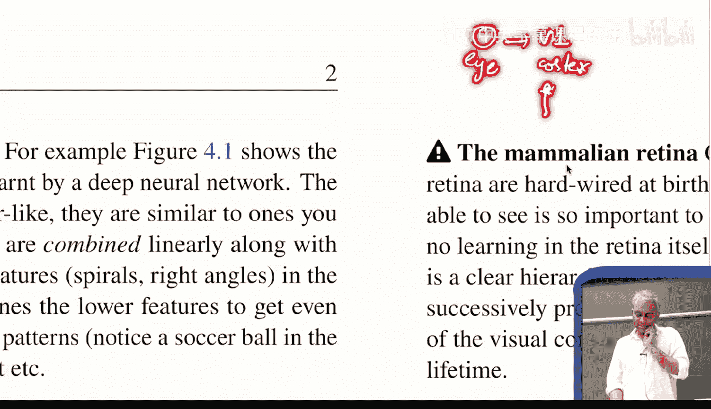
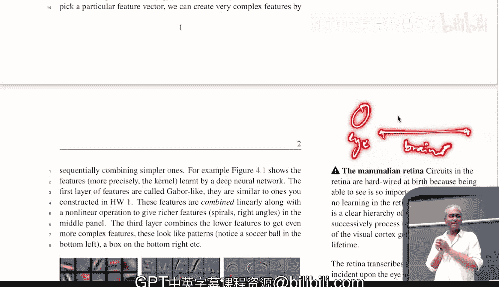

# 28：神经网络学习何种特征 👁️🧠

在本节课中，我们将探讨神经网络在学习过程中，其内部各层究竟学会了识别什么样的特征。我们将从第一层的简单特征开始，逐步深入到更高层的复杂特征，并将其与人类视觉处理系统进行类比。

---

上一节我们介绍了神经网络的基本结构，本节中我们来看看神经网络内部究竟学到了什么。特征函数 **φ** 可以表示为 **φ = S^T x**。我们可以取一个训练好的神经网络，检查其第一层之后学习到的特征类型。

以下是第一层学习到的特征示例：

*   这些特征看起来像是边缘，中间有明亮的区域，两侧被两条暗线包围。
*   这个特征与绿色相关。每当图像中出现绿色区域时，该特征的值就会很大。
*   这是绿色到粉色的渐变等。

这就是训练好的神经网络在第一或第二层后，其特征呈现的样子。

这很有趣，因为它与人类眼睛的视觉处理方式相似。眼睛的视网膜接收光线，以某种方式处理后，将其传递给某些神经元。可以想象，信息从眼睛传递到称为 **V1皮层** 的大脑区域，这是大脑视觉处理通路的第一层级。

事实证明，通过测量（例如在V1神经元上放置电极，观察不同视觉输入下电极记录到的高电压），人们发现V1神经元的特征与神经网络第一层的特征非常相似。这一认识已有大约50年的历史。

它们对边缘、颜色以及简单梯度的简单函数做出反应。你在作业中接触过的 **Gabor滤波器** 特征看起来就与此完全相同。

以上是第一、二层（例如第二层）的特征。随着我们向网络的更高层迈进，这些特征会变得更加复杂。

以下是更高层特征的示例：

*   你会看到这些特征是更基础特征（如边缘、颜色等）的函数。
*   如果一个神经元检测到水平边缘作为一个特征，另一个检测到垂直边缘，那么一个组合这些特征的神经元就能学会识别更复杂的模式。

特征通过矩阵 **S** 进行线性组合，并施加非线性激活函数，从而变得更加复杂。人们花费了大量时间来观察这些特征并猜测它们的功能。

例如，这个特征可能对应什么？一个足球？一个高尔夫球？很难确切猜出这些特征的真实含义，但可以肯定的是，你会同意这些特征比第一层的特征复杂得多。😊

随着网络层级的升高，特征会变得更加复杂。例如，这些可能是“眼睛”的特征。某张特定图片可能包含很多眼睛，或者这可能是一个高尔夫球等。

这是因为生成这些特征的数据集（称为 **ImageNet**）包含大量猫狗等宠物的照片。人们喜欢宠物，所以会拍摄宠物眼睛和面部的特写。这就是神经网络中会出现的特征类型。

所有这些都旨在让你相信，随着网络层级的升高，特征确实变得越来越复杂。输入是真实的自然图像，而这些就是这些图像的特征。

---

接下来，我想简要介绍一下眼睛的特征。神经网络通过训练进行学习，而人类的视觉处理通路则包括眼睛和大脑。

大脑在你出生后开始学习，但眼睛本身并不真正“学习”。眼睛的结构是经过数千年进化形成的。基本上，你一出生，眼睛的神经元处理机制就是完善的，之后不会有根本性的改变。

虽然有一些微小的适应性变化（例如，当你从暗室走到明亮的阳光下时，一种叫做 **视紫红质** 的分子会调整其分泌量），但神经元的根本功能不会改变。

---

本节课中我们一起学习了神经网络各层学习到的特征。我们从简单的边缘和颜色特征开始，看到它们如何随着网络层级的加深，组合成更复杂、更抽象的模式（如眼睛、特定物体）。同时，我们将此过程与人类视觉系统中V1皮层的功能进行了有趣的类比，并指出生物视觉系统中部分硬连线特征与神经网络学习特征之间的异同。理解特征如何逐层抽象，是理解深度学习工作原理的关键。