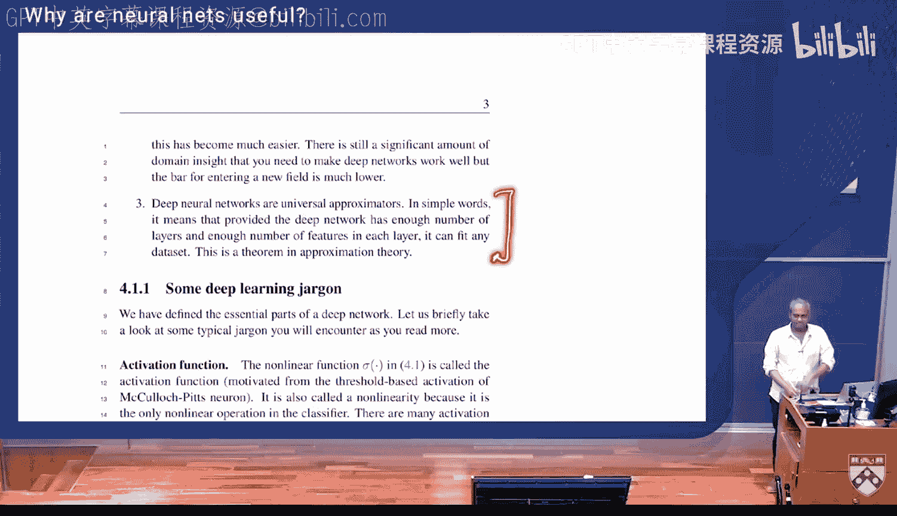
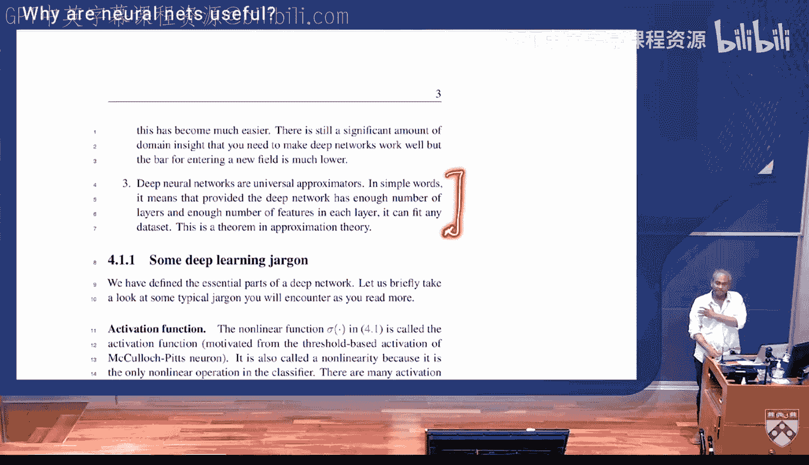
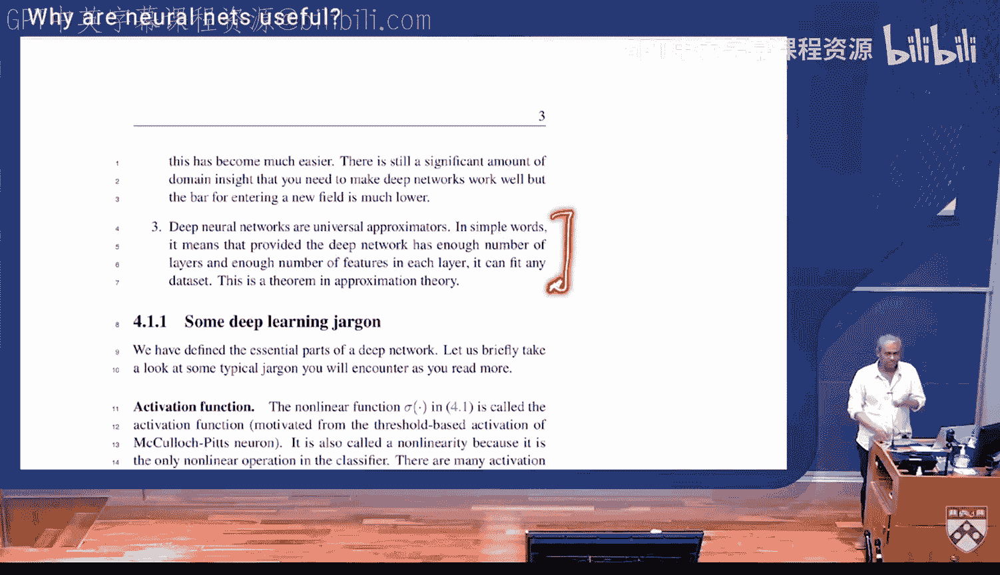
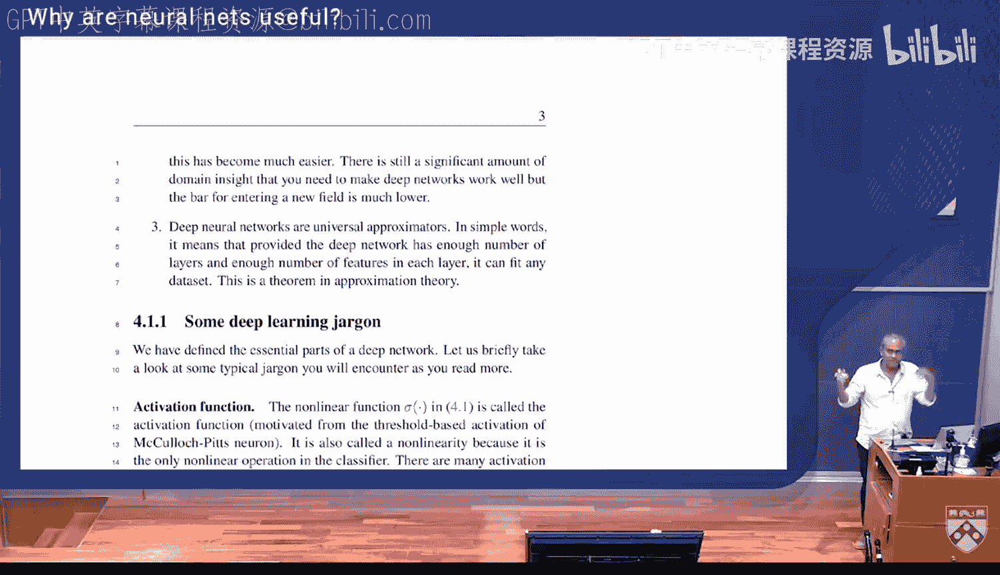
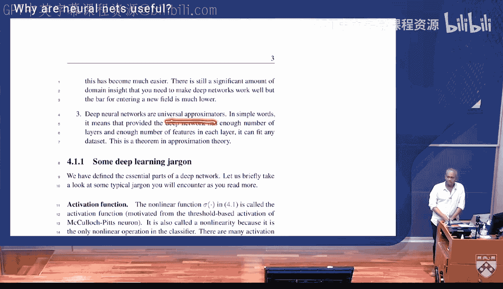
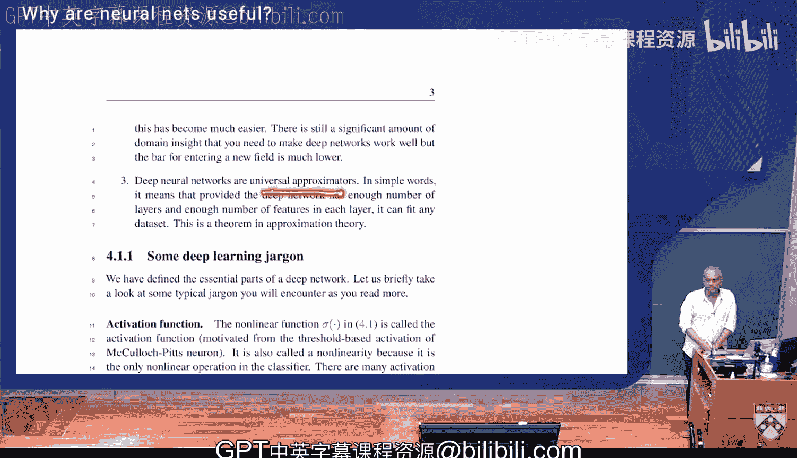

# 30：神经网络为何有效 🧠

在本节课中，我们将探讨神经网络为何如此强大和有效。我们将了解其核心优势，特别是它如何自动学习特征，以及它作为“通用近似器”的能力。

## 概述

上一节我们讨论了神经网络的灵感来源。本节中，我们将回归技术细节，解释训练神经网络的核心过程，并深入探讨其两大关键优势：**自动特征学习**和**通用近似能力**。理解这些概念是掌握现代深度学习的基础。

## 神经网络训练的本质

训练神经网络的核心任务，与许多其他机器学习模型一样，是计算所有权重。本质上没有变化。

对于之前讨论的二分类问题，你仍然需要最小化合页损失（hinge loss）。区别在于，现在你需要对**每一个权重**求导，而不仅仅是对其中一个。然后，你需要逐个更新所有权重。

在深入反向传播之前，我们先了解几个重要观点。

## 无需手动设计特征的力量 💪

无需手动挑选特征的能力非常强大，这是目前深度学习如此流行、超越其他机器学习方法的最主要原因。

你可能知道这一点，但未必能完全体会其意义。举例来说，在我像你们这个年纪，也就是本科毕业、开始读研的时候，一个计算机视觉领域的研究者几乎不可能听懂自然语言处理（NLP）领域的学术报告，反之亦然。这两个领域当时是完全不同的世界，使用截然不同的技术和特征工程方法。

今天，情况已大不相同。神经网络作为一种优秀的机器学习模型，其用于解决计算机视觉问题的核心概念，可以迁移到解决NLP领域的不同问题上。它以惊人的方式将这些领域融合在了一起，因为人们不再需要“烹饪”自己的特征了。

十年前，在一篇计算机视觉的会议论文中，你需要设计自己的特征；在一篇NLP的会议论文中，你会选择不同类型的特征。如今，长达数十年的特征工程工作，基本上被**自动学习这些特征**所取代。

我们学习到的特征是否与过去手工创建的特征相同，这一点并不明确。事实上，我认为我们学到的特征与过去手工设计的并不相同，否则性能不会提升得如此显著。我们似乎学到了不同类型的特征，但这彻底消除了不同学术领域之间的技术壁垒。

然而，这种热潮也存在一些不合理的冲动。在许多领域，例如医学影像（研究大脑或肺部图像以进行预测），人们已经开发出了非常复杂的特征构建方法。当人们开始将深度网络应用于这些领域时，他们发现这些网络的效果并不理想。按理说，既然能自动学习特征，性能应该更好才对。因此，你仍然能看到这种思维的残余：人们将神经网络应用于那些原始特征本就非常优秀的问题上，结果发现性能远不如旧方法。但由于应用这些新技术的巨大诱惑和对其更好性能的期望，人们仍在不断尝试。

但无论如何，核心故事是：**你不再需要手动挑选特征了**。现在，我可以去听一位NLP教授的讲座，并能理解个大概。

## 深度网络是通用近似器 🌐

深度网络是通用近似器，这一点我们已经多次提及，这里我们再次用语言（而非数学）来阐述：对于任何你想拟合数据的函数，只要网络足够大、层数足够多、宽度足够宽，你就能拟合这个函数。

但这并不意味着你需要的数据量会减少。实际上，网络越大，由于其高维特性，你通常需要**更多**的数据来拟合。但只要数据足够，你就能拟合它。

这就是“通用近似器”的含义：无论多么复杂的预测任务，你都可以（在理论上）实现。

## 总结

本节课中，我们一起学习了神经网络有效的核心原因。

首先，我们回顾了神经网络训练的本质是**优化所有权重**，这需要通过计算每个权重的梯度（反向传播）来实现。

接着，我们重点探讨了神经网络的两大关键优势：
1.  **自动特征学习**：神经网络能够从数据中自动学习有效的特征表示，这取代了传统机器学习中繁琐且需要领域知识的手工特征工程，极大地促进了不同AI子领域（如CV和NLP）的融合。
2.  **通用近似能力**：理论上，一个足够大、足够深的神经网络可以近似任意复杂的函数，这赋予了它解决极其复杂问题的潜力。

理解这些原理，有助于我们把握深度学习的核心价值，并在实际应用中更好地利用这一强大工具。