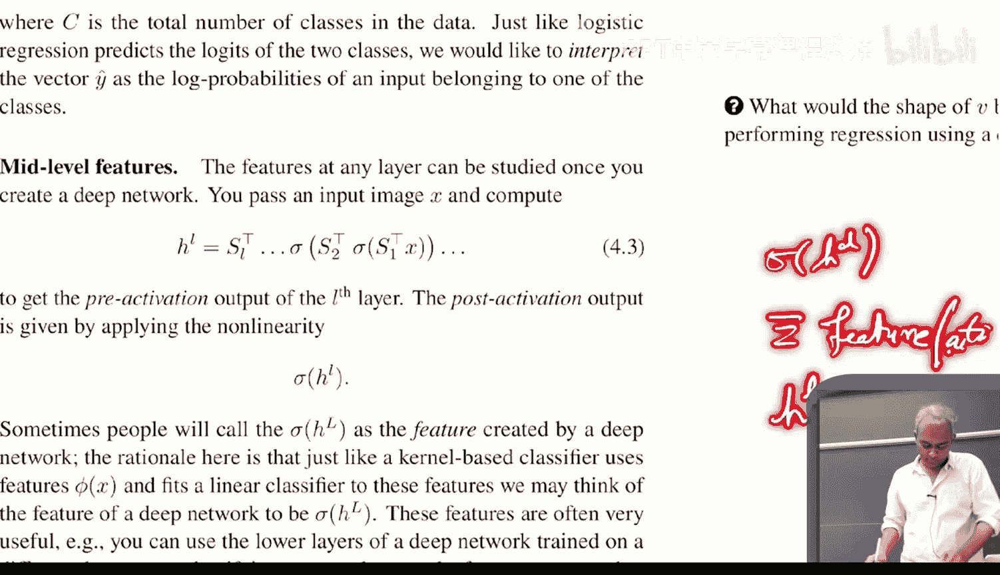
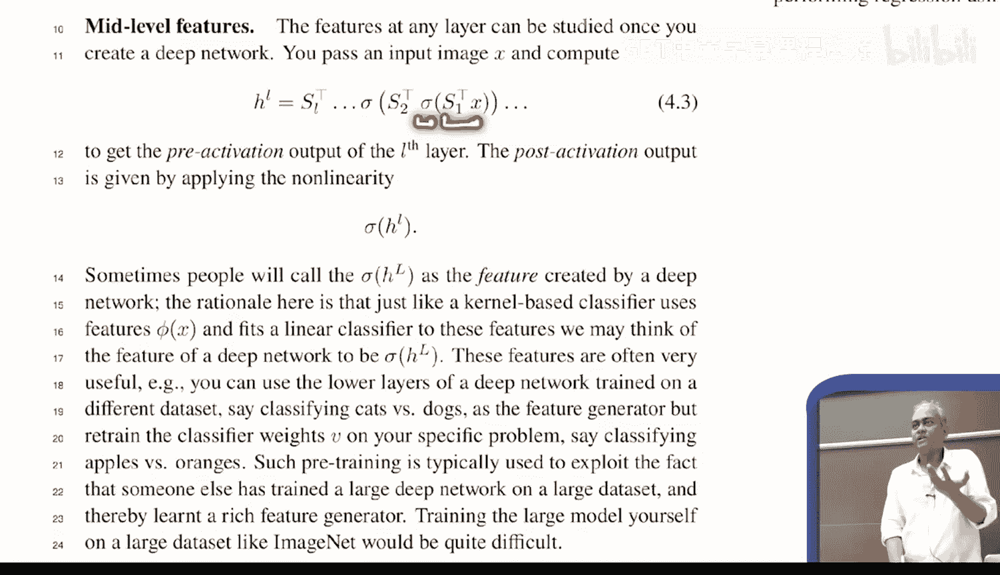
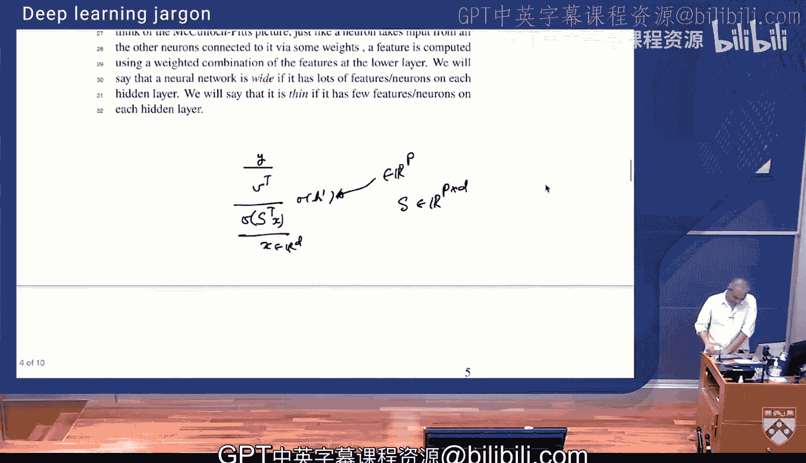
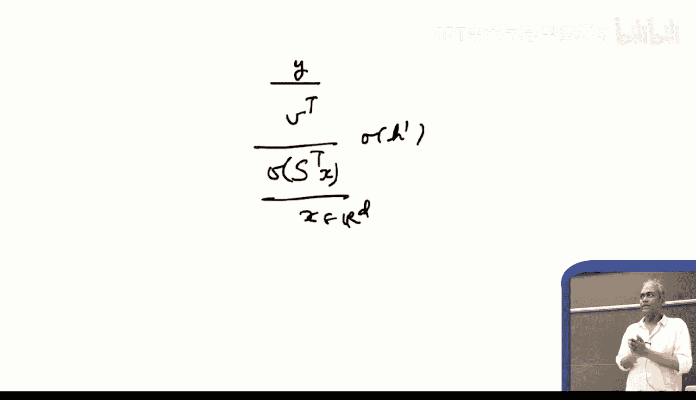

# 32：深度学习术语 🧠

在本节课中，我们将学习深度学习中的一些核心术语和概念。这些术语是研究人员为网络中的不同组成部分所起的名字。理解它们有助于我们更清晰地讨论和构建神经网络模型。

上一节我们介绍了神经网络的基本思想，本节中我们来看看构成网络的具体组件及其名称。

## 激活函数 🔌

在神经网络中，每个神经元内部都包含一个非线性函数。这个函数决定了神经元的输出。以下是几种常见的非线性激活函数。

以下是几种常见的激活函数及其定义：

*   **符号函数 (Sign Function)**：这是我们在第一讲中看到的McCulloch-Pitts神经元所使用的函数。它预测其输入的符号。其公式为：
    `y = sign(W^T * x)`
    其中 `sign` 是符号函数。

    

*   **阈值函数 (Threshold Function)**：这是符号函数的一个相关变体。你可以将其视为一个阈值函数：如果参数大于零，则返回1；否则返回0。它不是一个线性函数。

*   **Sigmoid / Logistic 函数**：其形状呈S形。当 `x` 非常大且为正时，输出接近1；当 `x` 非常大且为负时，输出接近0；当 `x` 为0时，输出为0.5。Sigmoid函数可以看作是阈值函数的一个平滑版本。

*   **双曲正切函数 (Hyperbolic Tangent)**：这是一个与Sigmoid类似的函数。当 `x` 非常大且为正时，输出接近1；当 `x` 非常大且为负时，输出接近-1；在零点输出为0。

*   **线性整流单元 (ReLU)**：其定义为 `f(x) = max(0, x)`。当 `x` 大于0时，输出就是 `x`；当 `x` 小于0时，输出为0。它在原点右侧是线性的，在左侧也是线性的（输出恒为0），只是在原点处有一个“拐点”。它非常接近一个线性函数。

*   **渗漏线性整流单元 (Leaky ReLU)**：这是ReLU的一个变体。在原点右侧，它与ReLU相同；在原点左侧，它有一个微小的正斜率，而不是完全为0。

这些都是在历史上被用来替代Sigmoid函数的不同函数名称。有些效果更好，有些则较差，其中存在合理的性能差异原因，我们稍后会看到。

**最重要的是**：除非你对你的问题有特殊了解，明确不应使用ReLU，否则**你应该使用ReLU**。通常不要使用线性函数，因为它的效果很差。如今，你几乎看不到Sigmoid被使用，有时会看到Tanh被使用，而ReLU则被广泛使用。

## 从单输出到多输出 🎯

之前我们考虑感知机时，我们知道如何拟合一个二分类感知机。对于多分类问题，可以通过“一对多”或“一对一”等策略训练多个感知机。然而，在神经网络中，有一种更优雅的方式。

我们一直将最终输出 `V^T * h` 视为一个向量。但 `V` 不一定是一个向量，`V` 可以是一个矩阵。

例如，假设 `V` 是一个大小为 `p × 5` 的矩阵。那么 `V^T * h`（其中 `h` 是 `p` 维特征向量）的结果就是一个5维向量。

这5个维度中的每一个，我们都可以解释为对应一个类别的得分（例如：猫 vs 非猫，狗 vs 非狗，大象 vs 非大象，长颈鹿 vs 非长颈鹿）。这样，我们就不需要训练多个独立的感知机，可以在同一个模型中直接获得5个不同类别的输出。

这在概念上与训练多个共享输入特征的感知机没有太大不同，只是以一种更紧凑的方式将它们组织在一起。我们将看到解释这种输出的不同方式，但目前请记住：**输出不需要是一个标量，它可以是一个向量；扩展来说，最后一层的权重 `V` 也不需要是向量，它可以是一个矩阵。**

## 前激活与后激活 ⚙️

我们一直将中间输出称为“特征”，并将继续这样做。但我们需要区分应用非线性函数 `σ` 之前和之后的部分。

*   **前激活 (Pre-activation)**：指在应用非线性函数 `σ` 之前的值。我们用 `h` 表示。即 `h = W^T * x`（对于第一层）。
*   **后激活 / 激活 / 特征 (Post-activation / Activation / Feature)**：指在应用非线性函数 `σ` 之后的值。我们用 `a` 或 `σ(h)` 表示。即 `a = σ(h)`。

有时在论文中，特征也被直接称为“激活”，两者是同一回事。

区分这两者在实现反向传播算法时非常有用，因为我们需要以略微不同的方式处理它们。我们可以将 `W^T * x` 视为一个层（线性层），将 `σ` 视为另一个层（非线性激活层）。`σ` 层没有可学习的参数，它只是一个对输入执行的操作。

## 隐藏层 🕵️♂️

在神经网络中，除了最后的输出层，所有中间层（即它们的激活值）都被称为**隐藏层 (Hidden Layers)**。

例如，当人们说“我有一个带一个隐藏层的神经网络”时，他们通常指的是这样的结构：输入 `x`，经过一个线性变换 `S^T` 和一个激活函数 `σ`，得到第一个隐藏特征 `a1 = σ(S^T x)`。然后这个特征再经过另一个线性变换 `V^T` 得到最终输出 `y`。

在这个网络中，`S` 和 `V` 是可学习的参数，因此这是一个两层网络。由于我们无法直接观察到输入 `x` 和最终输出 `y` 之间的内部状态（`a1`），所以这些中间层被称为“隐藏”层。

这些只是你在论文中会经常看到的名字。如果不了解它们，可能会感到困惑，但它们本质上只是名称。

## 网络的“胖”与“瘦” 📏

我们还会用一些名称来描述网络结构。例如，我们会说一个网络是“瘦”的，如果其隐藏层的维度不大。

让我们用数字说明：如果输入 `x` 是一个 `d` 维向量，第一层的权重矩阵 `S` 的大小是 `p × d`，那么前激活 `h1` 的维度就是 `p`。

*   如果 `p` 非常大，我们就说这个网络非常**“胖” (Fat)**。
*   如果 `p` 非常小，我们就说这个网络非常**“瘦” (Thin)**。

这只是一种思考网络容量的方式。

---

**本节课总结** 🎓

在本节课中，我们一起学习了深度学习中的关键术语：
1.  **激活函数**：如ReLU、Sigmoid、Tanh，它们为网络引入非线性，其中ReLU是最常用且效果良好的选择。
2.  **多输出层**：通过使用矩阵而非向量作为最终权重，神经网络可以优雅地处理多分类问题。
3.  **前激活与后激活**：区分了应用非线性函数之前（`h`）和之后（`a`）的值，这对理解网络计算和实现反向传播至关重要。
4.  **隐藏层**：指网络中除输入层和输出层外的中间层，其状态在训练过程中是“隐藏”的。
5.  **网络形状**：用“胖”和“瘦”来描述隐藏层维度的大小，这反映了网络的容量和复杂度。

理解这些术语是阅读文献、与他人交流以及构建自己神经网络模型的基础。