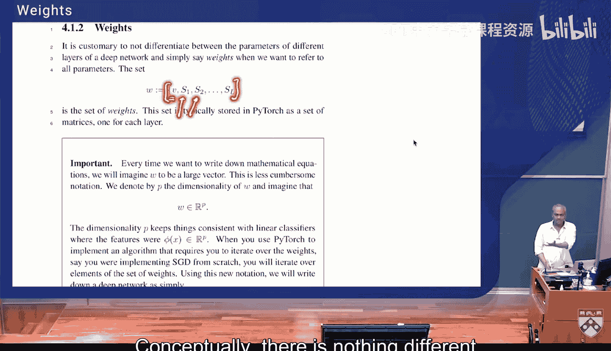

# 33：权重 🧠

在本节课中，我们将学习神经网络中一个核心的简化概念：**权重**。我们将了解为什么将所有网络参数统称为一个向量 `W` 可以极大地简化我们的表达和思考过程，并理解这与实际代码实现（如PyTorch）之间的关系。

---

我们今后将不再讨论网络中的单个参数。

原因很简单：反复书写那个庞大而复杂的公式过于繁琐。因此，我们将所有参数统称为 `w`。每当我提到 `w` 时，你应该想象自己将所有参数取出，并将它们拼接成一个大向量。这就是我们网络的表示方式。

我们总是说 `W` 是一个 `P` 维向量，可以想象 `P` 非常大。所有参数的拼接都包含在这个向量中。

如果你理解了这一点，那么我就可以将我的神经网络简单地写成一个关于两个变量的函数：`x` 是输入，`W` 是权重。

**公式：** `f(x, W)`

这不再只是一个简单的线性函数加一个激活函数，它内部包含了许多非线性函数和矩阵运算。但我可以像这样把它写下来，这将极大地简化我们的工作。

这就是我们的函数，也是我们的目标（稍后我们会讨论更多关于目标函数的内容）。拟合一个神经网络，本质上就是寻找最优的 `W`。

这等同于寻找最优的 `V`、`S1`、`S2`、`S3` 等参数，而这些都隐含在这个 `W` 之中。

需要记住的一点是，即使我们以这种非常简单的形式写下表达式，当你使用 PyTorch 时，PyTorch 会将网络的不同权重维护为一个大的矩阵列表。

因此，根据特定层的结构，每个权重可能是一个矩阵或一个向量。当你调用 `model.parameters()` 时，你将得到这个大的列表作为输出。在第二次作业中，你将学习如何获取并修改这个列表。

从概念上讲，这没有任何不同，这只是 PyTorch 选择维护其权重的方式。因为在这里，我们并不关心代码的具体实现细节，而是专注于表达式本身，所以我们将其简单地视为向量。

---

**本节课总结**

本节课中，我们一起学习了神经网络权重的简化表示方法。我们了解到，将所有参数拼接成一个高维向量 `W` 可以简化数学表达和理论分析。同时，我们也认识到，在实际的编程框架（如 PyTorch）中，这些权重是以矩阵列表的形式组织和管理的，但这并不改变其背后的核心概念。掌握这种抽象表示是理解后续优化算法的基础。