# 35：通过示例理解反向传播 🧠

在本节课中，我们将通过一个具体的例子，学习神经网络中一个核心算法——反向传播。我们将使用一种简洁的符号表示法，并一步步推导如何计算损失函数对模型参数的梯度。理解这个过程是掌握神经网络训练的关键。

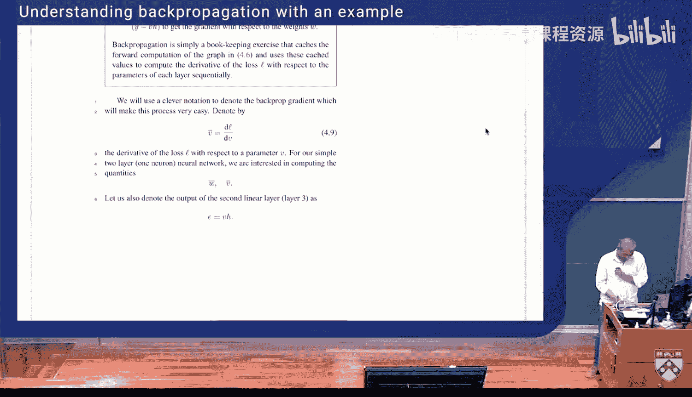

---

## 引入简洁符号表示法

上一节我们介绍了计算图的概念。本节中，我们来看看一种能极大简化反向传播计算的符号表示法。

这种表示法非常巧妙，其背后有深厚的纯数学根源，但我们现在无需深究。其规则如下：每次我们想写损失函数 `L` 对变量 `V` 的导数 `dL/dV` 时，我们将其写作 `V_bar`。这就是变量 `V` 的协变导数。

这只是一个符号。它的目的是让我们的计算变得极其简单，从此你无需再费脑筋进行反向传播计算。

我们的目标是计算 `dL/dW` 和 `dL/dV`，用我们的符号表示就是 `W_bar` 和 `V_bar`。这是我们希望计算的两个量。

---

## 定义前向传播计算图

首先，我们需要明确前向传播的步骤。我们的前向计算图可以用以下四个方程描述：

1.  `z = W^T * x`
2.  `h = σ(z)` （其中 σ 是激活函数，如 ReLU）
3.  `e = V * h`
4.  `L = (y - e)^2 / 2`

这些就是前向图的所有步骤。正如之前提到的，我们应该缓存每一步的输出，即 `z`、`h`、`e` 和 `L`。到目前为止，一切都还很简单。

---

## 反向传播的核心模式

现在让我们开始反向传播。首先，`dL/dL` 是多少？是 1，因为一个量对自身的导数为 1。我们可以将其写作 `L_bar = 1`。

接下来，我们想计算 `E_bar`，即 `dL/de`。我们可以利用链式法则写出：
`E_bar = dL/de = (dL/dL) * (dL/de) = L_bar * (dL/de)`

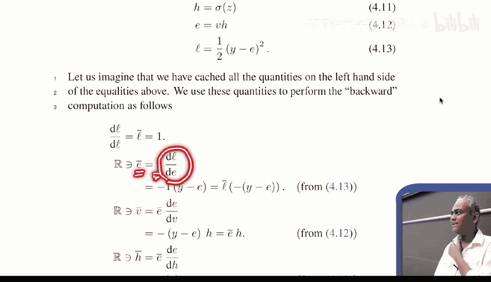

我们知道 `L_bar = 1`。那么 `dL/de` 怎么算？这很简单，`L` 是前向图第四步的输出，所以 `dL/de` 就是第四步方程右边对 `e` 的导数。从 `L = (y - e)^2 / 2` 可得，`dL/de = -(y - e)`。

这里发生了一件非常重要的事情，这也是反向传播的关键所在：
`L` 是第四步的输出，`e` 是第四步的输入之一（当然，`e` 也是第三步的输出）。我们想计算输入 `e` 的 `bar` 版本（即 `E_bar`），我们可以将其写为输出 `L` 的 `bar` 版本（即 `L_bar`）乘以 `L` 是如何由 `e` 创建的导数。

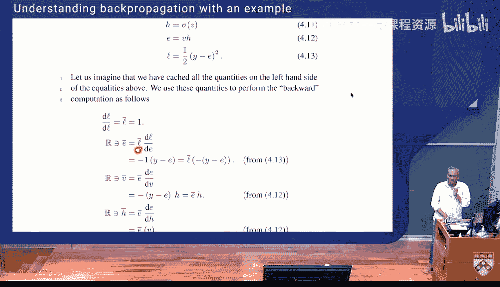

简单来说，我想知道损失对某个输入的敏感度。我首先检查损失对该操作输出的敏感度，然后乘以该输出对我关心的输入的敏感度。这就是链式法则的文字描述。

**记住这个核心模式**：右边变量的 `bar` 版本等于左边变量的 `bar` 版本乘以左边变量是如何由右边变量创建的（即其导数或敏感度）。

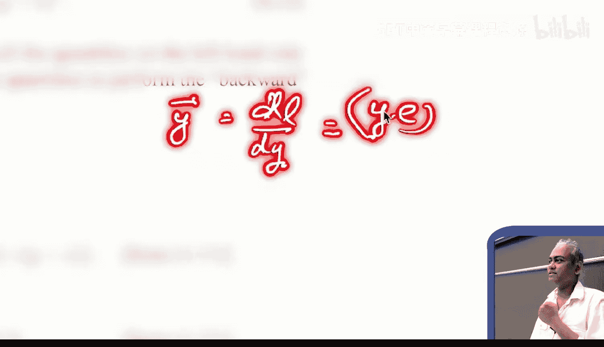

---

## 逐步计算梯度

现在我们已经有了 `E_bar`，让我们继续计算其他变量的梯度。

**计算 V_bar 和 H_bar**
每当你有了左边某个变量的 `bar` 版本，你就用它来计算右边变量的 `bar` 版本。

`V_bar` 是什么？`V_bar` 是其输出 `e` 的 `bar` 版本乘以 `e` 是如何由 `V` 创建的导数，即 `de/dV`。
用公式表示：`V_bar = E_bar * (de/dV)`
`de/dV` 是什么？从 `e = V * h` 可知，`de/dV = h`。

类似地，`H_bar` 是什么？`H_bar = E_bar * (de/dh)`
从 `e = V * h` 可知，`de/dh = V`。

所以：
`V_bar = E_bar * h`
`H_bar = E_bar * V`

**计算 Z_bar**
现在我们有了 `H_bar`，我们想计算 `Z_bar`。
`Z_bar` 是其输出 `h` 的 `bar` 版本乘以 `h` 是如何由 `z` 创建的导数，即 `dh/dz`。
用公式表示：`Z_bar = H_bar * (dh/dz)`
`dh/dz` 是激活函数 σ 对其输入 `z` 的导数，记作 `σ'(z)`。

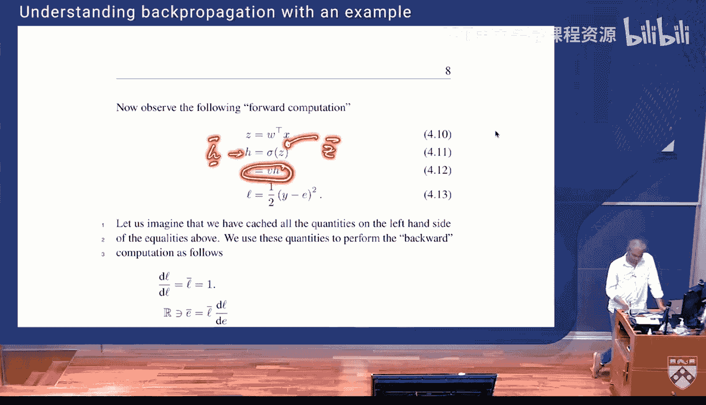

因此：`Z_bar = H_bar * σ'(z)`
如果 σ 是 ReLU 激活函数，那么当 `z > 0` 时 `σ'(z) = 1`，否则为 0。只要你知道了非线性激活函数，你就知道它的导数，也就能像这样进行反向传播。

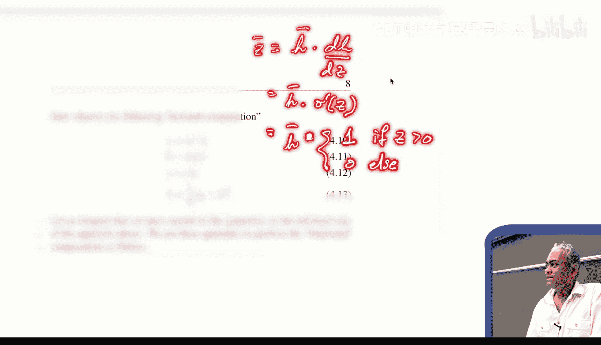

**计算 W_bar 和 X_bar**
现在我们有了 `Z_bar`，可以计算 `W_bar` 和 `X_bar` 了。这里涉及到向量乘法，需要小心维度。

`W_bar` 是什么？`W_bar = Z_bar * (dz/dW)`
`Z_bar` 是一个标量，`dz/dW` 是一个向量（因为 `z = W^T * x`）。`dz/dW = x`。
所以：`W_bar = Z_bar * x`

类似地，`X_bar` 是什么？`X_bar = Z_bar * (dz/dx)`
`dz/dx = W`。
所以：`X_bar = Z_bar * W`

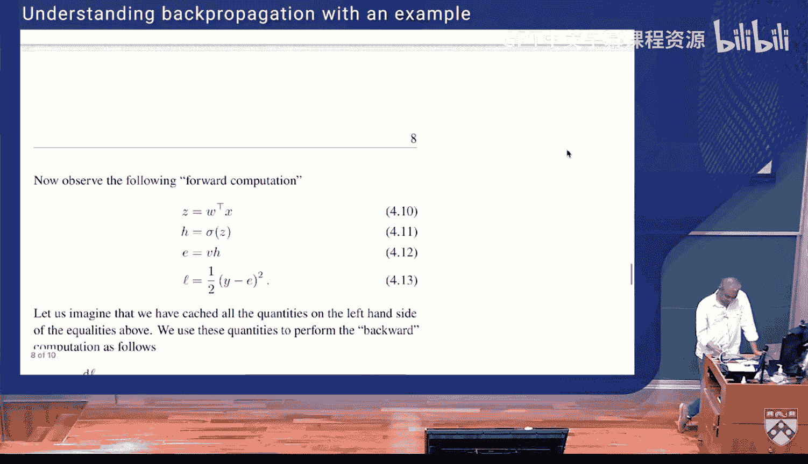

注意，我们已经得到了我们最初的目标 `W_bar` 和 `V_bar`。

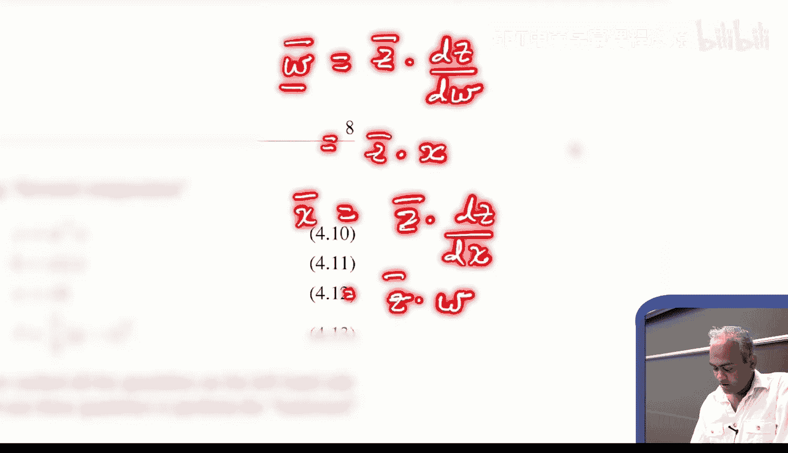

---

## 前向传播与反向传播的协作

让我们回顾一下整个过程的关键点。

首先，从左到右运行前向传播图。你会注意到，你缓存的中间结果（`z`, `h`, `e`）正是你计算反向传播时需要用到的。

例如，计算 `V_bar = E_bar * h` 时，`h` 就是你之前缓存的值，直接代入即可。而 `E_bar` 则是由反向传播上一步计算得到的。

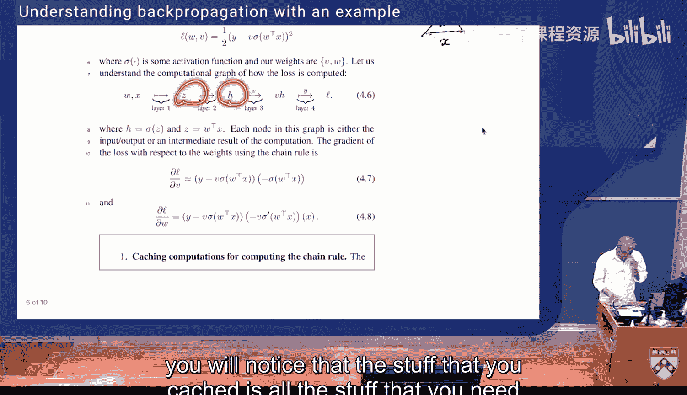

**这是一个非常重要的规律**：
*   前向传播从输入到输出。
*   反向传播从输出回到输入。
*   在每一步，反向传播都使用上一步反向传播的结果，以及前向传播在该步骤缓存的数据。

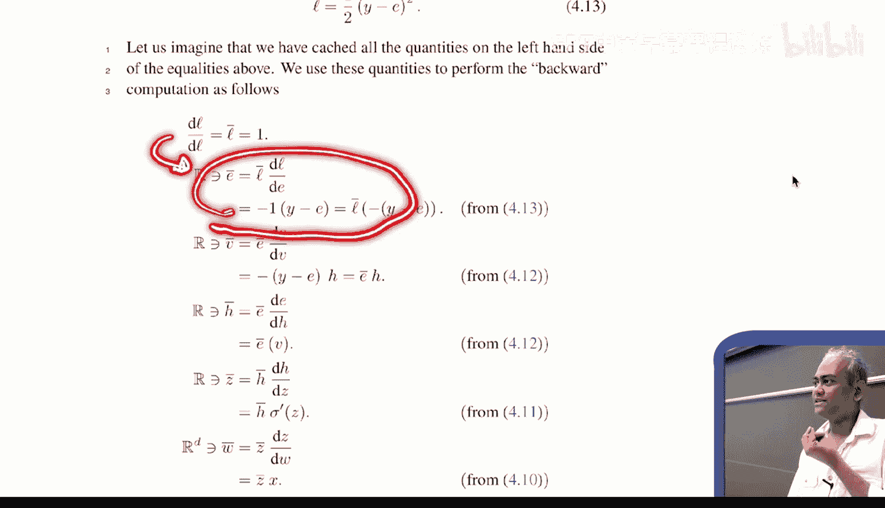

这很容易理解，但必须牢记：反向传播就像前向传播一样，接收上一步的输出。但反向传播还额外接收一个输入——它使用前向传播在那里缓存的数据。

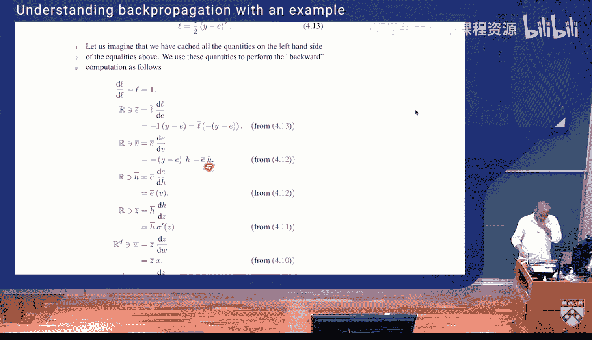

---

## 总结

本节课中，我们一起学习了反向传播算法通过一个具体示例的实现过程。我们首先引入了一种简洁的 `_bar` 符号来表示梯度。然后，我们一步步推导了如何从损失函数 `L` 开始，利用链式法则和缓存的前向传播中间结果，依次计算出损失对网络中每个参数（`V`, `W`）和中间变量（`e`, `h`, `z`）的梯度。我们总结出了反向传播的核心模式：右边变量的梯度等于左边变量的梯度乘以连接它们的局部导数。最后，我们强调了前向传播与反向传播的高效协作机制：前向传播缓存数据，反向传播利用这些数据高效计算梯度。掌握这一流程是理解和实现神经网络训练的基础。