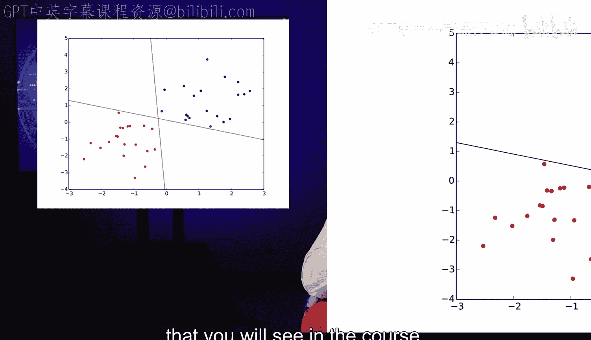

# 宾夕法尼亚大学《人工智能和机器学习基础（AI、数据科学、机器学习）AI and Machine Learning Essentials with Python》 -BV16f421Q72q_p105-

We will next look at the perceptron。 This will be the first of many different neural networks that you will see in the course。

 It is quite similar to linear regression。 But instead of fitting a straight line through a bunch of points。

 the perceptron finds a straight line that separates two sets of points。

 Serette points on one side and all blue points on another side of the line。

 It was the first artificial network that we ever built in Cornell University in 1958。

 And as Frank Close inbl who built this network said。

 this is the first machine capable of having an original idea。😊。

We will next look at kernel methods。 These are techniques that can separate two sets of points in more complicated ways。

 Think of a wiggly line that charged its path through a scatter of red and blue points。

 But always keeping the red ones to its left and the blue ones to its right。

 This is more complicated than a straight line。 And kernel methods build more complicated models than linear models。

😊。