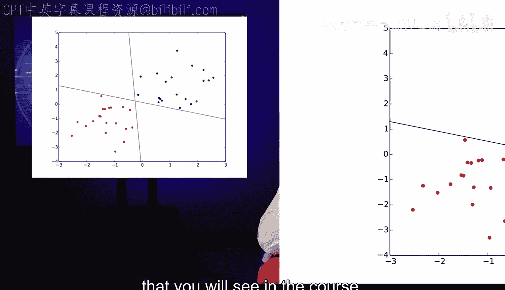

# 人工智能和机器学习基础：1：感知机与核方法

在本节课中，我们将要学习两种基础的机器学习模型：感知机和核方法。感知机是神经网络的开端，而核方法则能处理更复杂的数据分类问题。

## 感知机：第一个神经网络

上一节我们介绍了线性回归模型。本节中我们来看看感知机。感知机是你在本课程中将要看到的众多神经网络中的第一个。

感知机与线性回归非常相似。但感知机不是用一条直线去拟合一系列点，而是寻找一条直线来分隔两组点。

这条直线将所有红色点置于其一侧，所有蓝色点置于另一侧。

感知机是1958年在康奈尔大学建造的第一个人工网络。正如建造者弗兰克·罗森布拉特所说，这是第一台能够产生原创想法的机器。

以下是感知机模型的核心公式：

**`y = sign(w·x + b)`**

其中：
*   `y` 是输出（例如+1或-1）。
*   `w` 是权重向量。
*   `x` 是输入特征向量。
*   `b` 是偏置项。
*   `sign` 是符号函数，用于将结果分类。

## 核方法：处理复杂边界

我们已经了解了感知机如何用直线划分数据。然而，现实世界的数据分布往往更为复杂。本节中，我们来看看核方法。

核方法是一种能够以更复杂的方式分隔两组点的技术。

想象一条蜿蜒的曲线，它穿过散布的红点和蓝点，但始终保持红色点在其左侧，蓝色点在其右侧。

这种曲线比直线更复杂。核方法能够构建比线性模型更复杂的模型。

核方法的核心思想是将数据从原始空间（如二维平面）映射到一个更高维的特征空间。在这个新空间中，原本线性不可分的数据可能变得线性可分。我们无需显式计算高维映射，只需通过一个**核函数** `K(x_i, x_j)` 来计算数据点之间的相似度。

常用的核函数包括：
*   **线性核**：`K(x_i, x_j) = x_i · x_j`
*   **多项式核**：`K(x_i, x_j) = (x_i · x_j + c)^d`
*   **径向基函数（RBF）核**：`K(x_i, x_j) = exp(-γ * ||x_i - x_j||^2)`

## 总结

本节课中我们一起学习了两种重要的机器学习基础模型。我们首先认识了感知机，它是神经网络的原型，通过一个线性决策边界对数据进行二分类。接着，我们探讨了核方法，它通过将数据映射到高维空间，巧妙地解决了线性模型无法处理的复杂分类问题，为后续学习更强大的模型（如支持向量机）奠定了基础。