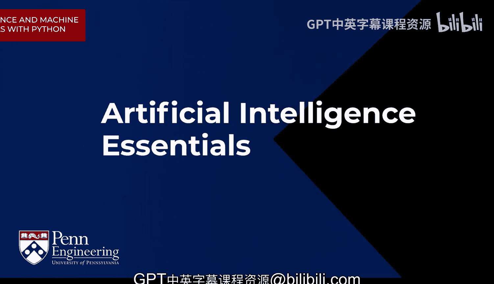

# 宾夕法尼亚大学《人工智能和机器学习基础（AI、数据科学、机器学习）AI and Machine Learning Essentials with Python》 p01 01_01_01_人工智能基础导论.zh_en -BV16f421Q72q_p1-

My name is Chris Callsison Birch， and I'm a professor at the University of Pennsylvania's School of Engineering and Applied Science。

 I'm thrilled to welcome you to our artificial intelligence course。

 which forms part of our specialization， artificial intelligence and machine learning essentials with Python。

😊，Our specialization will delve into the essential topics to help you understand the mathematical and algorithmic underpinnings of modern deep learning and classical AI。

In this course， we'll start by considering the philosophical question of what it means to be intelligent。

 and will'll explore how science fiction often foretells scientific advances in artificial intelligence。

We'll use Scifi as a jumping off point to think about what systems we would like to create as AI systems designers。

Should we build AI agents that think and act like humans。

 or should we build systems that think and act rationally？In this AI course。

 we'll focus on rational agents。We'll develop a theory of what it means to act rationally and will develop the algorithms that will allow our AI systems to plan。

Planning agents must pick from many possible actions in order to create a sequence of actions that enables them to reach their goal in an optimal fashion。

The first set of algorithms that we'll develop in this course is a broad class of algorithms called search algorithms。

Will build on classical algorithms like depth first search and breadth first search towards one of the most famous search algorithms in all of AI。

 the A star search algorithm。A star search was initially developed for robot navigation。

 and it's what underpins the driving directions that you get from your smartphone。

To help you make these AI algorithms more concrete。

 you'll do a series of short coding assignments in Python。

As part of this course will provide a thorough review of Python that's appropriate for advanced beginners。

 If you're just starting out with programming， then consider trying our other specialization intro to programming with Python and Java。

After you complete this course， which focuses on important topics like rational agents and planning。

 you'll also have the opportunity to learn more AI essentials through the other courses in our specialization。

 which will teach you the statistical and mathematical foundations of machine learning and deep learning。

