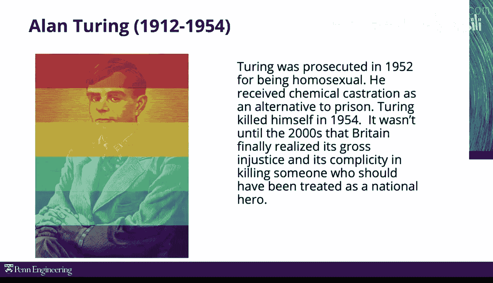
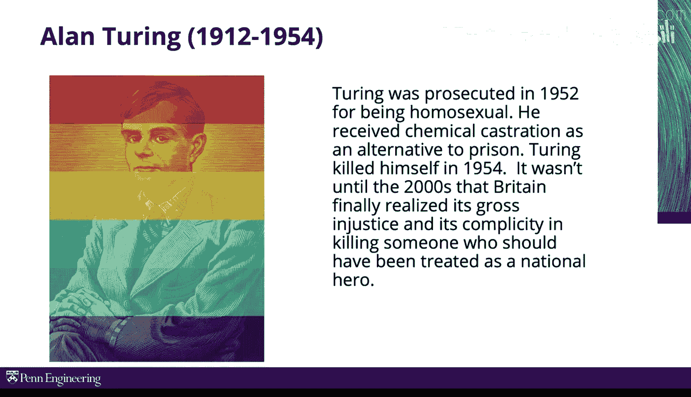
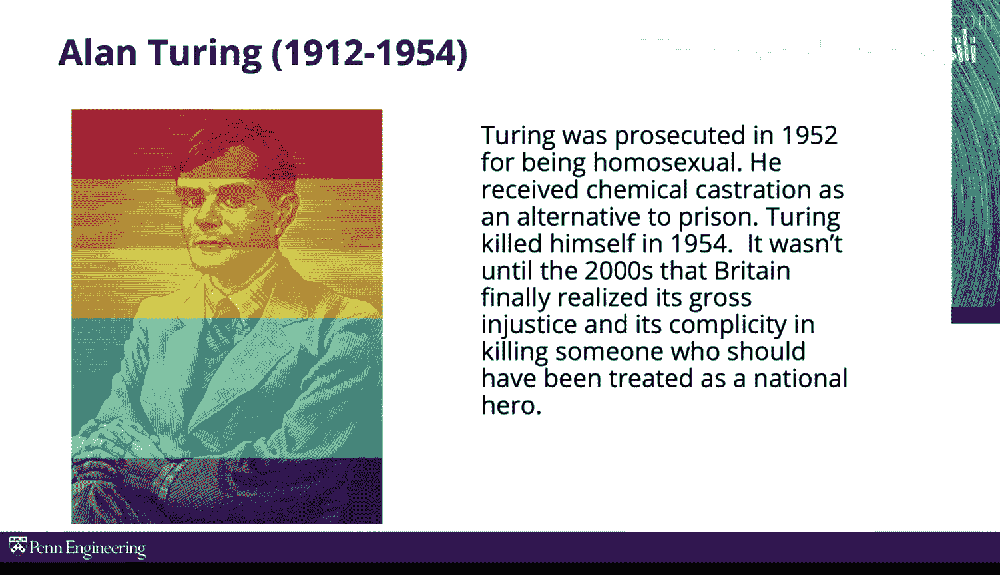
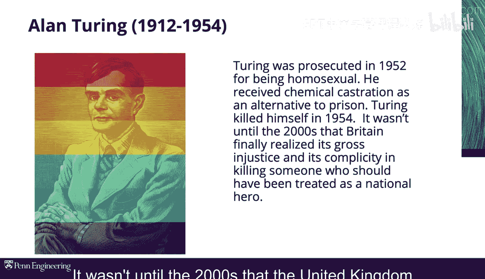
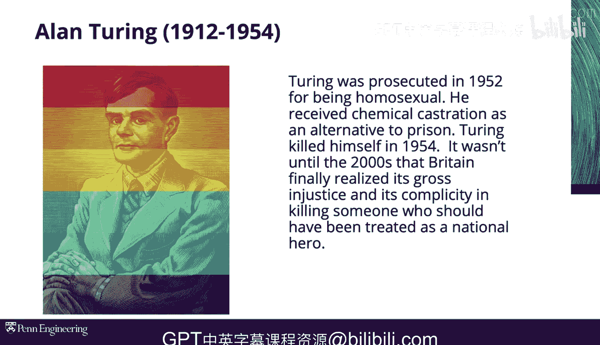

# 宾夕法尼亚大学《人工智能和机器学习基础（AI、数据科学、机器学习）AI and Machine Learning Essentials with Python》 p03 03_01_01_哲学中的AI-I.zh_en -BV16f421Q72q_p3-

If we are interested in building an artificially intelligent agent。

 we might first pause to ask ourselves， what does it mean to be intelligent or perhaps what does it mean to have a mind。

These are questions that have been debated by philosophers throughout history。

One example is a philosopher from the 17th century named Renee Descartes。

 who is often called the founder of Western philosophy。

 because a lot of modern Western philosophy is directly in response to his writings。

Descartes also had a major impact on mathematics， especially in geometry。

 where we have Cartesian coordinates。Descartes has a famous quote。

 I think therefore I am from his book Mediitations on First Philosophy。In the book。

 Descartes embarked on a philosophical exercise where he first discards all beliefs in things that are not absolutely certain。

And then tries to establish what can be known only for sure。

Even physical experiences like perceptions of the world might be a dream or an illusion created by a demon。

With， I think therefore I am， he suggests that one's consciousness implies one's existence。

Related to this idea is the idea of mind body dualism。

 This is the idea that your mind is the essential element。Your spiritual core。

 the part of you that is you。And that part is somehow separate from your corporeal form， your body。

For instance， if a part of your body was lost in an accident。

 that doesn't make you any less you than you are right now。You're still you。And you're still there。

So once I've established that I exist， how do I know that anyone else does？

How do I know that other people exist if I cannot be sure that they have a mind。

What if other people are simply simulations of humans， They could be automatons。

People's bodies and their appearance could potentially be replicated mechanically。

Our bodies and the bodies of animals are basically just complex machines that move and interact with the world。

 Mussels could be replaced by cogs or pistons， or cams， or so on。

So how do I know that you aren't just an extremely compelling replica of a human being？

Part of the reason that Descartes was interested in this topic was that in the 17th and 18th century。

 there was a big hobbyist industry for building life like automas。On the left。

 we have a chess playing automaton from the 18th century called the Turk。

It was built to appear as if it were an artificially intelligent thing that could actually play chess。

But secretly， there was actually someone one hidden inside that caused the mechanism to move the pieces around。

It was a hoax， but it was a compelling one to a lot of people at the time。 On the right。

 we have an actual mechanical automaton that was capable of writing out a poem and drawing a picture。

This one is housed in the Franklin Science Museum in Philadelphia。

 Descartes was intrigued by the idea that there could be lifelike replicas of people。

That could even move in a similar fashion to how our bodies move。

He wanted to formulate a test to determine if someone。Was an automaton or a true person。

He came to the conclusion that perhaps the thing that differentiated automas from people is that automas can only react in particular predetermined fashions。

If you wanted to have an open knit conversation with such a machine。

 it was unlikely to be able to use human language。This was certainly true of automatons in the 17th century。

But does it still hold， We'll see later in the course what the state of the art in natural language generation is。

 We'll take a look now at some other philosophers who have had similar tests to see if someone was indeed a human or actually an automaton。

Another philosopher who grappled with the question about what constitutes intelligence and what conditions might allow us to be satisfied that something as intelligent。

 was Alan Tring， who is one of the founders of the field of computer science。

Alllan Tring was instrumental in designing and using the first digital computers back during World War I in a place called Bletchley Park。

Bletchley Park was home to the secret effort by the British to use computers to break the German enigma code。

 This code breaking effort by Alan Turing was one of the most successful applications of the first modern computers。

Alllan Tring became interested in artificial intelligence because a lot of people were intrigued by computers in the 1950s and would ask questions like。

Are machines actually capable of thought？Allan Turing decided that that was a very hard question to answer directly。

Instead of trying to directly answer the question， can machines think since thinking is too hard to define。

 Alllan Turing proposed an alternative， which eventually became known as the Tring test。

The alternative formulation that Tring proposed was the question。

 is it possible for a machine to imitate a human so plausibly that a human judge would be incapable of distinguishing that machine from an actual human being。

Turing's idea was inspired by a game called the Iitation Game。The imitation game was a party game。

Where two people would go off to different rooms in the house and other people at the party would interact with them by sending them questions to answer。

The people who were hidden away in the other rooms would type back their answers。

 and the other players would have to guess just based on these typerant and responses， who was who。

The imitation game is very similar to Tring's formulation of a test for whether a machine can be intelligent。

In the Tring test， you have a human judge interacting with either a computer or a human。

During the session， they have a conversation via text messages。At the end of the session。

 the judge has to say whether they were interacting with a person or with a machine。

If a machine successfully convinces the judge that he or she was talking with a person。

Then we'll say that that's sufficient to say that the machine itself is intelligent。

 If a system is capable of passing as a human。Then it is a thinking machine。

The essence of the Tring test is that notion of passing。

 the notion of passing for something that you are not and convincing other people that you're something other than who you truly are。

That notion is actually quite tragic coming from Alan Tring。Allan Tring was gay。

 and at the time in the United Kingdom， it was illegal to be a homosexual。

 Tring was caught having a relationship with another man， and he was convicted of a crime。

As a result， he was sentenced to chemical castration as an alternative to imprisonment。

 That is a truly horrible thing that manipulates your hormones and your emotions。 And as a result。

 Turing killed himself。

Because his work at Bletchley Park was a tightly held government secret。

 It wasn't until nearly 50 years later that his contributions to computer science were eventually recognized。

After the efforts were declassified。

Alllan Tring LED the code breaking effort that effectively allowed the Allies to end World War I early by breaking the German Enigma code。

And it wasn't until the 2000s that the United Kingdom actually recognized what a gross injustice it had done to Alan Tring。

 instead of treating him as a criminal， he should have been held up as a national hero。

