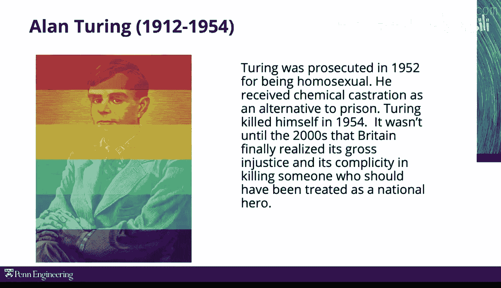
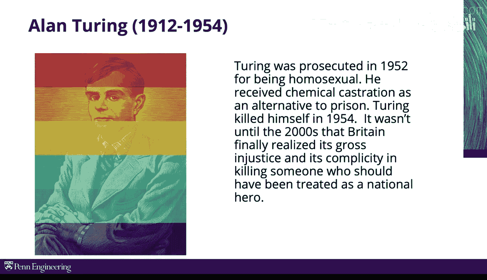
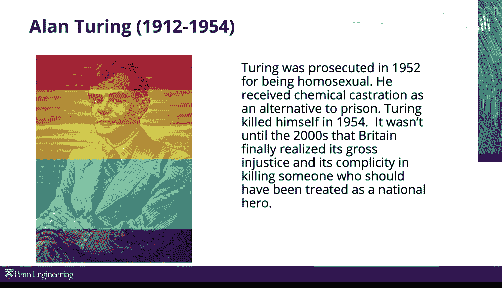
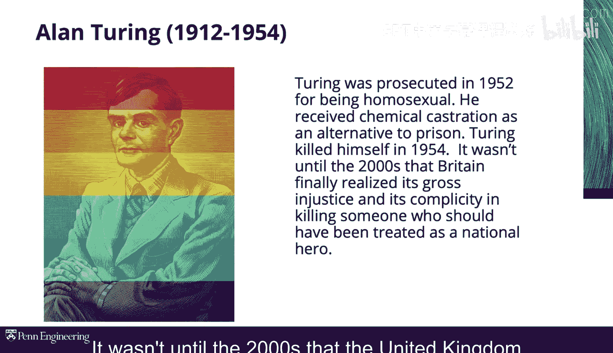
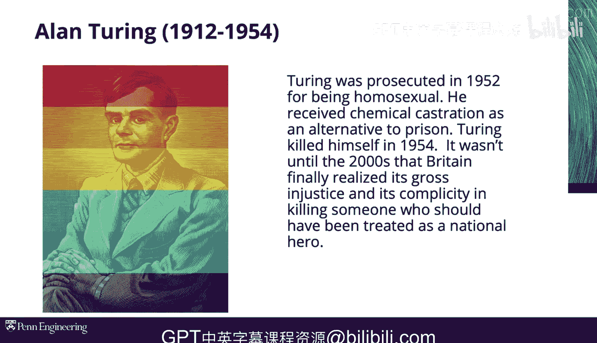

# 人工智能与机器学习基础：p03：哲学中的AI-I 🤖

在本节课中，我们将要学习人工智能在哲学思想中的起源。我们将探讨“智能”和“心灵”的本质，并了解历史上哲学家们如何思考这些问题，以及这些思考如何影响了现代人工智能的测试标准。

## 智能与心灵的哲学追问

如果我们对构建人工智能体感兴趣，首先需要停下来问自己：智能意味着什么？或者说，拥有心灵意味着什么？

这些问题在历史上一直被哲学家们争论不休。

## 笛卡尔的哲学奠基

一个例子是17世纪的哲学家勒内·笛卡尔。他常被称为西方哲学之父，因为许多现代西方哲学都是直接回应他的著作。

笛卡尔对数学，尤其是几何学也有重大影响，例如我们熟知的笛卡尔坐标系。

笛卡尔有一句名言：“我思故我在”，出自他的著作《第一哲学沉思集》。在这本书中，笛卡尔进行了一项哲学练习：他首先抛弃所有非绝对确定的信念，然后试图确立哪些是唯一可以确定知晓的。

即使像对世界的感知这样的物理体验，也可能是一场梦或由恶魔制造的幻觉。通过“我思故我在”，他提出，一个人的意识意味着他的存在。

## 身心二元论

与这个想法相关的是身心二元论。这种观点认为，你的心灵是本质元素，是你的精神核心，是构成“你”的那个部分。而这个部分在某种程度上与你的肉体形式，即你的身体，是分离的。

例如，如果你的身体某部分在事故中失去，那并不会使你变得比现在更不像“你”。你仍然是你，你仍然存在。

## 他心问题

一旦我确定了我存在，我如何知道其他人也存在？如果我无法确定他人拥有心灵，我如何知道他人存在？

如果其他人只是人类的模拟呢？他们可能是自动机。人们的身体和外表可能被机械地复制。我们的身体和动物的身体基本上只是与世界互动和移动的复杂机器。肌肉可以被齿轮、活塞或凸轮等取代。

那么，我如何知道你不是一个极其逼真的人类复制品呢？

## 历史上的自动机

笛卡尔对这个话题感兴趣的部分原因是，在17和18世纪，有一个庞大的业余爱好者产业，致力于建造栩栩如生的自动机。

*   **左侧**：我们有一个18世纪的国际象棋自动机，名为“土耳其行棋傀儡”。它被建造得看起来像是一个能真正下棋的人工智能体。但秘密是，实际上有一个人藏在里面，操纵机械移动棋子。这是一个骗局，但对当时的许多人来说非常具有说服力。
*   **右侧**：我们有一个真正的机械自动机，能够写出一首诗并画一幅画。这个自动机现藏于费城的富兰克林科学博物馆。

笛卡尔对可能存在栩栩如生、甚至能以类似我们身体运动方式移动的人类复制品这一想法很着迷。他想要制定一个测试，以确定某人是否是自动机或真正的人。

## 笛卡尔的测试标准

他得出的结论是，或许区分自动机与人的关键在于，自动机只能以特定的预定方式做出反应。如果你想与这样的机器进行开放式的对话，它不太可能使用人类语言。这在17世纪的自动机中当然是正确的。

但这在今天仍然成立吗？我们将在课程后面看到自然语言生成的最新技术水平。

## 图灵与智能测试

现在，我们来看看其他一些哲学家，他们提出了类似的测试，以判断某人是否是人类或实际上是自动机。

另一位思考“什么构成智能”以及“什么条件能让我们满意地认为某物是智能的”这一问题的哲学家是艾伦·图灵，他是计算机科学领域的奠基人之一。

艾伦·图灵在第二次世界大战期间，于一个叫布莱切利园的地方，对设计和使用第一台数字计算机起到了关键作用。布莱切利园是英国秘密利用计算机破解德国恩尼格玛密码的地方。艾伦·图灵的这项密码破译工作是第一台现代计算机最成功的应用之一。

艾伦·图灵对人工智能产生兴趣，是因为在20世纪50年代，许多人对计算机着迷，并提出诸如“机器真的能够思考吗？”这样的问题。艾伦·图灵认为这是一个很难直接回答的问题。

## 图灵测试的提出

由于“思考”太难定义，图灵没有试图直接回答“机器能思考吗”这个问题，而是提出了一个替代方案，后来被称为“图灵测试”。

图灵提出的替代性问题是：**一台机器是否有可能如此逼真地模仿人类，以至于人类评判者无法将该机器与真实的人类区分开来？**

图灵的想法受到一个名为“模仿游戏”的派对游戏的启发。在模仿游戏中，两个人会去到房子的不同房间，派对上其他人通过发送问题与他们互动。藏在其他房间里的人会打字回复答案，其他玩家必须仅根据这些打字回复来猜测谁是谁。

模仿游戏与图灵提出的测试机器是否智能的构想非常相似。

## 图灵测试的流程

在图灵测试中，有一位人类评判者与一台计算机或一个人进行互动。在测试过程中，他们通过文本消息进行对话。在会话结束时，评判者必须说出他们是在与人还是在与机器互动。

如果一台机器成功地说服评判者他/她正在与一个人交谈，那么我们就可以说这足以证明机器本身是智能的。如果一个系统能够冒充人类，那么它就是一台会思考的机器。

图灵测试的本质在于“通过”这个概念，即冒充你本不是的事物，并说服他人相信你是与你真实身份不同的东西。

## 图灵的个人悲剧

这个概念对艾伦·图灵来说实际上相当悲剧。艾伦·图灵是同性恋者，而当时在英国，同性恋是非法的。图灵被发现与另一名男子有染，并被定罪。结果，他被判处化学阉割作为监禁的替代方案。这是一种通过操纵你的激素和情绪来实施的极其可怕的事情。最终，图灵自杀了。

由于他在布莱切利园的工作是政府严格保守的秘密，直到近50年后，他对计算机科学的贡献才最终得到认可。在这些努力被解密后，人们才知道，艾伦·图灵领导的密码破译工作通过破解德国恩尼格玛密码，有效地使盟军得以提前结束第二次世界大战。

直到21世纪，英国才真正认识到它对艾伦·图灵犯下了多么严重的不公。他本应被视为民族英雄，而不是被当作罪犯对待。

---

**本节课总结**：本节课我们一起学习了人工智能的哲学起源。我们从笛卡尔对“我思故我在”和身心二元论的探讨开始，理解了他对智能本质的思考以及区分人与自动机的早期尝试。接着，我们重点学习了艾伦·图灵提出的图灵测试，这是一个通过判断机器能否在对话中冒充人类来评估其智能的经典方法。我们还了解了图灵本人的生平及其悲剧，这为理解图灵测试中“通过”概念的深层含义提供了背景。这些哲学思考为后续我们理解现代人工智能的目标和挑战奠定了基础。