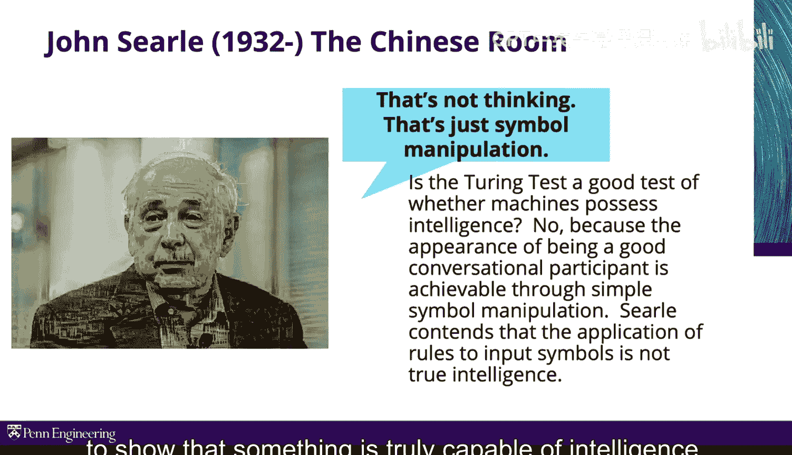
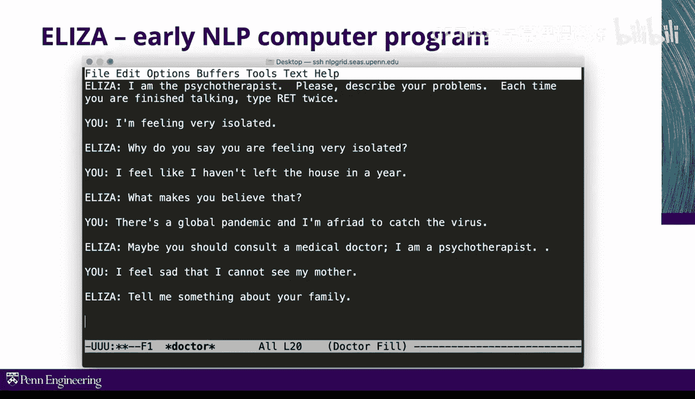
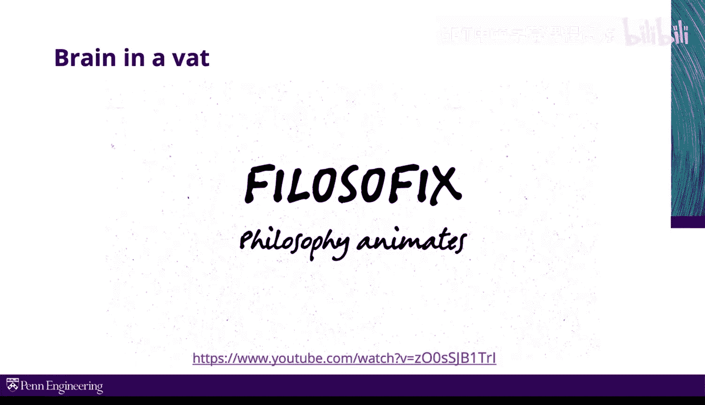

# 宾夕法尼亚大学《人工智能和机器学习基础（AI、数据科学、机器学习）AI and Machine Learning Essentials with Python》 p04 04_01_02_哲学中的AI-II.zh_en -BV16f421Q72q_p4-

John Crle is another philosopher whose work addresses artificial intelligence。

Crll argues that Tring's test is insufficient。He contends that the Tring test could be solved through simple。

 simple manipulation and argues intuitively that simple simple manipulation isn't true intelligence。

Imagine that I gave a symbol to a machine， and the machine simply responds by looking that symbol up and performing some predetermined action。

 If you imagine my input symbol to be a turn in a conversation like， how are you to day。

Then the machine might be able to do a table look up and output a plausible reply like I'm fine。

 How are you。Cirll contends that this type of symbol manipulation is just syntax。

It's just doing something basic， like a regular expression transformation。

A machine that follows syntax rules doesn't actually understand the meaning of the conversation。

If you agree with Crle， then giving the appearance of conversation is not sufficient to show that something is truly capable of intelligence。

Cril proposed an interesting thought experiment called the Chinese Room。

The idea is that there's someone one working inside a room who receives messages written in Chinese and then produces a response to them that's also written in Chinese。

This cartoon depicts the idea。A colleague of the person who's sending and receiving these Chinese messages is surprise。

 she says。I didn't know that you understand Chinese。 And he replies， I don't。

 The symbols are just meaningless squiggles to me。 I consult the list of rules that gives me instructions on how to get back certain Chinese symbols with certain kinds of shapes in response。

Certain kinds of shapes come into me as input。And all that I'm doing is just following the rules of symbol manipulation。

And then the cartoon continues to joke about whether that person even understands English when clearly he does。

The message of Crul's Chinese room thought experiment is that even if we can build a system that does symbol manipulation to produce a plausible conversation。

Well you probably don't think of its actions as constituting intelligent behavior。

 It's just like the person looking at Chinese symbols in order to come up with a good Chinese response。

 That person doesn't actually understand Chinese。There are examples of systems that use rule based response to imitate a conversation。

One of the earliest notable AI systems was a system called EliSza。

Eliza was a simulated psychotherapist。There's a particular style of psychotherapy called Rogerarian psychotherapy。

In this type of therapy， you tell a therapist about how you're feeling or what's bothering you。

 and they respond by asking you questions。The therapist is non judgmental。

And never tries to tell you the underlying reason for what you experience。 Instead。

 they're trying to get you to delve into your own feelings and kind of search for the truth in yourself by asking these leading questions。

Rogerarian psychotherapy is easy to parody。 You could pretend to be a rogerarian psychotherapist by just taking what someone says and transforming it into a question。

And you can do this in a deterministic way， and in fact， that is how this early program Eliza worked。

This is a sample transcript of Eliza interacting with an actual human， in this case， with me。

Eliza introduces itself saying， I am the psychotherapist。

 Please describe your problems Each time you're finished talking， just press return twice。

 So I typed into Eliza。 I'm feeling very isolated。😊，And Eliza responded by saying。

 why do you say that you're feeling very isolated， So you can see that this kind of transformation is just taking what I have said and transforming it into a question。

I feel that I haven't left the house in nearly a year。 What makes you believe that， Eliza says。

There's a global pandemic， and I'm afraid to catch the virus。

 I say maybe you should consult the medical doctor。 I'm just a th psychotherapist， says Eliza。

 I feel sad that I can't see my mother， I say。😔，And then based on that keyword of my mother。

 that triggers Eliza to ask me something about my family。

So Eliza is just transforming the user input in a deterministic way to generate its responses。

Eliza's architecture works similarly to the Chinese room symbol manipulation experiment。

 which Cril says， is not intelligence。

Cl's symbol manipulation idea introduces a distinction of the idea of strong versus weak artificial intelligence。

A system that isn't actually intelligent。And is just giving the appearance of intelligence。

 he declares is a weak AI。He goes on to posit that there must be something about the human brain that causes us to have intelligence and contends that there's something foundational about the biological brain that allows us to have intelligence。

I find this argument kind of weak because it would seemingly rule out the possibility that robots or computer programs in the future could ever be intelligent。

The argument that the brain is a necessary precondition for intelligence is taken down by another philosopher called Dan Dent。

He has this fun armchair philosophy experiment。hi is a creative writing essay where he talks about a fictionalized account of himself being recruited by the US Department of Defense to go on some top secret mission to disarm a bomb that's underneath Oklahoma。

In this essay， the military has lost control of this bomb and it's leaking a lot of radiation。

As a result， they can't send in a person to repair it because their brain would be damaged by the radiation。

The military proposes to send someone one in to defffuse the bomb。

 but they decide that they must first remove that person's brain。

They proposed to put their brain in a vat in a remote location and replace all of the neurons that link the brain to the body with microscopic radio transceivers。

The philosopher Dan Dennettt volunteers for the job since he's deeply interested in neuroscience and thinks that it is his duty as a philosopher。

They pick him to do the mission。 and soon his brain is floating in a vat and his body goes away to Oklahoma。

In the essay， Dennett addresses questions like where am I and what is the element that makes me me？

Is the brain floating in a vat me or is my body me。

The perceptions of the brain in the v are all linked to the body。

In an attempt to debunk Crl's point about biological brains being necessary。

 Dennett continues this fanciful argument by saying that。

Although he diffused the bomb underneath Oklahoma。In doing so。

 the radiation so ravaged his physical body that all the neuroradial links between his brain and his body were lost。

 His brain is still floating in that bat and still there as a conscious entity。

And the scientists realize that it's having this kind of existential crisis with no input。

 So they flip a switch and turn it off， and then they flip a switch later。

 And he suddenly revived again with a new synthetic body。

 But he comes to realize that it's not only the body that's synthetic。

 but it's also a synthetic brain。 They replicated all of the things that his brain was doing。

 capturing the same information flow and the same level of computation inside this new robot。

 So then the question is， was that biological brain actually necessary for him to have a sense of self and to interact with the world。

There's a fun short video about this idea that I'll link to that explains the idea of the brain in the VAat experiment and how it links back to Dickcarte's initial idea of mind body dualism。

Most artificial intelligent researchers don't care about the strong AI hypothesis。

As long as their programs work， they don't really care whether it's a simulation of intelligence or real intelligence。

This is not going to be a course about philosophy。 This is about as philosophical as we'll get in this course。

 but it's really fun to think about things like this。

Notions like strong versus weak AI are really more of a philosophical quandary than one that's been integrated into mainstream artificial intelligence research。

So we'll leave it to the philosophers to focus on the underpinnings of what makes us intelligent beings and what's necessary to declare a system to be intelligent。

In this course， we are going to end up focusing more on practical algorithms that will let us build programs that enable some elements of intelligence。

