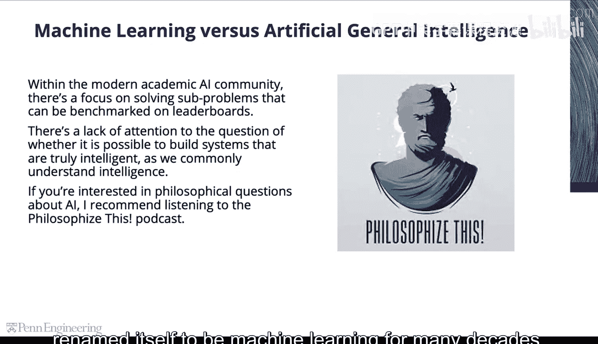
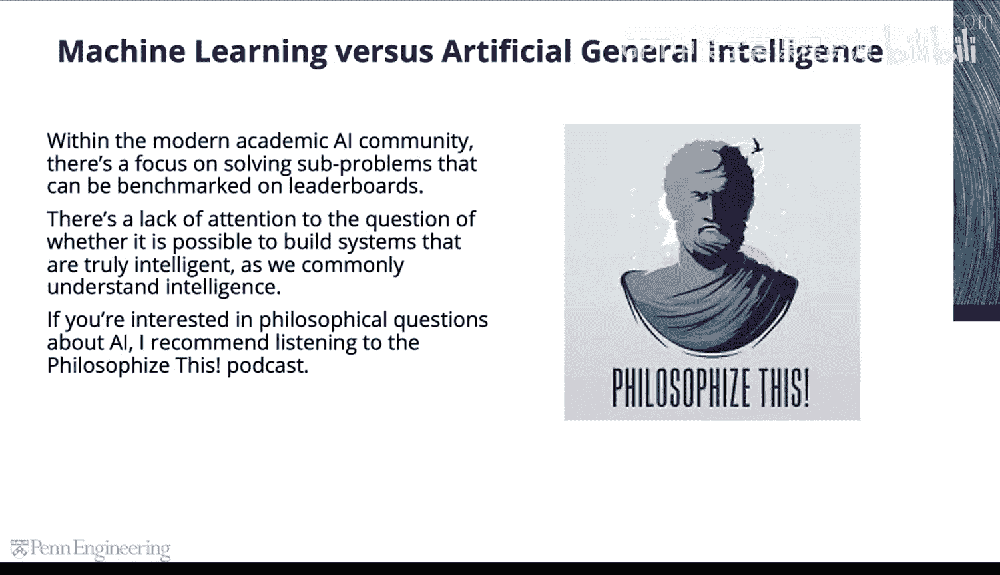
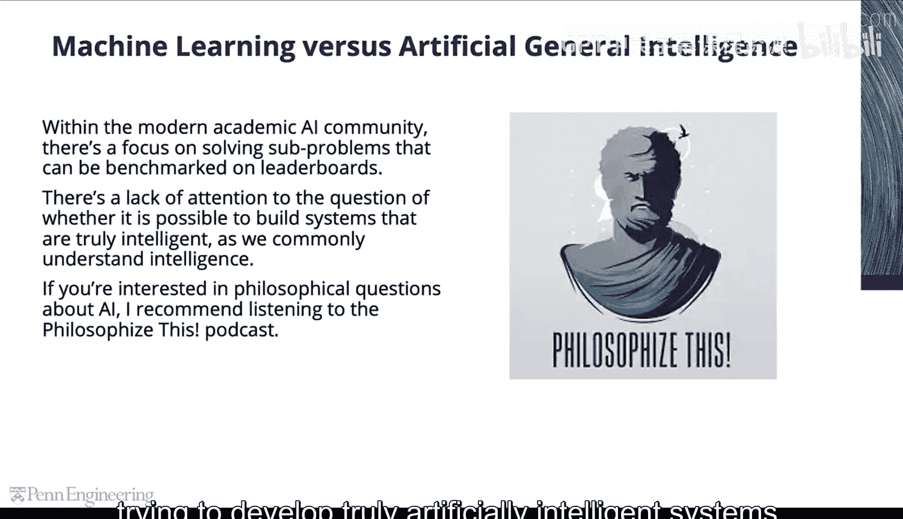
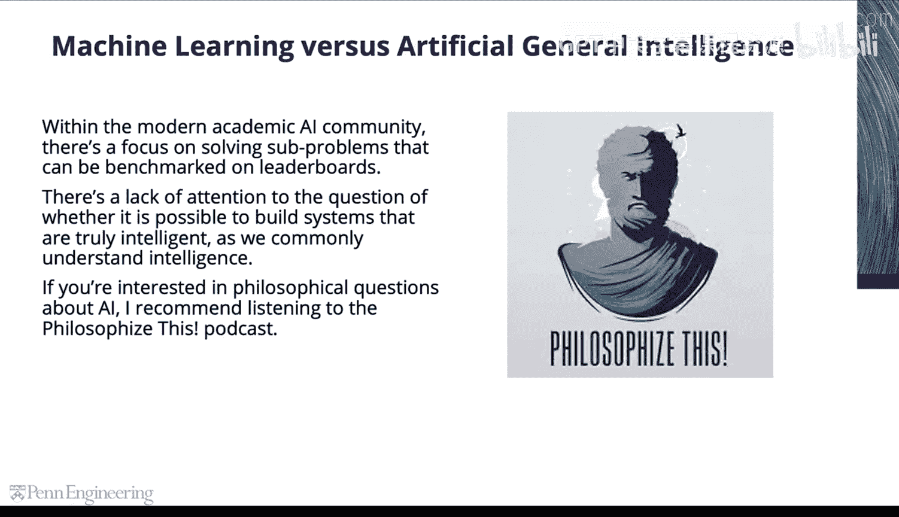

# 宾夕法尼亚大学《人工智能和机器学习基础（AI、数据科学、机器学习）AI and Machine Learning Essentials with Python》 p05 05_01_03_通用人工智能.zh_en -BV16f421Q72q_p5-

Philosophers who consider artificial intelligence ponder some really fascinating questions。

 They think about how he could make a distinction between how the human mind works and how a simulated mind might work。

They'll pose questions like， what if your brain was removed from your body placed in a nutrient rich that。

 And then all of the electrical impulses that come to your brain via your perceptual system were replaced by computer probes that simulate the universe。

Would the thinking that you do as a brain in the vat be the same as the thinking that you do as a human being。

 And if so， how is that substantially different than the kind of thinking that an artificial intelligence program might do with its own electrical impulses reflecting the world that it sees around it。

These sorts of questions are fascinating， but they're ones that artificial intelligence researchers tend not to think as much about。

Artificial intelligence researchers are often much more concerned with practical applications of artificial intelligence and thinking about designing programs that work。

For many decades， the field of artificial intelligence focused in on very specific sub problems。

 rather than trying to solve the problem of artificial general intelligence。 In fact。

 the field basically renamed itself to be machine learning for many decades。

The field focused in on very specific problems that could be benchmarked and whose results could be analyzed in a leaderboard like fashion。

 Que like， can you identify what objects appear in a photograph became proxies for our broader goals of trying to develop truly artificially intelligent systems with the shift to focus on machine learning rather than artificial general intelligence。

Many people in the field set aside the philosophical questions that we've asked so far。

If you're interested in exploring those， I recommend the podcast philosopphifies this that often will grapple with questions related to artificial general intelligence。

Despite the fields focused on self contained machine learning tasks for many years。

The notion that we might be able to achieve artificial general intelligence has started to creep back into the conversation over the past few years。

Back in 2022， a Google employee started to worry that their large language model system。Then。

 called Lambda。Was somehow displaying signs of sents or signs that it was expressing things that you might expect from an agent that could truly reason。

Of course， rather than going to his boss and talking about his concerns there。

 he went to the Washington Post and promptly got fired。

This person's thoughts were kind of snicker at by people in the field。

 But I think we've all moved closer to this position that maybe artificial general intelligence is not as far off as we once had thought。

I myself had quite a profound experience the first time that I used GPT3。

 which I had early access to through their private beta。

Its ability to produce human sounding text was really uncanny and unlike anything that I had seen in the past 20 years of having done research in natural language processing。

Now， artificial intelligence researchers are starting to address these questions more seriously。

This group from Microsoft Research。Had early access to G G 4 and explored its capabilities through the lens of whether it might be demonstrating properties that would be prerequisite to having artificial general intelligence。

 One thing that I found fascinating about this paper was that G P 4 seemed to have some kind of theory of mind。

 The of mind as the idea that you understand that the person that you're talking to as a different representation and different perception of the world from you And you create an internal model of what it is that they think about the world。

GP 4 seems to have some capabilities that might hint at that capability， as well。

This is truly wild and puts us back into the realm of philosophy and artificial intelligence。

