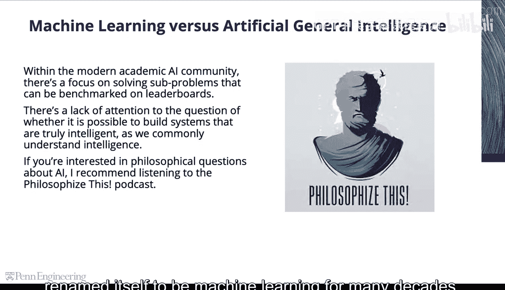
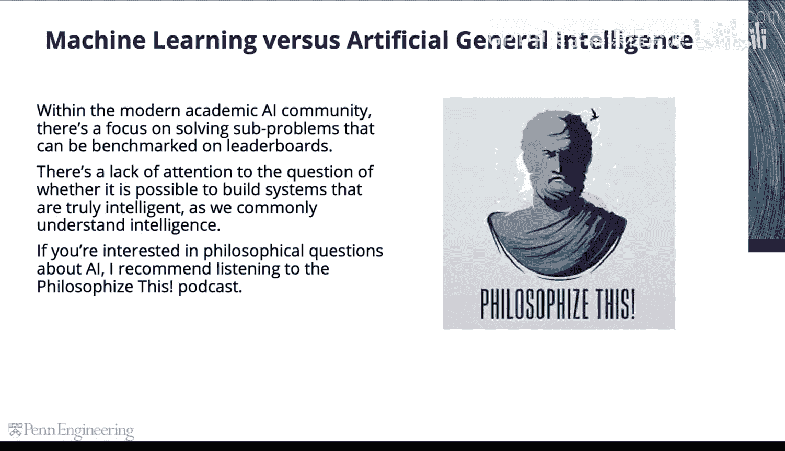
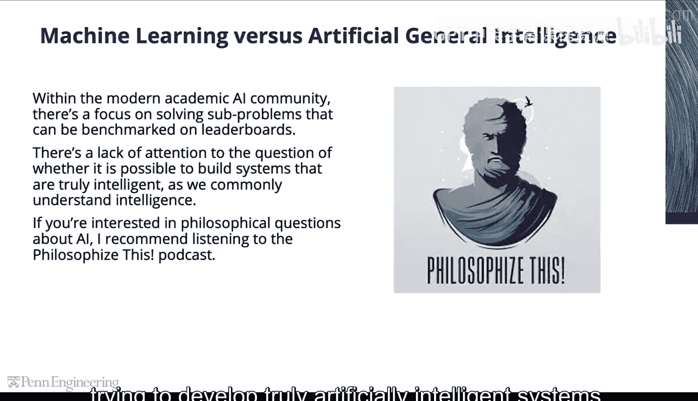
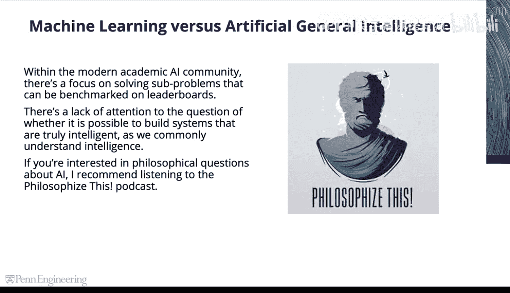

# 人工智能和机器学习基础：p05：通用人工智能 🤖

在本节课中，我们将要学习通用人工智能（AGI）的概念，并探讨其与哲学思考及实际人工智能研究之间的关系。

## 概述

本节内容将介绍哲学家对人工智能的思考，对比人类思维与模拟思维的区别，并回顾人工智能研究领域从追求通用智能到专注于具体机器学习任务的转变。最后，我们将讨论近年来通用人工智能概念如何重新引起学界关注。

## 哲学家的思考

哲学家在思考人工智能时，会探讨一些非常引人入胜的问题。

他们思考如何区分人类思维的工作方式与模拟思维可能的工作方式。

他们会提出这样的问题：如果你的大脑被从身体中取出，放入一个营养丰富的容器中，然后所有通过感知系统传入大脑的电脉冲都被模拟宇宙的计算机探针所取代。

那么，你作为容器中的大脑所产生的思考，与你作为人类时的思考是否相同？

如果相同，那么这与人工智能程序通过其自身的电脉冲反映其所见世界时进行的思考，在本质上又有何不同？

## 研究重点的转变

上一节我们介绍了哲学家对通用人工智能的抽象思考，本节中我们来看看实际研究领域的侧重点。

这类问题虽然引人入胜，但人工智能研究人员往往不会过多思考它们。

人工智能研究人员通常更关注人工智能的实际应用，并思考如何设计能够运行的程序。

数十年来，人工智能领域专注于非常具体的子问题，而非试图解决通用人工智能的问题。

事实上，该领域在几十年里基本上将自己重新命名为“机器学习”。

该领域专注于那些可以被设定基准、并且其结果可以像排行榜一样进行分析的具体问题。

例如，“你能识别照片中出现什么物体”这样的问题，成为了我们实现开发真正人工智能系统这一更宏大目标的替代品。

随着研究重点转向机器学习而非通用人工智能，该领域的许多人将我们之前提出的哲学问题暂时搁置了。

如果你有兴趣探索这些问题，我推荐播客“Philosophize This!”，它经常探讨与通用人工智能相关的问题。

## 通用人工智能的回归

尽管该领域多年来专注于自包含的机器学习任务，但在过去几年里，我们可能实现通用人工智能的观念已开始重新回到对话中。

2022年，一名谷歌员工开始担心他们的大型语言模型系统（当时称为LaMDA）似乎显示出感知的迹象，或者表现出你可能期望一个真正能推理的智能体所表达的东西的迹象。

当然，他没有去找他的上司谈论他的担忧，而是去找了《华盛顿邮报》，并随即被解雇。

此人的想法受到了该领域一些人的嘲笑，但我认为我们都已更接近这样一种立场：也许通用人工智能并不像我们曾经认为的那样遥远。

我自己在使用GPT-3时就有过一次相当深刻的体验，我通过其私人测试版获得了早期访问权限。

它生成类人文本的能力确实不可思议，与我过去20年在自然语言处理研究中所见的任何东西都不同。

## 新的研究探索

现在，人工智能研究人员开始更认真地探讨这些问题。

这个来自微软研究院的团队早期接触了GPT-4，并通过审视它是否展现出拥有通用人工智能所需的前提属性这一视角，探索了其能力。

这篇论文中让我觉得非常有趣的一点是，GPT-4似乎拥有某种“心智理论”。

“心智理论”是指你理解与你交谈的人拥有与你不同的世界表征和感知，并且你创建了一个关于他们对世界看法的内部模型。

GPT-4似乎具备一些可能暗示其拥有这种能力的特性。

这确实非常惊人，并将我们带回了哲学与人工智能的领域。

## 总结

本节课中我们一起学习了通用人工智能的概念。我们探讨了哲学家对其本质的思辨，回顾了人工智能研究历史上从宏大目标到具体机器学习任务的务实转变，并了解了随着大型语言模型的出现，关于机器是否具备真正推理与感知能力的讨论如何再次成为前沿话题。理解这些背景有助于我们把握人工智能领域的现状与未来可能的发展方向。