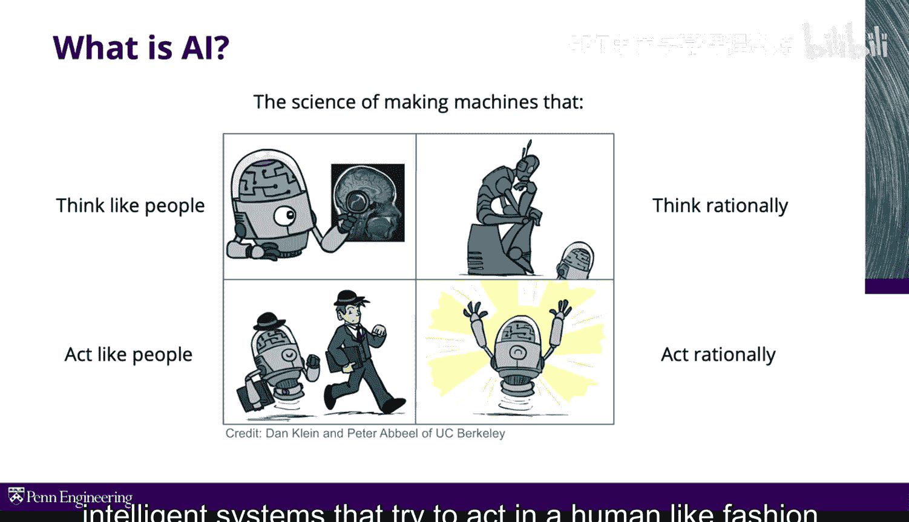
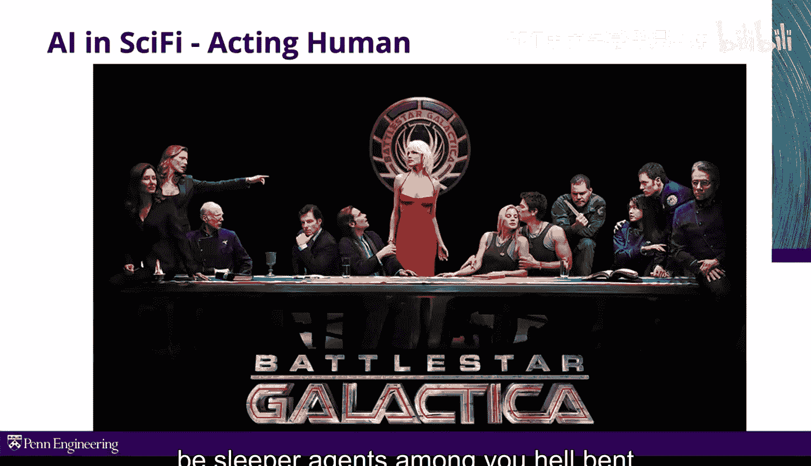
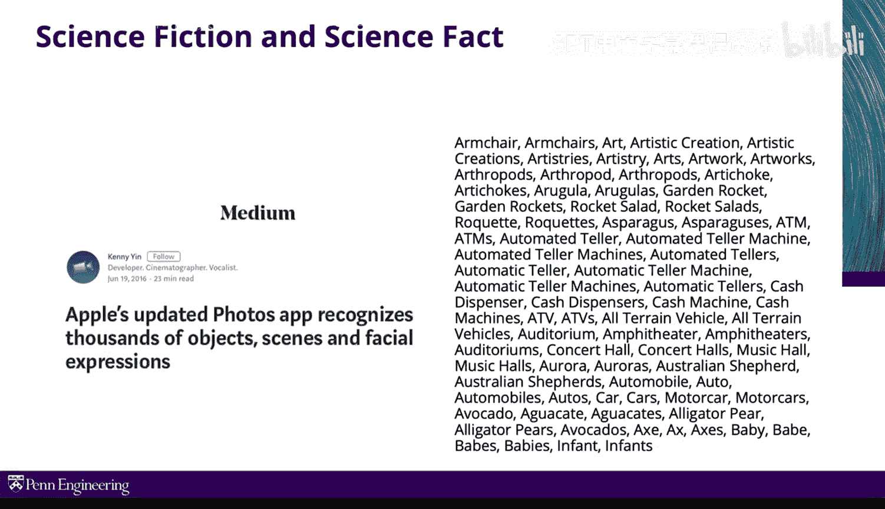

# 宾夕法尼亚大学《人工智能和机器学习基础（AI、数据科学、机器学习）AI and Machine Learning Essentials with Python》 p06 06_01_01_科幻中的AI-I.zh_en -BV16f421Q72q_p6-

In addition to philosophy， AI is rooted in a long tradition of science fiction。

We talked earlier about what it means to be artificially intelligent and how you could design an agent with the goal of doing any of the following。

 you could have an agent that thinks like a person or acts like a person or thinks rationally or acts rationally。

A common trope in science fiction is trying to have artificially intelligent systems that try to act in a human like fashion。

One of my favorite examples of this is from a version of Star Trek that aired when I was in high school called Star Trek the Next Gene。

In that show， there was a character called Datata， who was an Android。

 whose goal in life was to be able to act as humanly as possible。

He lacked a lot of the elements that you would think， make us human， like our emotions。 for example。

 He had other strange quirks。 for instance， for some reason， he couldn't contract words。

 He had to say， cannot instead of can't。Which actually seems like a pretty easy thing to implement。

So data is one example of an artificially intelligent system that tries to act human。

The idea of acting human shows up in a lot of different science fiction。

There's a really great HBO series called Westworld。

 which was based on a 1970s movie also called Westworld。

 where there's an amusement park that's designed to look like the Wild West and is populated with artificially intelligent agents。

Humans go to this amusement park to live out their fantasies。

 and they act totally horrifically towards these AI systems。They can shoot them down in the street。

 they can murder them or rape them because the people who are at this park feel that the AI systems are not really people。

 they're just made to look like people and act like people。

The main theme of this show explores the questions of what it means to be human and what it means to be a slave and whether artificially intelligent systems。

Could have enough humanness that they should be considered human and treated with the respect and dignity that all humans should be treated with。

Yet another variation on this idea is the science fiction series Battlestar Galactica。

 where they have AI systems that are sleeper agents among the Starship crew。

 where some number of the crew are actually AI agents masquerading as humans。

Robots called Cylons have been made so advanced that they're virtually indistinguishable from humans。

The show is also a parable about things that were in the news at the time， like terrorism and。

The suspicion that permeates about Sils being on this spaceship is similar to the feeling that you might have had at the time that there could be sleeper Asians among you。

 hell bentent on trying to destroy your civilization。

A science fiction movie that I love is one called Blade Runner。

 which deals directly with this notion of how a person can tell whether or not someone that they're interacting with is a human or an automaton。

The movie is centered around a detective who goes out and tries to hunt down replicants。Once again。

 this is a slave narrative where the AI systems are away from their human captors and trying to pass as human。

In blade Runner， they have a test called the void Comf test that's actually quite like the Tring test。

 I really love this scene because it directly mirrors the philosophical questions that were raised about artificial intelligence。

Questions like， how can I tell if someone is an automaton or not。

This hearrkkenens back to the notion that Descartes had where you could design a test to see whether someone one is an automaton。

And in fact， that movie is directly referencing Descartes。

 because the main character in the movie is named Decarte。

Which is clearly a minor manipulation of the name Descartes。

Science fiction has this really wonderful relationship with artificial intelligence。

 where oftentimes Scifi anticipates where the field of AI is going and imagines what is possible several decades before the AI technology is actually there。

There are many instances of scihi showing us the future of what AI will be capable of。

Several decades after the movie comes out。Here's a clip from Terminator that shows the robot's heads up display。

This is the view through the robot's eyes where you can see what it's seeing and see the computer vision tasks that it's performing like object recognition。

 you'll see that it recognizes a motorcycle。It's reading the text on a sign。

It's recognizing people and taking some scans， estimating their weight and taking their body measurement。

In fact， what's happening in this scene is that the Terinator is completely naked and walking around this bar。

 looking for someone that has the same build as him so that it can take their clothes and then go around in society。

Why the robot itself can time travel， but it can't send its clothes back with it is unclear。

The kind of technology shown in Terminator 1 and Terminator 2。

 which were filmed in the 1980s and early 1990s。That kind of technology was science fiction at the time。

Many elements from the Terinator movies have now become science fact as artificial intelligence has continued to advance。

Luckily， not the murderous robot part。Unfortunately， not the time travel part。

Over the past few years， we've made really amazing advances to the field of computer vision。

Where we're able to do things like classification of images where we can feed an image to a computer vision system。

 and it can tell us what objects it contains。Like a person， some sheep and a dog in this photo。

Computer vision can draw broad bounding boxes around these objects or perform exact segmentation to indicate which pixels in the photo correspond to those objects。

This is exactly what was happening in the Terminator's heads up display where it was hand drawn animation at the time。

And the Terinator's ability to reason about images is now possible with computer vision。

 And that's really amazing。Your smartphone can recognize thousands of objects automatically now。

Before these advances to computer vision， you would have to manually tag your photos in order to search for things in them。

Now， you can search your photos for everything from armchairs to skyscrapers。

 precisely because computer vision has become so good。That you can deploy it on a smartphone。

There are lots of other places where we've crossed over from science fiction to science fact。

 sometimes what science fiction authors imagined certain technologies would be useful for turned out to be quite a bit different in reality。

A friend of mine made this joke about the void Comf test from Bla Runner。

 where the interviewer asks Leon， are you ready for the test。Leon says。I'm ready。And then in reality。

 the test would be much more like this。We're now asked to prove that we're humans by having to pick out all of the squares that have traffic lights in them。

In reality， this is the kind of test that we're now asked to prove that we're human This is an example of a capcha from Google which pops up to force you to demonstrate that you're human and not a robot when you're signing up for an internet account。

Kapcha is an acronym for completely automated public tuuring tests to tell computers and humans apart。

And captions often lead to quite a high level of frustration。

There are other examples of where the science fiction vision of what computers are capable of comes in advance of what's possible。

Here's a movie from the 1980s called War Games。There's a young college aged kid who's hacked into a computer system and sees that it can play chess and some other games。

One of those other games is called Thernuclear War。Instead of being a game。

 it's actually the computer managing the nuclear arsenal for the United States。In this scene。

 the computer is about to launch an attack on Russia。

 So the people in the control room are desperately trying to figure out how to stop it。

 It's a race against the clock as the computer breaks the encryption for the nuclear launch code。

While the computer is trying to break the encryption。

 they tell it to start playing the game ofticte toe。They set the number of players to 0。

 so the computer plays against itself。 They hope to convince the computer to learn that there's no good strategy for winning Tite toe。

It learns thatticte toe is unwinnable。 And from that。

 the computer is able to extrapolate that there's no good strategy for winning a thermonuclear war。

