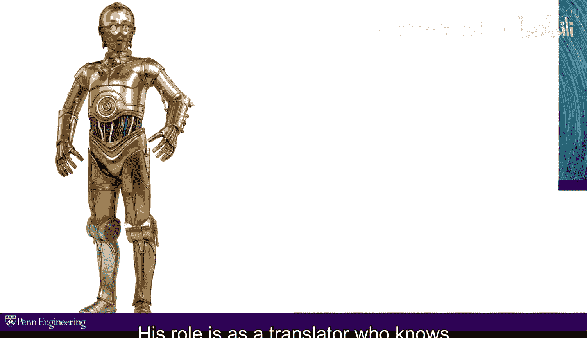
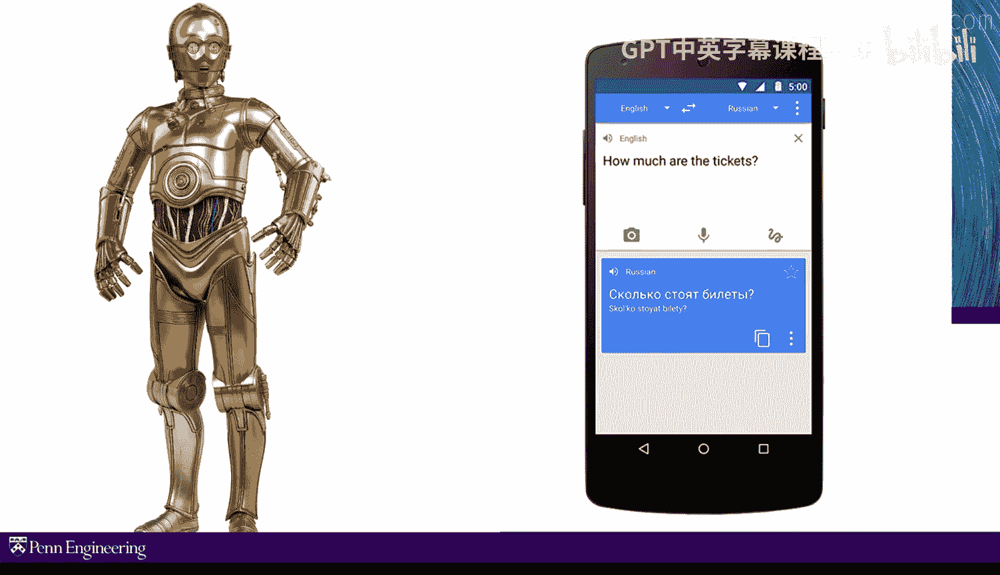
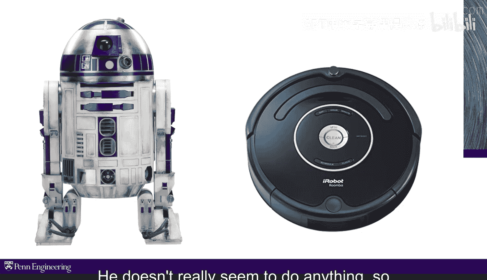

# 宾夕法尼亚大学《人工智能和机器学习基础（AI、数据科学、机器学习）AI and Machine Learning Essentials with Python》 p07 07_01_02_科幻中的AI-II.zh_en -BV16f421Q72q_p7-

The notions of computers playing games has been core to artificial intelligence for many decades。

A variety of games have served as challenge problems for AI。 In the late 1990s。

 IBM designed an artificially intelligent system called Deep Blue that beat chess Grandmaster Gary Casbrov。

 At the time， people believed that chess required a human intellect。 but Deep blue disproved it。

A chess playing machine surpassed the best human player in the world。

 And now human players basically get skunkked by machines all the time。In 2013。

 IBM had another success for AI systems playing games。

They designed a question answering system called Watson to play the television game show Jeeopardy。

In order to succeed at Jeeopardy， you need to be able to extrapolate from clues to be able to answer trivia questions。

Watson beat Ken Jennings in a head to head match。Jennings holds the record for the longest winning streak on the game show Jeopardy。

In 2016， a system developed by Google Deep Mind called Alphago beat the Go world champion Lee Siol。

Go is interesting because the space of possible moves。

And the space of possible board configurations is far larger than the space of configurations on the chess board。

It's therefore a much more ambitious challenge because it requires many more potential configurations。

That an AI system would have to explore for possible solutions to the game。

 It's so big that you can't explore the space of possible solutions exhaustively。In fact。

 you can't even do an exhaustive search for the space of possible solutions to chess。

Exhausive search is only possible。With games with more limited moves， liketict toe or checkers。

In the search module of this class， we'll talk about game playing and the search for the best next move and the implications of not being able to search over the full space of possible moves。

In the movie 2001， a Space Odyssey， there's a robot named Hal 9000。

 who's responsible for controlling the spaceship。Interestingly。

 the filmmakers represent Hal as a disembodied voice。

This is a clip from the film that has an interview with Hal。

This clip relates to the idea of AI systems that are designed to think rationally。

Howwell claims to be perfect and incapable of error。 But that turns out not to be true。 In fact。

 he ends up murdering the crew later in the movie。2001， a space Odyssey was released in 1968。

 long before the advent of personal computers。The filmmakers had a vision of what computing in the future would be like。

Their vision included the idea that you could talk to your computer。

 that it could reason about what you said， and then it could respond in natural language。

This idea now permeates our everyday life with devices like Amazon， Alexa。

You can say commands like Alexa turn on my lights。This is quite similar to the capabilities that were envisioned by the science fiction movie more than 40 years ago when they said。

 close the pod ba doors， how。We have lots of other scifi ideas that have been translated into reality。

This is C3PO from Star Wars。His role is as a translator who knows tens of thousands of languages。

C3PO is like Google Translate right now。

We have science fiction that's become science fact。Here's my favorite character from Star Wars， R2D2。

What can he do？Well， it's kind of hard to say， actually。It doesn't really seem to do anything。

So maybe he's like a Roomumbba or something one way that the state of the art and artificial intelligence gets advanced is by investment in research。

 a big funder of AI research in the United States is an agency called DARPA。

 the Defense Advanced Research Projects Administration。

DARPpa has been investing in AI research since the 1960s， and in 2018。

 DARPpa announced that it would spend $2 billion on AI research。

 DARPA is where a lot of my own academic funding comes from。In fact。

 a lot of the language technologies like Google Translator。

 Apple Siri owe their existence to DARPA projects。Google Translate， for instance。

 came out of a DARPA project that I was involved with in the early 2000s。

A lot of self driving car technology can trace its origins to the DARPpa Grand Challenge from 2005。

 This original grand challenge was to drive through the desert。

On one of several predetermined routes using a fully autonomous automobile。

5 teams completed this race with their cars driving totally autonomously through the desert。

Stanford finished the route in just under seven hours。A few years later。

 DARPA sponsored the Urban Grand challengege。Instead of driving through the desert。

 where if you crash into something， it's no big deal。

 They actually had cars driving on a military base where the stakes were a lot higher。

Autonomous vehicles had to deal with other obstacles that were much more significant。

 This photo shows the University of Pennsylvania's entry into the urban Grand Challen。

 Penn was one of six teams to actually finish the urban Grand challenge in 2008。Right now。

 self driving cars feel like they're imminent。 There are several companies that have gone on to commercialize this technology。

 and they are trying to make it part of our everyday lives。

As self driving cars have become more feasible， DARPpa has moved on to even bigger challenges。

 They have one called the robotics challenge。In this challenge。

 researchers must design humanoid robots that can accomplish tasks like carrying a hammer。

 turning a spigot and opening a door。Although these tasks seem basic。

 it turns out that they're super hard for robots to do。

Here's a pretty funny blooper reel to show you exactly how hard it is for robots to accomplish these tasks。

Like self driving cars advancing as a result of the DARPpa Grand challenges。

 humanoid robots are also getting better over time and now can accomplish these tasks pretty well。

A company called Boston Dynamics， which produces very capable humanoid robots and quadruppeent robots。

Have machines that are capable of doing things like lifting weights and navigating over rough terrain and recovering from unexpected inputs。

 There are lots of exciting ideas from science fiction that have eventually become science fact。

 So if you want to see what the future of artificial intelligence might be。

 you can look at the imaginative things that happen in science fiction。

