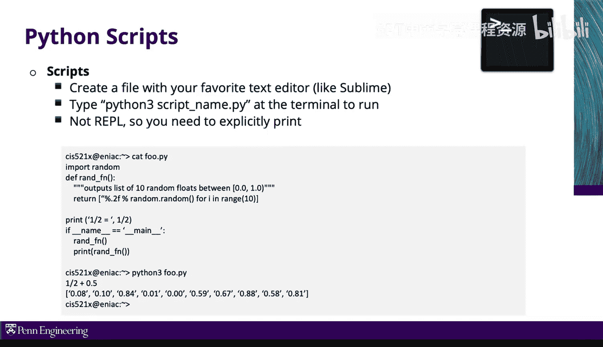
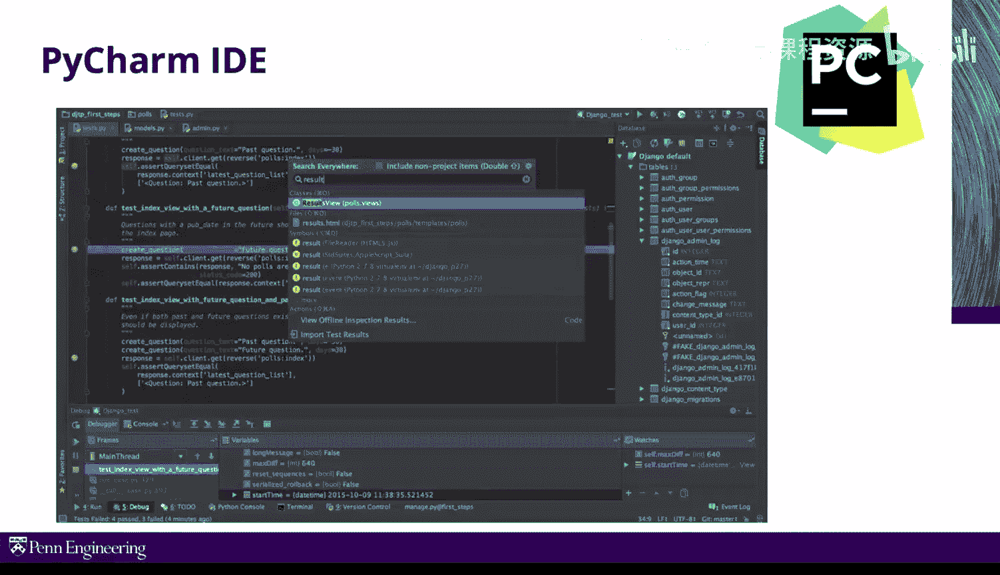
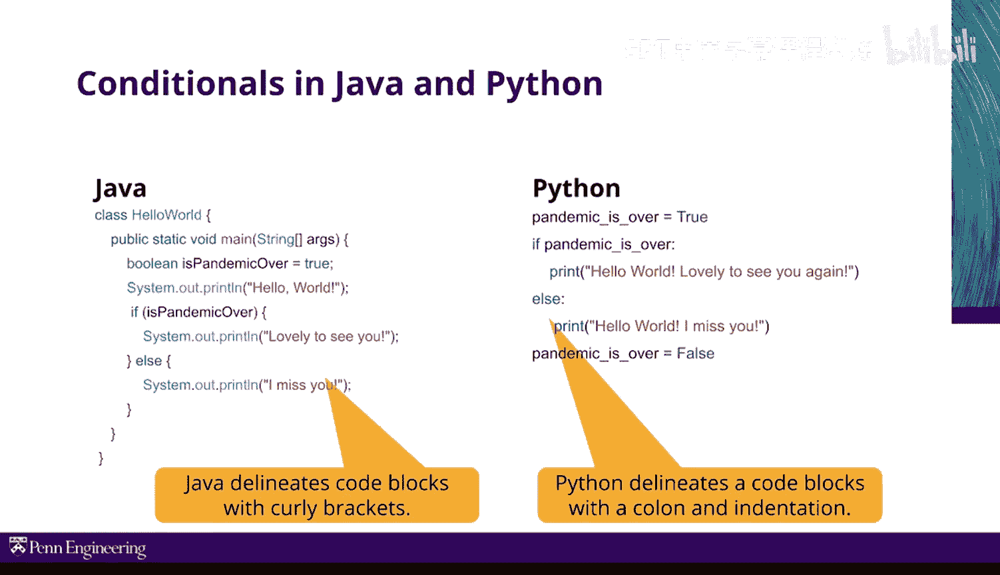

# 宾夕法尼亚大学《人工智能和机器学习基础（AI、数据科学、机器学习）AI and Machine Learning Essentials with Python》 p08 08_01_01_Python复习-概述.zh_en -BV16f421Q72q_p8-

For the lessons in this module， I'm going to give you a gentle introduction to Python。

 We'll talk about where it came from， Different environments that you can use to program in Python and the core language elements of Python。

We'll walk through some of the most important data types in Python like sequences。

 which include strings， lists and tuples。And then we'll talk about things like hash tables。

 which in Python are called dictionaries。But first。

 let's talk about a little bit of Python's history。

Python was developed starting in 1989 by Guido von Rossom。

The original inspiration for Python came from a language called ABC that was being developed in the Netherlands at the National Research Institute for Mathematics and Computer Science。

 where Guido Vanrossom was working， as the name ABC suggests。

 it was designed to be a very simple language that could be taught to non programmers。

There are a lot of computer literate scientists who aren't computer scientists。

 but who work in other disciplines like physics or social science or linguistics。

The idea behind the ABC language was to strip away all the things that make it difficult to get started with programming languages。

In 1999， Guido submitted a funding proposal to DARPpa called Comp programming for everyone。

 In the proposal， he laid out the design goals for Python， which were first。

 it should be easy and intuitive。And just as powerful as the major competitor languages。Second。

 it should be open source so that anyone could contribute to its development。Third。

 it should be about as easy to understand as plain English。And fourth。

 it should be suitable for everyday tasks， allowing for very short development time。

The design goals for Python included the ability to enable very fast prototyping of complex programs。

Python succeeds at that， partly due to the fact that it's super easy to write Python because its syntax is very concise and condensed and intuitive。

There are other reasons that make prototyping easy in Python。

 As with other modern programming languages， Python is automatically garbage collected。

 meaning that you don't have to do your own memory allocation and Dallocation like you would in an older language like C。

Another advantage to Python is that you can run it on almost any platform without changing your code。

There are lots of useful built in types in Python。It includes built in things like dictionaries and sets。

 which are very useful for constructing larger， more complex algorithms。

 like the algorithms that we're going to be studying in artificial intelligence。Over time。

 Python has also accumulated a huge number of useful third party libraries that are easy to incorporate into your own code。

Many of these external packages are relevant for data science and artificial intelligence and machine learning。

 Guido Van Rossam humorously declared himself Python's benevolent dictator for life。

 He set up a mechanism to allow other people to propose ideas about what should be incorporated into the next versions of the Python language。

These proposals are called PEEPs， which stands for Python enhancementhment proposalpos。P。

 E P 8 is the official style guide for writing Python code。

 It discusses how to consistently format your code so that it looks familiar to everyone else who uses the Python language。

It includes details like that you should use spaces to indent， instead of tabs。

Instead of having camel cased variable names， you should separate words with underscores。

Following the P E P 8 style guide will help your code maintain a consistent style。

 The advantage of having consistently written code is the fact that code is much more frequently read than it is written。

 Investing the time to make your code readable to others is very important and worth while。

 I'm going to walk through a bunch of different Python environments that you can use。

There are many different ways of creating and running Python code。One is called a Reple environment。

 Repple stands for a read， evaluate print loop。All you have to do to get started with a ripple environment is to open the terminal application on your computer and type Python at the shell。

The Reple environment is a useful tool for testing out different elements of the language。

As a quick note， you should be aware that there are many different versions of Python。

You can also write your own Python scripts and then run them from the command line。

 You can use your favorite text editor， saveve the file as a dot pi file。

And then run the Python script by typing Python followed by the name of the script into your terminal。

Python will run your script and print out any input that it generates。

 in addition to writing Python code in whatever text editor you want and running it on the command line。

 you can also use an I D E。

IDE stands for Integrated Development Environment。One advantage of using an IDE is that it has a lot of features that will help you with debugging。

You can set break points and inspect the contents of variables。

 rather than simply scattering print statements throughout your code。

If you haven't ever worked with an integrated development environment before。

It is worth your time to install one and to learn how to use its debugger。

 I recommend investing the time now to do some tutorials online on how to use a debugger。

Debuggs are a kind of power tool for a software engineer。 Using a debugger will be a useful skill。

 both for your courses now and for later in your career。

My personal favorite way of interacting with Python is to use Python Notes。

 which are also called Jupiter notebooks。They let you intermix code blocks with text blocks。

 and you can format the text using the mark down formatting language。

 which also lets you insert images and mathematical formulas。

You can install Jupiter notebooks on your own computer， or you can run them online。

 Let's take a look at two simple programs， one written in Java and one written in Python。

You can see that the Python program is incredibly simple。

To write the classic Hello World program in Python， all you have to do is type print Hello world。

In Java， on the other hand， you have to create a class。

Name your file with the same name as that class。Create a main method。And make a call to system。t out。

 printline。So you can see that there's lots of elements to this Java program。

That are unapproachable to people programming for the first time。

One of the interesting things about Python that's different than most other languages that you might have encountered is that white space is meaningful。

 What do I mean by that。I mean， instead of having code blocks denoted by curly brackets。

 like you do in Java， Python uses indentation。Let's take a look at what that looks like。In Java。

 we denote blocks like in this if statement with curly brackets。In Python， to have an if statement。

 you simply write if。The Boolean or the conditional statement， a colon。

And then everything that follows that's indented will be executed if that conditional statement is true。

