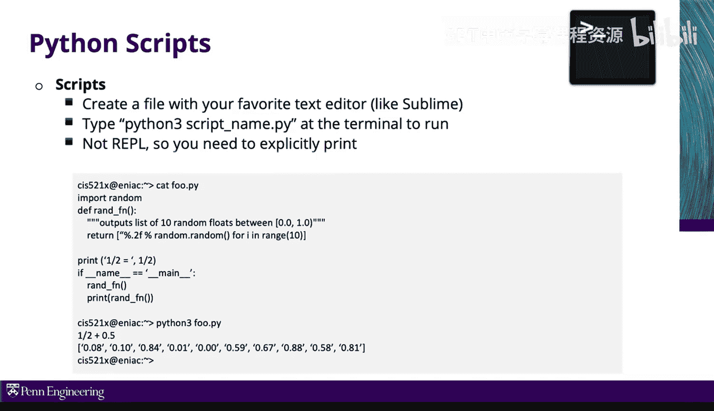
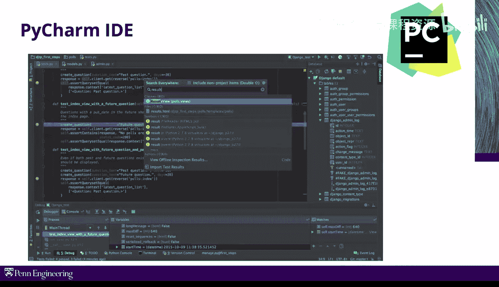
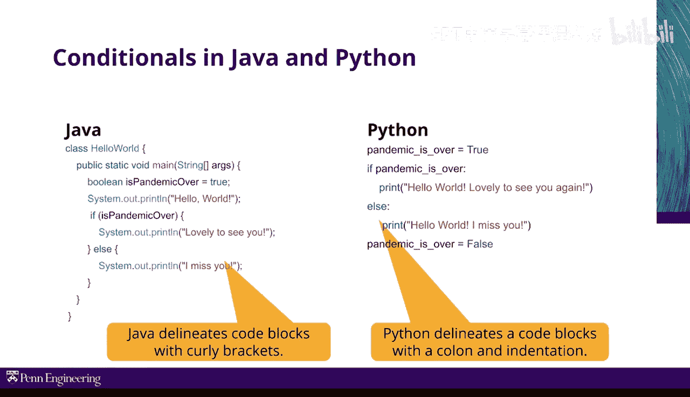

# 人工智能和机器学习基础：08：Python复习-概述 🐍

在本节课中，我们将对Python语言进行一个温和的介绍。我们将探讨Python的起源、可用的编程环境以及其核心语言要素。通过本教程，初学者能够理解Python的基本概念和优势。

## Python的历史与设计目标

上一节我们介绍了本模块的学习内容，本节中我们来看看Python语言的背景。

Python由吉多·范罗苏姆于1989年开始开发。其最初的灵感来源于荷兰国家数学与计算机科学研究所开发的一种名为ABC的语言。正如其名ABC所示，该语言旨在设计得非常简单，以便非程序员学习。许多具备计算机素养的科学家并非计算机科学家，他们可能从事物理、社会科学或语言学等其他学科。ABC语言背后的理念是剔除所有使编程语言入门困难的因素。

1999年，吉多向DARPA提交了一份名为“为所有人的计算机编程”的资金提案。在提案中，他阐述了Python的设计目标：
*   首先，它应该简单直观，并且与主要竞争语言一样强大。
*   其次，它应该是开源的，以便任何人都能为其开发做出贡献。
*   第三，它应该像普通英语一样易于理解。
*   第四，它应该适合日常任务，允许很短的开发时间。

Python的设计目标包括能够实现复杂程序的快速原型设计。Python在这方面取得了成功，部分原因在于其语法非常简洁、紧凑和直观，使得编写Python代码超级容易。还有其他原因使得在Python中进行原型设计很容易。与其他现代编程语言一样，Python具有自动垃圾回收功能，这意味着您不必像在C这样的旧语言中那样自己进行内存分配和释放。

Python的另一个优势是您几乎可以在任何平台上运行它而无需更改代码。Python内置了许多有用的类型，包括字典和集合等，这些对于构建更大、更复杂的算法（如我们将在人工智能中研究的算法）非常有用。随着时间的推移，Python还积累了大量的第三方库，这些库易于整合到您自己的代码中。许多这些外部包与数据科学、人工智能和机器学习相关。

吉多·范罗苏姆幽默地宣布自己为Python的“终身仁慈独裁者”。他建立了一种机制，允许其他人就应将哪些内容纳入Python语言的下一版本提出建议。这些建议被称为PEP，即Python增强提案。PEP 8是编写Python代码的官方风格指南。它讨论了如何一致地格式化代码，使其对所有使用Python语言的人来说看起来都很熟悉。它包括诸如应使用空格而非制表符进行缩进、变量名应使用下划线分隔单词而非驼峰式命名法等细节。遵循PEP 8风格指南将有助于您的代码保持一致的风格。代码被阅读的频率远高于被编写的频率，因此投入时间使您的代码对他人可读非常重要且值得。

## Python编程环境

上一节我们了解了Python的历史，本节中我们来看看可以使用的各种Python环境。

创建和运行Python代码有许多不同的方式。一种称为REPL环境。REPL代表读取、求值、打印循环。要开始使用REPL环境，您只需在计算机上打开终端应用程序，并在shell中键入`python`。REPL环境是测试语言不同元素的有用工具。

请注意，您应该知道Python有许多不同的版本。

您也可以编写自己的Python脚本，然后从命令行运行它们。您可以使用您喜欢的文本编辑器，将文件保存为`.py`文件。然后通过在终端中键入`python`后跟脚本名称来运行Python脚本。Python将运行您的脚本并打印出它生成的任何输出。

除了在您想要的任何文本编辑器中编写Python代码并在命令行上运行之外，您还可以使用IDE。



IDE代表集成开发环境。使用IDE的一个优势是它有许多功能可以帮助您进行调试。您可以设置断点并检查变量的内容，而不是简单地在代码中到处散布打印语句。如果您以前从未使用过集成开发环境，那么花时间安装一个并学习如何使用其调试器是值得的。我建议现在花时间在线做一些关于如何使用调试器的教程。调试器是软件工程师的一种强大工具。使用调试器将是一项有用的技能，无论是对于您当前的课程还是未来的职业生涯。



我个人最喜欢的与Python交互的方式是使用Python笔记，也称为Jupyter笔记本。它们允许您将代码块与文本块混合，并且您可以使用Markdown格式化语言格式化文本，这还允许您插入图像和数学公式。您可以在自己的计算机上安装Jupyter笔记本，也可以在线运行它们。


## Python的简洁性与语法特点

上一节我们介绍了不同的编程环境，本节中我们通过对比来感受Python的简洁性及其独特的语法。

让我们看两个简单的程序，一个用Java编写，一个用Python编写。您可以看到Python程序非常简单。要在Python中编写经典的“Hello World”程序，您只需键入：


```python
print("Hello world")
```

另一方面，在Java中，您必须创建一个类，用与该类相同的名称命名您的文件，创建一个main方法，并调用`System.out.println`。因此，您可以看到这个Java程序有许多元素对于第一次编程的人来说是难以接近的。

Python与您可能遇到的大多数其他语言不同的一个有趣之处在于，空白符是有意义的。这是什么意思？我的意思是，Python使用缩进来表示代码块，而不是像在Java中那样用花括号表示。让我们看看那是什么样子。在Java中，我们像在这个if语句中一样用花括号表示块。在Python中，要有一个if语句，您只需编写`if`、条件语句、冒号，然后后面缩进的所有内容将在该条件语句为真时执行。



## 核心数据类型预览

在接下来的课程中，我们将深入探讨Python的一些最重要的数据类型，例如序列（包括字符串、列表和元组），然后我们将讨论哈希表（在Python中称为字典）。


本节课中我们一起学习了Python的简要历史、其核心设计目标、多种可用的编程环境（如REPL、脚本、IDE和Jupyter笔记本），并通过与Java的简单对比，了解了Python语法简洁直观的特点，特别是其使用缩进定义代码块的独特方式。这些基础知识为我们后续深入学习Python用于人工智能和机器学习打下了坚实的基础。