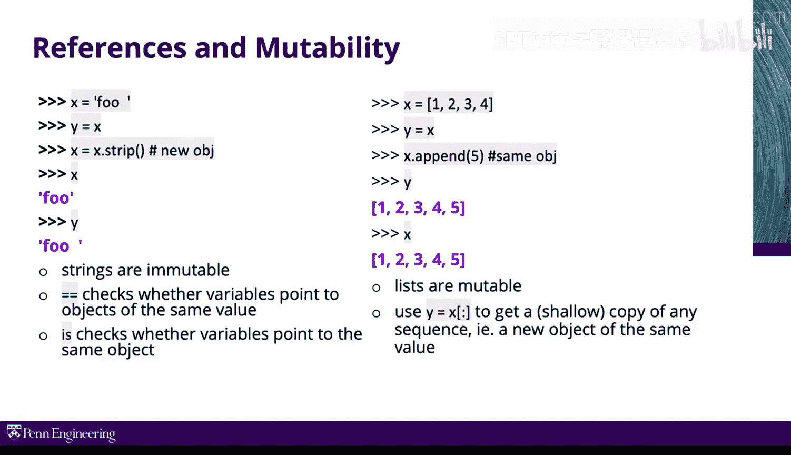
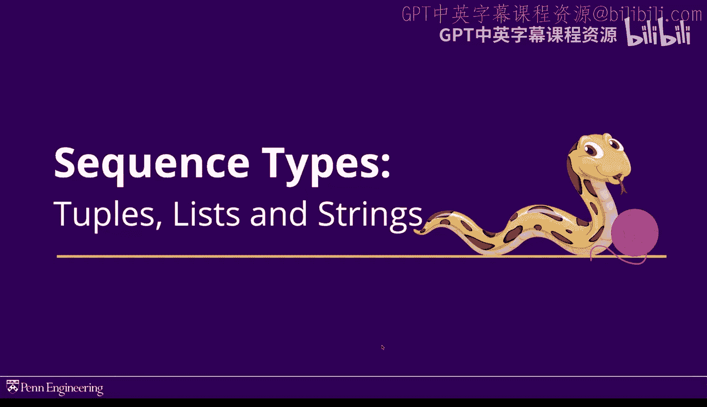
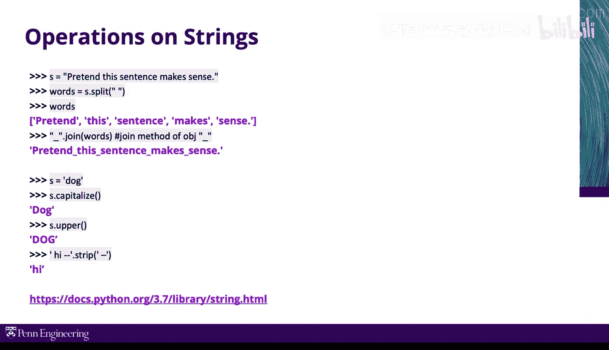
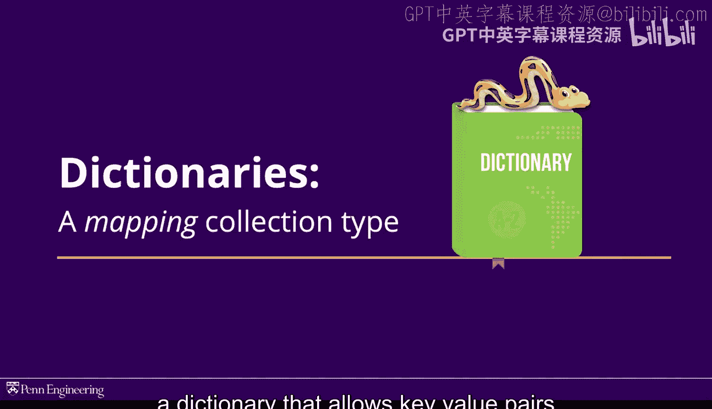
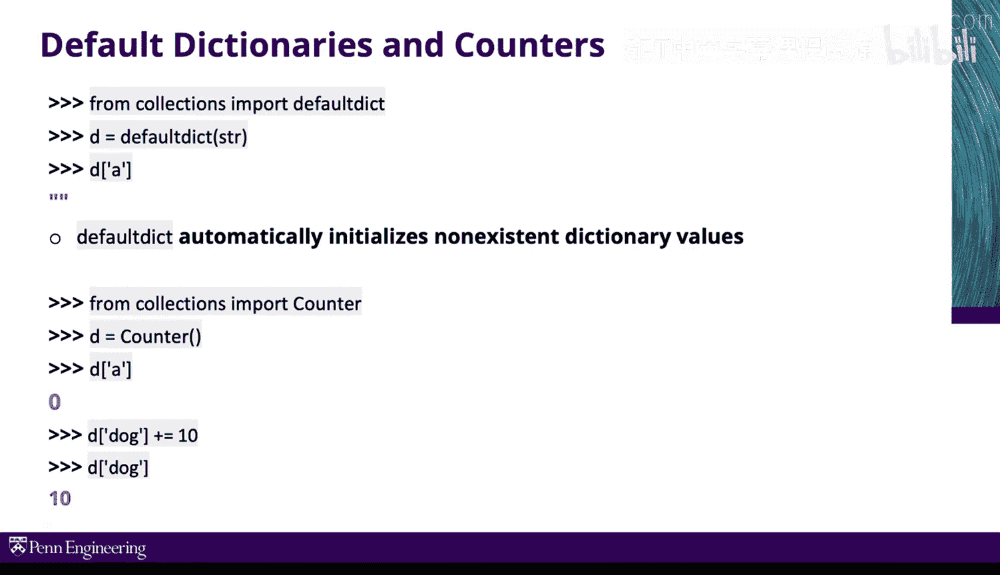

# 宾夕法尼亚大学《人工智能和机器学习基础（AI、数据科学、机器学习）AI and Machine Learning Essentials with Python》 p09 09_01_02_Python复习-对象与类型.zh_en -BV16f421Q72q_p9-

In Python， all data are treated as objects。An object is deleted by the garbage collection once it's unreachable。

Python is a strongly typed language， meaning that every object has a fixed type。

 and the interpreter won't allow things that are incompatible with that type to be combined。 So。

 for instance， I can't try combining a string with an integer。

 If you want to reveal the type of an object， you can use the function type。Alternativelynately。

 you can see if a particular object is of a particular type using the is instance method。

There are many standard built in types in Python integers， floating point numbers， strings。Tuples。

 dictionaries and lists， and then some specialized types， like generators。

 and even functions can be used as objects in Python。Although Python is strongly typed。

 one difference between Python and Java is that Python is dynamically typed whereas Java is statically typed。

In Java， when you declare variables， you also declare what type that variable will be。 So。

 for instance， if I want to create an integer X， I have to declare that x is an integer the first time I create it。

 Or similarly， if I want to say y as a string， when I declare the variable， Y。

 I must indicate that it is a string。In Python， on the other hand。

 I don't have to have that static type。 I can create a variable X。

 And when it comes into existence by being assigned a string fo。

It will be dynamically typed as a string。I can then reassign the variable x to be of a different type。

 so I can change the type of x from a string to an integer just by simply having a statement later in my code that says x equals 2。

The type will be automatically determined and updated each time I change the variable assignment。

 Another difference between Python and Java is the fact that in Java。Methods have a type signature。

 B Java， when I define a method， I'll say what its return type is or say explicitly that it has no return type using the void keyword。

When I define a method， I'll also define the types of each of the arguments to the method。In Python。

 that's not necessary。 Functions do not have type signatures。

 They don't tell you what their return type is， and they don't tell you what the type of each of their arguments are。

This makes it easier to define functions in Python。

But it has the drawback that type errors are only caught at run time。

 So if I pass in a variable of an incorrect type， it won't be caught a compiled time。

 It'll only be caught when I'm running my code。 Here are some example of math basics in Python。

Python supports all sorts of mathped literals， like integers， floats and Booleans。

 You can declare them in a variety of different ways。 For instance。

 you can declare a floating point number corresponding to 2 billion， using the notation 2 E 9。

 Python supports all sorts of mathematical operators like arithmetic， the power operator。

 which is denoted with a star star。😊，The moddo operator。With the percent sign。

 we' give you a remainder。Mathematical comparison operators like less than are equal to greater than or equal equal to or not equal to are written out in the way that you would expect。

Logical operators like and or and not are written out as opposed to written in symbols。

 like you may have seen in other languages。You can increment the count of your mathematical variables using the plus equals operator。

 so for instance， you could say x plus equals 1， however。

 Python does not support unitary operators like plus plus or minus minus。

String creation in Python is straightforward。 You can declare a string。

 either with a single quote or a double quote It has a special syntax for strings that are multi line or for strings that are used as documentation strings by using a triple quote。

Stringings can be concatenated together using the plus operator。

 which is overloaded to be used both with numbers and with strings。

As with other programming languages， some special characters are prefixed with the back slash character。

So， for instance， backslash n represents a new line。

 If you need a string that contains the sequence back slash n。

Instead of having to escape that special character back slash by adding another back slash。

 you can instead add an R in front of your string declaration。

Which means that the string is a raw string， and you won't have to escape special characters。

Python also supports special string formatting with a use of the percent sign。 So， for instance。

 I can declare a string that has several placeholders like the percent S representing a placeholder for a string and the percent D representing the placeholder for an integer。

 I can then pass in a list of arguments that I'd like to have the string formatted with using the percent operator strings themselves are immutable。

 meaning when you create them， they're created only once。When you modify them， for instance。

 by concatenating them together， that creates an entirely new string and doesn't update the string in memory。

Streams being immutable has implications for how you check whether two strings are equal。

There are two different ways of checking for equality in Python。

 double equals will compare the two strings and check whether their values are the same。

The operator is checks whether two variables point to the same object in memory。

So if I create a string X as F with a trailing space。 and then I set y to be equal to X。

 both the double equals and the is operator will return true that those two strings are equal because their value is the same。

 and they point to the same string in memory。If I then use the strip operator on the string X。

 that will create an entirely new object。 So the double equals operator will return true。

 but the is operator will return false。Lists are mutable。

 If I create a list X containing the integers 1，2，3，4。

 and I set the variable Y equal to the variable X， then they both point to the same place in memory。

If I append something to the end of my list X， instead of creating a new object like a string operator would do。

 the append operator just updates the same object。Therefore。

 if I look at the contents of the variable Y I see that it has been updated too。

If I need to create a copy of a list， we'll use the slice operator， which we'll look at shortly。

 I can make a copy of X。 that'll create an entirely new object containing the same values as X。

Python has three built in sequence types， tuples， lists， and strings。

These three types share the same syntax for accessing elements within them。

 They differ based on whether they are mutable or immutable and by specializing for sequences of particular types。

A tuple is a simple， immutable ordered sequence of items。

 The fact that it's immutable means that the tuple cannot be modified after it's created。

Items in a tuple can be of mixed types， so you can mix integers and strings。

 or even collection types， similarly to a tuple， a string is an immutable object。However。

 strings cannot be of mixed type。 Theyre a sequence of characters。In Python。

 regular strings are sequences of Uniicode characters。In older versions of Python。

 strings were8 bit characters， meaning you could only represent ASi characters。 Ls。

 unlike tus and strings， are mutable ordered sequences of items like tus， they can be of mixed types。

These three different sequence types share a lot of the same syntax and functionality。

The way that you declare them is slightly different to declare a tuple。

 you use an open parnne and a closed parnne to declare a list。

 you use an open square bracket and a closed square bracket。To declare a string。

 you use a quotation mark。 Once you've created a sequence variable。

 you can access items within it using this open square bracket， closed square bracket notation。

 For instance， if I want to access the second thing and just say open square bracket 1 closed square bracket because Python sequences are indexed starting at 0。

 Python also lets you access elements in a sequence from the right hand side of the list。

You do this using the open square bracket notation。

 instead of giving it a positive number or the number 0。

 you start with -1 to get the last element in a list。

 Python extends the open square bracket notation for accessing elements in a sequence to also allow you to access a sub sequence。

You can specify a range using the notation open square bracket。Index。

 colon end index closed square bracket。 The end index is exclusive。

 meaning it doesn't select that element。This notation is called slicing。

 and it returns a copy of the sub sequence。The notation for slicing is quite flexible。 For instance。

 it allows you to use the negative indexing to count from the right hand side of the sequence。

It also lets you leave implicit。 either the first of the two numbers or the second of the two numbers。

 If you leave out the first number， it'll start from the beginning of the sequence。

 If you leave out the last number， it'll go to the very end of the sequence。

The slicing operator even lets you select every in item by adding a third argument。Next。

 let's take a look at the operations you can do on lists。

Listists are the only mutable of the three sequence types that are built into Python。

You can append items to the end of a list using the append operator。

 You can insert elements at a particular index using the insert operator。

 You can also look up the first occurrence of an element using the index operator。

 If that element isn't found anywhere in the list， it'll return a -1。

You can count the number of occurrences of an element using the count operator。

Or delete an element using the remove operator。 Python lists also allow sorting and reversing lists。

The sort operator will sort the list in place， meaning it won't create a new copy of the list。

If you do want a copy of a list， you can use the sorted function。

 That will return a copy of a sorted list。 You can also pass in some function to the sort operator to sort lists in place using your own defined comparison method。

Streams have a special set of operators。You can split a string into words using the split operator。

 which takes as an argument， a character that you'd like to split on。

 This will return a list of string tokens that were separated by that character。

You can do the converse of the split operator using the join operator。

Passing in a list of tokens to join together。Strings also support a variety of operators for capitalizing strings and removing trailing and leading white space。

 In addition to its sequence types， Python provides a built in map called a dictionary that allows key value pairs to be easily stored and manipulated。

Unlike the sequence types that we looked at， dictionaries are unordered。

They provide a constant average time look up to associate a key with a value。

The mechanism through which they achieve this constant time look up is via hash tables。 As a result。

 the keys have to be immutable。You can initialize a Python dictionary with an open squiggly bracket and a closed squiggly bracket。

The key value pairs are specified as two items with a colon in between them。

 and multiple key value pairs are separated with commas。

In order to look up a value associated with a key， you simply use the square bracket notation that we use for finding things by index in the sequence types。

 For instance， if I have this dictionary D here， I can look up the value associated with a key user by saying D open square bracket user close square bracket。

You can only query Python dictionaries by keys and not by values。

 if you attempt to query a value here like R2 D2， then you'll get a key error because R2 D2 is a value and not a key。

The syntax for associating a value with a key。Or for overriding a value of an existing key is the same。

We say dictionary， open square bracket。The key close square bracket equals the value。

 and that will then update the key value pair in the dictionary。

 There are several useful methods that are associated with dictionaries。

You can call the method keys on dictionary to get a list of the current keys for the dictionary。

 Similarlyly， you can call the method values， which will give you a list of the current values。

You can also get a list of all the items in the dictionary with the items method。

 This returns a list of tus where the first element is the key。

 and the second element is the associatedsociative value。

The built in Python's collection package also has a number of specialized dictionaries。

 One is called a default dictionary， which will automatically initialize non existent dictionary values。

So if you search for a key that does not yet exist in your dictionary。

 the default dictionary for strings will return the empty string。

You could also create a default dictionary for integers。

Similar to the default dictionary for Integers is a class called counter。

 a counter will create a default dictionary for keys where you're counting the values for those keys。

So if I look up a key that's not currently in my counter， it'll return the value 0。

 I can increment the values in my counter dictionary， and those get updated appropriately。

