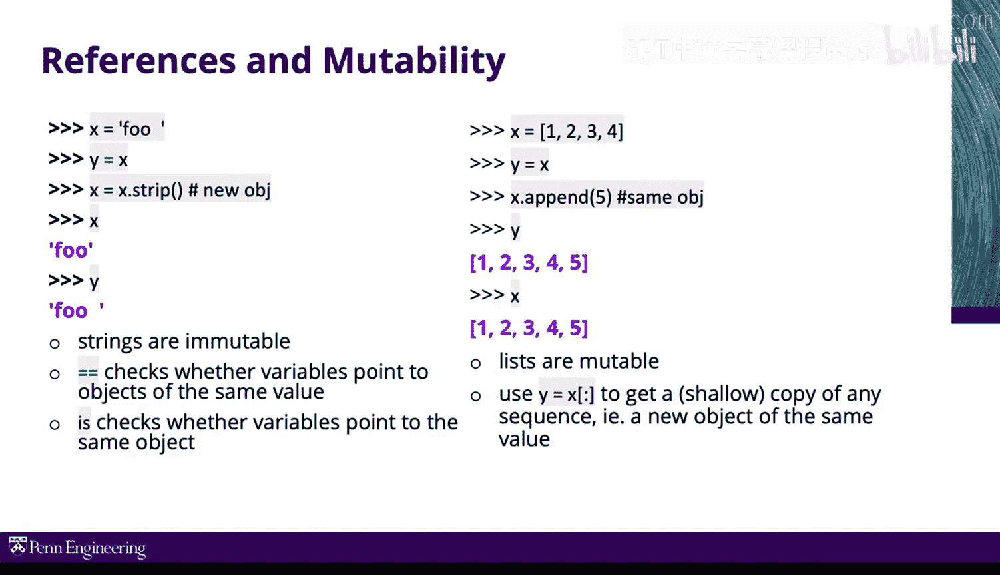
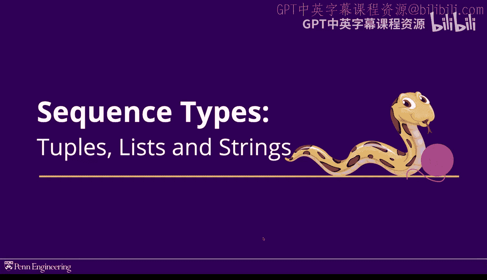
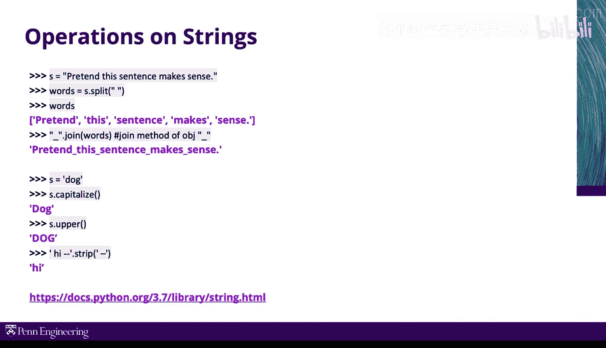
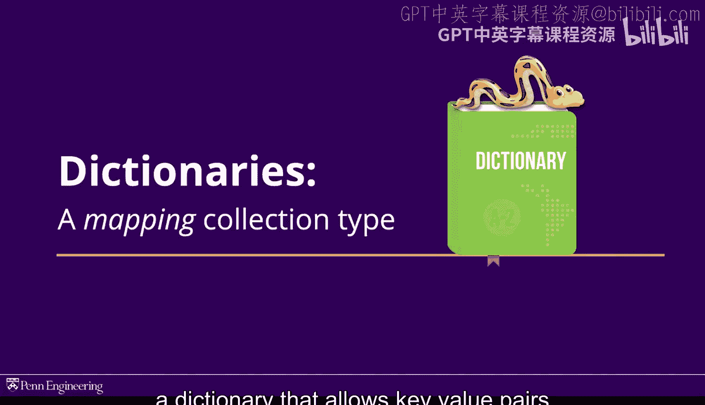
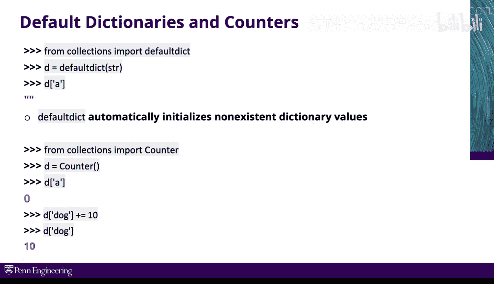

# 人工智能和机器学习基础：09：Python复习-对象与类型 🐍

在本节课中，我们将要学习Python编程语言中关于对象与类型的核心概念。理解这些概念是掌握Python进行数据科学和机器学习工作的基础。我们将从对象的基本定义开始，逐步探讨类型系统、动态类型特性，以及Python中几种重要的内置数据类型，如数字、字符串、列表、元组和字典。

## 对象与类型基础

在Python中，所有数据都被视为**对象**。当一个对象变得不可访问时，它会被垃圾回收机制删除。

Python是一种**强类型**语言，这意味着每个对象都有一个固定的类型，解释器不允许将与该类型不兼容的事物组合在一起。例如，不能尝试将字符串与整数组合。

如果你想查看对象的类型，可以使用 `type()` 函数。或者，你可以使用 `isinstance()` 方法来检查特定对象是否属于特定类型。

```python
x = 10
print(type(x))  # 输出: <class 'int'>
print(isinstance(x, int))  # 输出: True
```

## 动态类型与静态类型

虽然Python是强类型的，但它与Java的一个区别在于：Python是**动态类型**的，而Java是**静态类型**的。

在Java中，声明变量时也必须声明该变量的类型。例如，要创建一个整数 `x`，必须在首次创建时声明 `x` 是整数。同样，如果要声明字符串 `y`，必须指明它是字符串。

在Python中，则不需要这种静态类型声明。我可以创建一个变量 `x`，当它通过被赋值为字符串 `"foo"` 而存在时，它会被动态地确定为字符串类型。随后，我可以通过在代码中稍后写一条 `x = 2` 的语句，将变量 `x` 重新赋值为不同的类型（从字符串变为整数）。每次更改变量赋值时，类型都会自动确定和更新。

Python与Java的另一个区别是，在Java中，方法具有**类型签名**。定义方法时，会说明其返回类型，或使用 `void` 关键字明确表示没有返回类型。同时，也会定义方法每个参数的类型。

在Python中，这不是必需的。函数没有类型签名，它们不会告诉你返回类型是什么，也不会告诉你每个参数的类型是什么。这使得在Python中定义函数更容易，但缺点是类型错误只在运行时才会被捕获。因此，如果传入一个类型不正确的变量，它不会在编译时被捕获，只会在运行代码时被捕获。

## 数学基础

Python支持各种数学字面量，如整数、浮点数和布尔值。你可以用多种不同的方式声明它们。例如，可以使用 `2e9` 这样的表示法来声明对应20亿的浮点数。

Python支持各种数学运算符，如算术运算符、幂运算符（用 `**` 表示）、取模运算符（用 `%` 表示，会给出余数）。数学比较运算符如小于、等于、大于或等于、不等于的写法符合预期。逻辑运算符如 `and`、`or` 和 `not` 是写出来的，而不是像在其他语言中可能看到的用符号表示。

你可以使用 `+=` 运算符来递增数学变量的计数，例如，可以说 `x += 1`。然而，Python不支持 `++` 或 `--` 这样的单元运算符。

## 字符串操作

在Python中创建字符串很简单。你可以使用单引号或双引号来声明字符串。对于多行字符串或用作文档字符串的字符串，可以使用三引号这种特殊语法。

字符串可以使用 `+` 运算符连接在一起，该运算符被重载以同时用于数字和字符串。

与其他编程语言一样，一些特殊字符以反斜杠字符为前缀。例如，`\n` 表示换行。如果你需要一个包含序列 `\n` 的字符串，而不是通过添加另一个反斜杠来转义该特殊字符，你可以在字符串声明前添加一个 `r`，这意味着该字符串是原始字符串，你不需要转义特殊字符。

Python还支持使用百分号进行特殊的字符串格式化。例如，可以声明一个包含多个占位符的字符串，如 `%s` 代表字符串的占位符，`%d` 代表整数的占位符。然后，可以使用 `%` 运算符传入一个参数列表，以便格式化字符串。

字符串本身是**不可变**的，这意味着当你创建它们时，它们只被创建一次。当你修改它们时，例如通过将它们连接在一起，会创建一个全新的字符串，而不会更新内存中的原字符串。

字符串的不可变性对你检查两个字符串是否相等的方式有影响。在Python中有两种不同的检查相等性的方法：`==` 会比较两个字符串并检查它们的值是否相同；`is` 运算符检查两个变量是否指向内存中的同一个对象。

例如，如果我创建一个末尾带空格的字符串 `x = "f "`，然后设置 `y = x`，那么 `==` 和 `is` 运算符都会返回 `True`，因为它们的值相同，并且指向内存中的同一个字符串。如果我随后对字符串 `x` 使用 `strip()` 操作符，那将创建一个全新的对象。因此，`==` 运算符会返回 `True`，但 `is` 运算符会返回 `False`。

## 列表与可变性



列表是**可变**的。如果我创建一个包含整数 `[1, 2, 3, 4]` 的列表 `x`，并将变量 `y` 设置为等于变量 `x`，那么它们都指向内存中的同一个位置。如果我向列表 `x` 的末尾追加一些内容，`append()` 操作符只会更新同一个对象，而不是像字符串操作符那样创建一个新对象。因此，如果我查看变量 `y` 的内容，会发现它也被更新了。



如果我需要创建列表的副本，可以使用切片操作符（我们稍后会看到），我可以复制 `x`，这将创建一个包含与 `x` 相同值的全新对象。

## Python内置序列类型

Python有三种内置的序列类型：**元组**、**列表**和**字符串**。这三种类型共享相同的语法来访问其中的元素。它们的不同之处在于是否可变，以及是否为特定类型的序列进行了专门化。

*   **元组**：是一个简单、**不可变**的有序项目序列。不可变意味着元组在创建后不能被修改。元组中的项目可以是混合类型，因此可以混合整数和字符串，甚至集合类型。
*   **字符串**：与元组类似，字符串是**不可变**对象。然而，字符串不能是混合类型，它们是字符序列。在Python中，常规字符串是Unicode字符序列。在旧版本的Python中，字符串是8位字符，意味着只能表示ASCII字符。
*   **列表**：与元组和字符串不同，列表是**可变**的有序项目序列。像元组一样，它们可以是混合类型。

声明它们的方式略有不同：声明元组使用圆括号 `()`；声明列表使用方括号 `[]`；声明字符串使用引号 `""` 或 `''`。

创建序列变量后，可以使用 `[ ]` 表示法访问其中的项目。例如，如果想访问第二个元素，可以说 `[1]`，因为Python序列的索引从0开始。Python还允许你从列表的右侧访问序列中的元素，使用 `[-1]` 来获取列表中的最后一个元素。

Python扩展了用于访问序列中元素的 `[ ]` 表示法，也允许你访问子序列。你可以使用 `[起始索引:结束索引]` 表示法指定一个范围。结束索引是排他的，意味着不选择该元素。这种表示法称为**切片**，它返回子序列的副本。

切片表示法非常灵活。例如，它允许你使用负索引从序列的右侧开始计数。它还允许你隐式省略两个数字中的第一个或第二个。如果省略第一个数字，它将从序列的开头开始。如果省略最后一个数字，它将一直到序列的末尾。切片操作符甚至允许你通过添加第三个参数来选择每隔n个项目。

## 列表操作

列表是Python内置的三种序列类型中唯一可变的。以下是你可以对列表执行的一些操作：

*   **追加元素**：使用 `append()` 方法将项目添加到列表末尾。
*   **插入元素**：使用 `insert()` 方法在特定索引处插入元素。
*   **查找索引**：使用 `index()` 方法查找元素的首次出现位置。如果该元素在列表中任何地方都找不到，它将返回 `-1`。
*   **计数**：使用 `count()` 方法计算元素出现的次数。
*   **删除元素**：使用 `remove()` 方法删除元素。
*   **排序与反转**：Python列表也允许对列表进行排序和反转。`sort()` 方法会**原地**排序列表，意味着它不会创建列表的新副本。如果你确实想要一个列表的副本，可以使用 `sorted()` 函数，它将返回一个排序后列表的副本。你也可以向 `sort()` 方法传入某个函数，以使用你自己定义的比较方法对列表进行原地排序。

## 字符串操作

字符串有一组特殊的操作符：

*   **分割**：使用 `split()` 操作符将字符串分割成单词，它接受一个参数，即你想要分割的字符。这将返回一个由该字符分隔的字符串标记列表。
*   **连接**：使用 `join()` 操作符执行与分割相反的操作，传入一个要连接在一起的标记列表。
*   **其他操作**：字符串还支持各种操作符，用于将字符串大写、删除尾随和前导空格等。

## 字典：键值对映射

除了序列类型，Python还提供了一个称为**字典**的内置映射，允许轻松存储和操作键值对。





与我们看过的序列类型不同，字典是**无序**的。它们提供恒定的平均时间查找，以将键与值关联起来。它们通过哈希表实现这种恒定时间查找。因此，键必须是不可变的。

你可以使用花括号 `{}` 初始化一个Python字典。键值对被指定为两个项目，中间用冒号分隔，多个键值对之间用逗号分隔。

为了查找与键关联的值，只需使用我们在序列类型中用于按索引查找的方括号表示法。例如，如果我有这个字典 `d`，我可以通过 `d["user"]` 来查找与键 `"user"` 关联的值。

你只能通过键查询Python字典，而不能通过值查询。如果你尝试在这里查询一个值，比如 `"R2D2"`，那么你会得到一个 `KeyError`，因为 `"R2D2"` 是一个值，而不是一个键。

将值与键关联或覆盖现有键的值的语法是相同的。我们说 `字典[键] = 值`，这将更新字典中的键值对。

字典有几个有用的方法：

*   `keys()`：调用字典的 `keys()` 方法可以获取字典当前键的列表。
*   `values()`：类似地，调用 `values()` 方法会给你当前值的列表。
*   `items()`：你还可以使用 `items()` 方法获取字典中所有项目的列表。它返回一个元组列表，其中第一个元素是键，第二个元素是关联的值。

Python内置的 `collections` 包也有一些专门的字典：

*   **默认字典**：称为 `defaultdict`，它会自动初始化不存在的字典值。因此，如果你搜索字典中尚不存在的键，字符串的默认字典将返回空字符串。你也可以为整数创建默认字典。
*   **计数器**：与整数的默认字典类似的是一个名为 `Counter` 的类。计数器将为键创建一个默认字典，用于计算这些键的值。因此，如果我查找当前不在我的计数器中的键，它将返回值 `0`。我可以递增计数器字典中的值，这些值会得到适当的更新。

---



本节课中我们一起学习了Python中对象与类型的核心概念。我们了解了Python的强类型和动态类型特性，探讨了数字、字符串、列表、元组和字典这几种基本数据类型的特性与操作。理解对象的可变性与不可变性、序列的索引与切片、以及字典的键值对映射机制，是编写高效、正确Python代码的关键。这些基础知识将为后续学习更复杂的数据结构和算法打下坚实的基础。