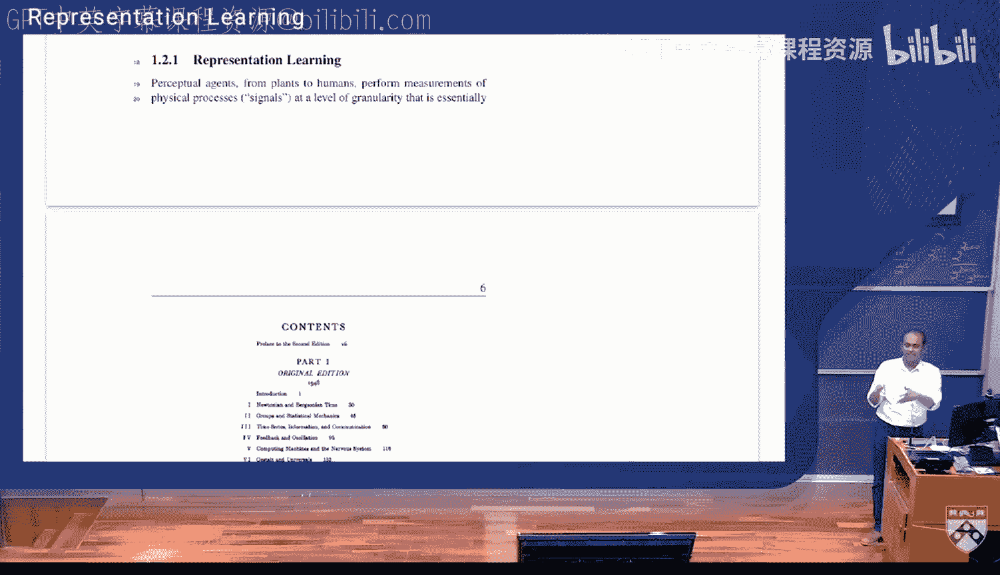
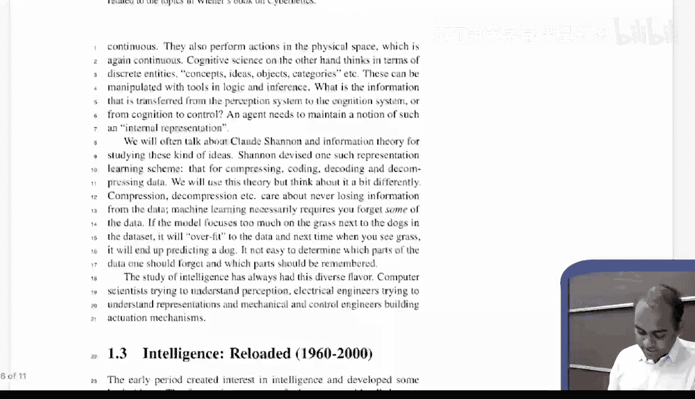
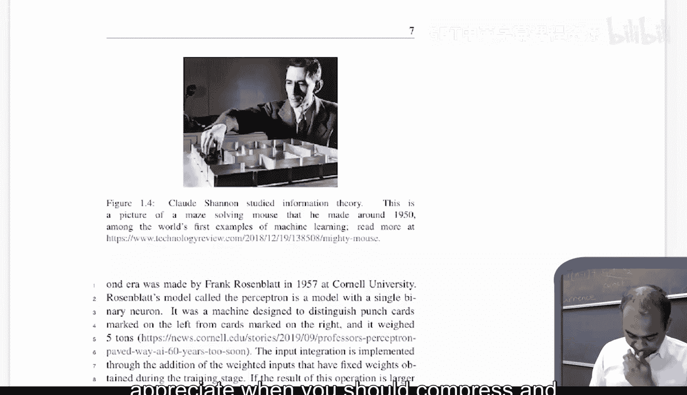

# 宾夕法尼亚大学《人工智能和机器学习基础（AI、数据科学、机器学习）AI and Machine Learning Essentials with Python》 p100 07_01_02_表示学习.zh_en -BV16f421Q72q_p100-

The next thing that I want to introduce to you is something called representation learning representationation learning is just a word given to the notion of you using stimuli from sensors and then creating comp representations out of it objects that have meaning so I look at the bunch of pixels or a bunch of photons that are reflected from the chair in front of me and I think of it as a chair I can appreciate that one of you is wearing a checkered shirt by watching how different pixels next to each other are these are discrete representations that I have created for signals that are necessarily continuous the world evolves in a continuous way to reason about it to do something with it we collapse it into a discrete representation There is objects everything that doesn't change too much in time is an object。

Everything that and to further make the description of objects simpler。

 we have given them names there's a red color and a blue color and a green color， etc。

So representation learning is the question of when should you stop？

I have a continuous a huge gamut of a continuous signal。

 I could be compressing it in essentially nothing so I could say that everything in this room is an object but of course that doesn't help me talk to people that doesn't help me move around too much or I could say that everything is a bunch of molecules that is the other end of the spectrum where I again don't find it very useful to this description is not very useful for me to interact with the world and depending on the kind of things you do you will choose a certain granularity if you're talking to a friend and then telling them about rock music versus I don't know classical music you would if the person is new you would say it in a different way but if you have audiophie friend。

 you would explain the exact same song to them in a very。

 very different language with much more nuances and very different vocabulary so。

Depending on the kind of tasks that machines should be doing。

 the language that we use to compress into the continuous signal is different。

Sometimes you want to compress a lot more that means that you want to use very few symbols。

 sometimes you want to compress a lot less that means you want to use a lot of symbols for the exact same thing and that is what representation learning means and Claude Shannon is this person in the picture he started this field called information theory in the late 40s to understand such things so we'll be looking at some concept from information theory to appreciate when you should compress and when you should not compress。

其。

This is roughly the first few years of intelligence。

 where there was a lot of talk and not much action， roughly speaking。

 Everyone was thinking very deeply， but no one was doing much。

