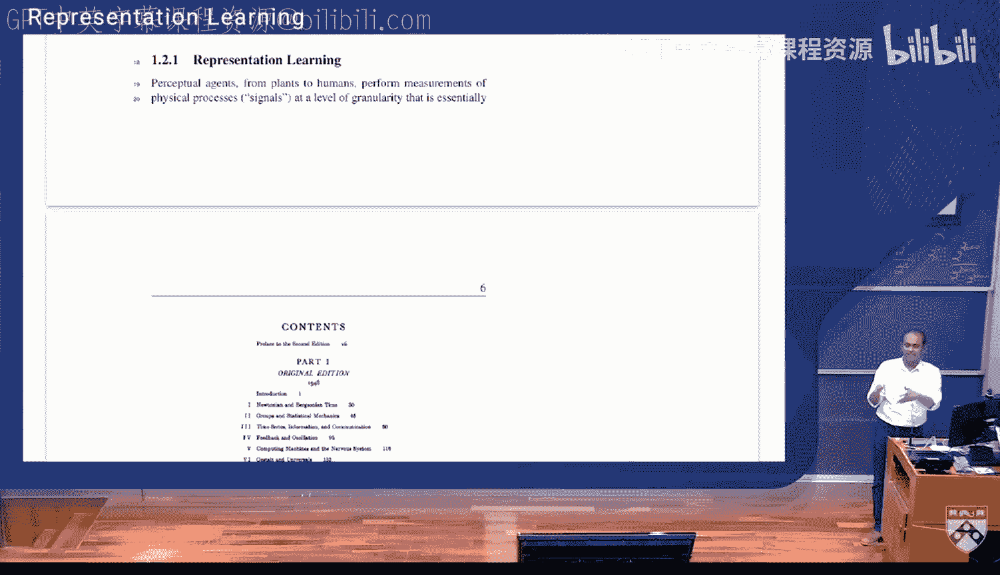
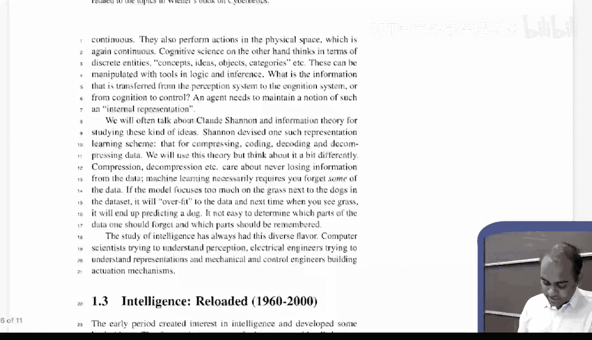
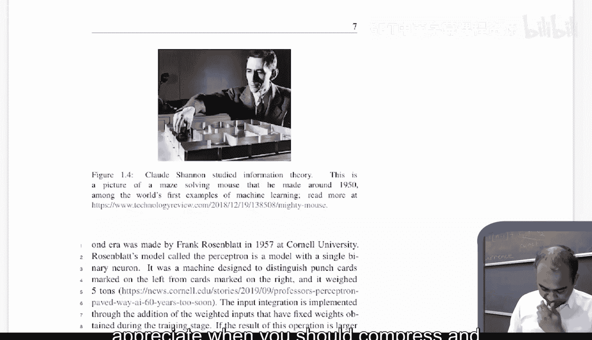

# 人工智能和机器学习基础：07_01_02：表示学习 🧠

在本节课中，我们将要学习一个核心概念——**表示学习**。我们将探讨机器如何从连续的感官信号中提取有意义的、离散的表示，以及如何根据任务需求选择合适的表示粒度。

---

## 什么是表示学习？ 🤔

上一节我们讨论了机器学习的基本流程，本节中我们来看看**表示学习**。表示学习指的是这样一个过程：我们利用来自传感器的刺激信号，并从中创建出有意义的、压缩后的表示。

例如，我观察从面前椅子反射过来的一堆像素或光子，并将其识别为“一把椅子”。我能辨认出你们中有人穿着格子衬衫，是通过观察相邻像素的不同模式实现的。这些都是我从本质上连续的信号中创造出的**离散表示**。

世界以连续的方式演变。为了理解它、处理它，我们将其**压缩**成离散的表示。我们将那些随时间变化不大的事物视为**对象**。

为了进一步简化对对象的描述，我们给它们赋予了名称，例如红色、蓝色、绿色等。

---

## 表示学习的核心问题：压缩的粒度 ⚖️

那么，表示学习的核心问题是：**你应该在何时停止压缩？**

我拥有一个连续的、范围巨大的连续信号。我可以将其压缩到几乎没有信息量。例如，我可以说这个房间里的一切都是一个“对象”，但这无助于我与他人交流或四处活动。我也可以说一切都是“一堆分子”，这是另一个极端，这种描述对于我与世界互动同样没有太大用处。

根据你所做的事情类型，你会选择特定的**粒度**。这就像向朋友介绍摇滚乐和古典乐：如果对方是新手，你会用一种方式解释；如果你面对的是发烧友，你会用更细腻、词汇完全不同的语言来描述同一首歌。

因此，根据机器需要执行的任务类型，我们用来压缩连续信号的“语言”是不同的。

*   **高压缩**：意味着你想用**很少的符号**。
*   **低压缩**：意味着你想用**很多符号**来描述同一事物。

这就是表示学习的含义。

---

## 信息论的基础 📊

为了理解何时应该压缩、何时不应该压缩，我们需要借助一个领域的知识。图中这位人物——克劳德·香农，在40年代末开创了**信息论**这一领域，专门研究此类问题。

在接下来的课程中，我们将学习信息论中的一些概念，以更好地把握表示的尺度。

---

## 早期人工智能的发展 🌱

其发展历程大致如下图所示：

这大致是人工智能发展的最初几年，特点是**谈论很多，实际行动较少**。粗略地说，每个人都在进行深度思考，但并没有太多具体的实践成果。

---

## 总结 📝

本节课中我们一起学习了**表示学习**的核心思想。我们了解到，机器通过将连续的感官数据压缩成离散的、有意义的表示（即“对象”）来理解世界。关键在于，根据不同的任务目标，我们需要选择不同**粒度**的表示——有时需要高度压缩（使用少量符号），有时则需要保留更多细节（使用大量符号）。克劳德·香农的**信息论**为我们提供了衡量和选择合适表示的理论工具。最后，我们回顾了人工智能早期“重思考、轻实践”的发展阶段，为后续更具体的技术学习做好了铺垫。