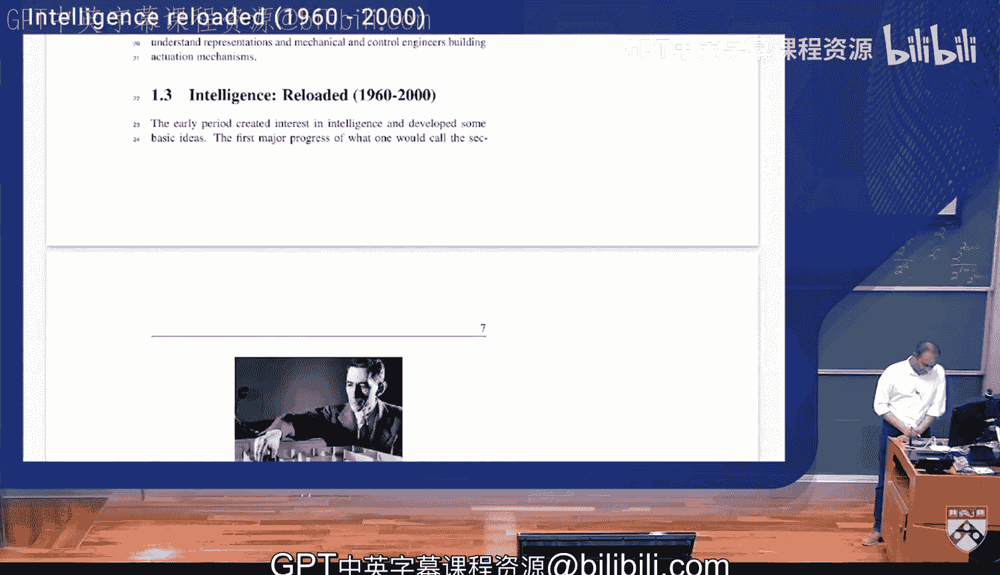
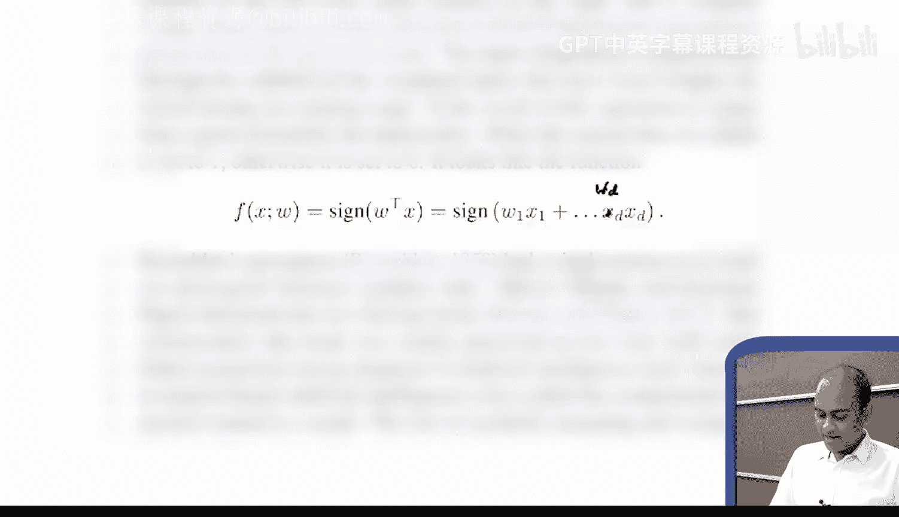
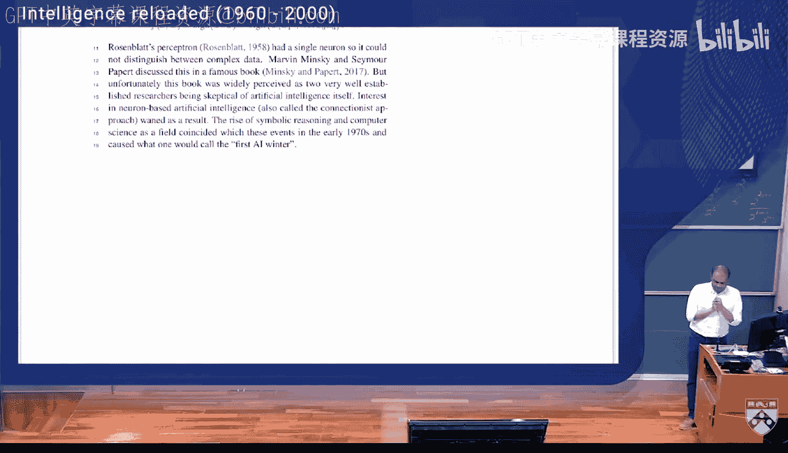
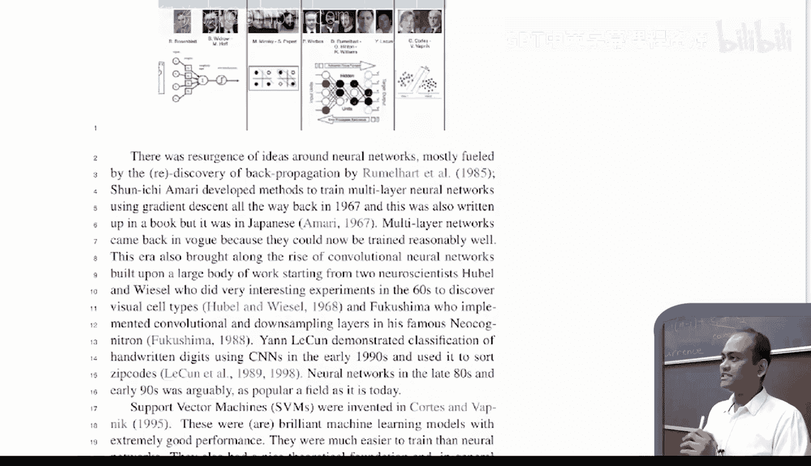

# 宾夕法尼亚大学《人工智能和机器学习基础（AI、数据科学、机器学习）AI and Machine Learning Essentials with Python》 p101 08_01_03_智能重载-1960-2000.zh_en -BV16f421Q72q_p101-

Around late 60s or mid 60s moreized I guess people started to build things so this is a picture of the first neuro network ever built this person here is named Frank Rosenblt he is a researcher in Cornell University and the Navy research center in Ithaca and this machine is exactly the same neuron that you saw in MacClo and pitchs neuron it takes in a bunch of inputs and it returns it outputs one Booleion0 or1 it is called a perceptron and this thing weighed five tons。

So this was the first neural network， the simplest possible neural network， one neuron。

 and that was the first time anyone ever engineered an artificial neural network。In mathematics。

 this is how we would write it in the remainder of the course， of course。

 think of x1 x2 till xt as the pixels in your image and w。

Imagine that you have a image of an orange and this would be the number of pixels in the image typicalical images are quite large so if you look at your phone it takes an image of anywhere from 10 meapixels to 50 megapixels that is 10 million to 50 million numbers images are rather large and you multiply each of them with a different number W1 W2 all the way till Wd is some some vector that you choose that lets you decide whether this image is an orange or an apple how do you decide this well you apply a sine function to it if the thing inside the signine function is positive。

 it returns a plus1 if the stuff is negative it returns a minus1 and so you will annotate that and say if the output of this thing is positive then I will call it an orange if it is negative it call it an apple and you will choose the values of w1 to wt to make sure that。

All the images in some training dataset that you have collected are classified correctly。

 oranges are called oranges， apples are called apples by this machine once you found these values of w then you could run this same thing on a slightly new image which was not a part of your training set and you would be able to guess whether it was an apple or an orange。

I will repeat this in the next lecture a little more precisely。

 but in a nutshell this is machine learning using patterns in the training data to guess values of your weights。

 W1 to WT and then using those weights to make inferences of new images that are not a part of your training data。

It's a matter of history and a tragedy at that that these kinds of ideas these are called connectionist ideas in learning where people were beginning from a little more groundup level where you have neurons neurons come together they create representations that create outputs in the late 60s there's a very famous researcher called Marvin Minsky in MIT he and Seymour puppet he wrote a book where they said these kinds of functions can only solve simple problems in the sense that if you have a bunch of points that are labeled plus one in a bunch of points that are labeled minus one then you can only split them using a linear function this is exactly what a perceptioncept run does and we'll see it in a bit in the next lecture it cannot solve problems where there are a bunch of。

Pluses here there is a bunch of minuses here and there is a bunch of pluses here and the bunch of minuses here。

 There is no straight line that splits the pluses and the minuses cleanly。In such a case。

And this is clearly a problem that such models cannot solve and so Martin she said。

 oh look so the perceptron can solve some problems cannot solve some other problems but everyone else understood it as hyms on the perceptron and he was a very famous guy at that time so everyone said thought oh no perceptrons aren't any good and basically people began to stopped working on connectionist approaches and at the same time some other things were getting popular like planning or logic etcter or very popular in the early 70s and that is why this kind of learning。

 lost steam。嗯。It became popular again roughly in the late 80s when people discovered that inside your retina or in the early parts of your visual processing there is something called convolutions you are creating features that are edgelike or colors like and they began to imbibe artificial neural networks using these features it was also led this entire second phase of learning was led by P discovery of something called back propagation which is what we will see again in a few lectures it is an algorithm to train the weights W1 to WD remember I said we have to find the ways that correctly classify apples and oranges back propagation is an algorithm that allows us to find these weights。

That algorithm although it was built a long time ago in the 60s itself by this professor called Sunnihiri。

 we will also look at some of his work a few lectures from now it was written in a paper in Japanese and basically unknown in the rest of the world and so in mid 80s Hinton。

 Jeff Hinton and Ruelhart rediscover this algorithm and that is really when everyone began to appreciated this work that backrop was thought to be a very nice way to train artificial neural networks combinations of neurons that we have seen we've seen one neuron you can put many of them together backpro can and find the weights for each of these neurons。

Yeah and around that time people notice that look inside the brain。

 there is different parts of the brain， some of them are in charge of audition。

 some of theyre in charge of visual processing inside the visual processing part there is different subparts the V1 cortex which identifies edges and colors the V2 cortex which combines these features into combinations of edges and combinations of colors all the way until the V4 or the main cortex which identifies faces and people and language etc so this progress in neuroscience basically led people to believe that you could build similar things in architectures in artificial architectures and that is the worth of convolutional neural networks so con neural networks are nice neural networks are near nice combinations of neurons of specific kind of neurons that are particularly well suited to handling images。

And so Ian Lacoon is a professor in NYU and he is also the head of Facebook research right now。

 he became famous because he was among of the first few people to train a convolutional layer network to identify handwritten digits from each other and so even today of course but even in the late 90s the US postal system was using automated detection of zip codes on letters so you can bin the letters in different bins based on what zip code there is written on the letter and because the zip codes were written by people。

 you need some robust way of discovering or guessing what digit is is written。

The the next somehow I want to say technological progress in machine learning was done by Wpnik and they built these models for support vector machines support vector machines were very popular。

Because they were particularly easy to use so all this stuff about neural networks red discovery and then classifying digits and stuff it was widely dismissed by the broader population because neural networks were very difficult to use only the very experts could use them and the ones who are not good at training neural networks could never get them to work。

Whereas SVMs were stuff that basically most people could get to work and so there is a time you lessoner we learned here。

 the reason you and I can do deep learning well today has lot to do with how much we understand neural networks and deep learning。

 but also because there is a lot of libraries and software and good code that people have written over the past 15-20 years that makes it really。

 really easy to use these things。