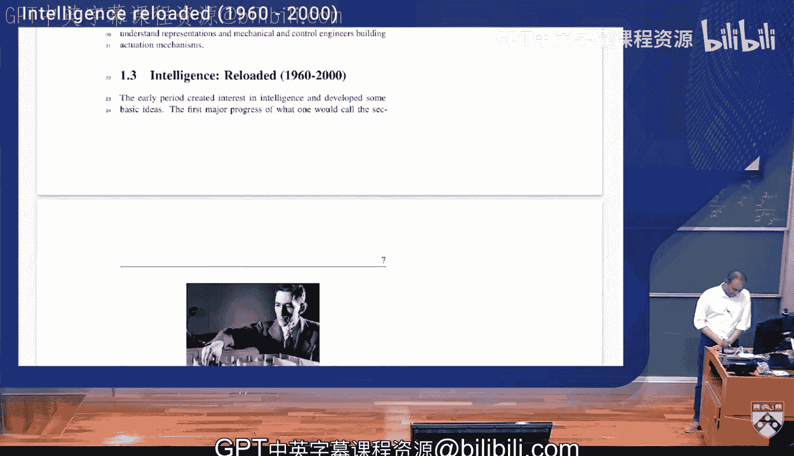
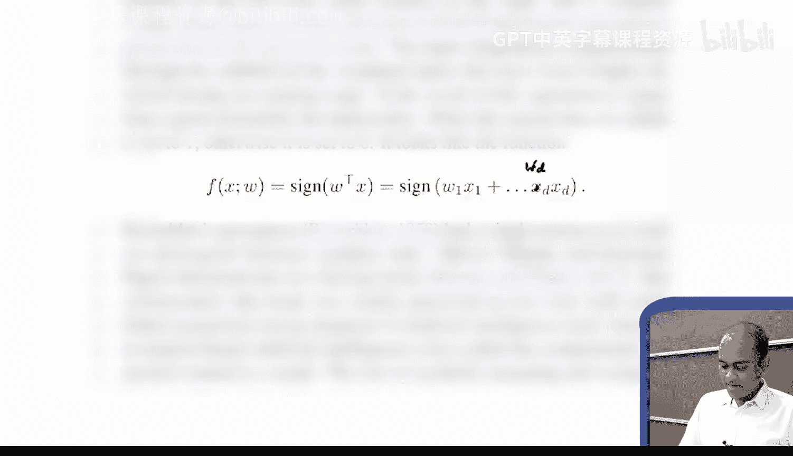
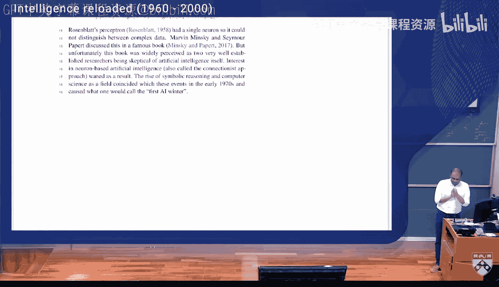
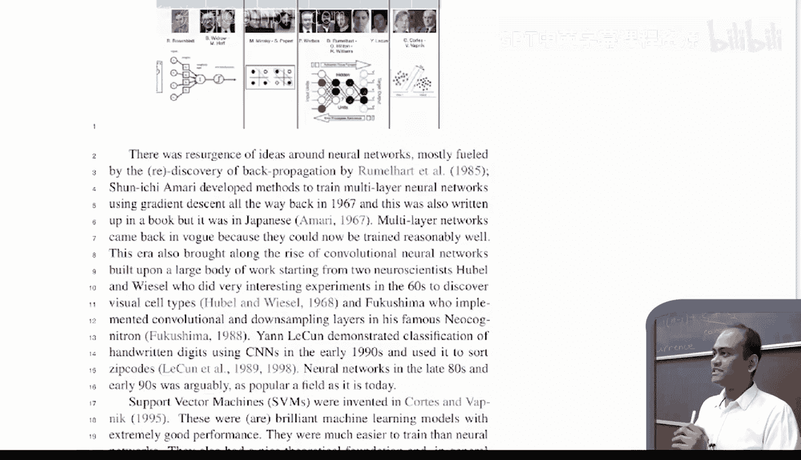

# 人工智能和机器学习基础：08_01_03：智能重载-1960-2000 🧠

在本节课中，我们将回顾人工智能发展史上一个关键时期——从1960年代到2000年。我们将了解早期神经网络的诞生、其面临的挑战、以及后续如何通过新的思想和算法实现复兴。核心内容包括感知机、连接主义思想的兴衰、反向传播算法的再发现，以及卷积神经网络和支持向量机的出现。

## 感知机的诞生：第一个神经网络 🤖

上一节我们介绍了早期人工智能的萌芽。本节中我们来看看第一个真正意义上的人工神经网络是如何被构建出来的。

大约在60年代末期，人们开始着手构建实物。下图展示了有史以来第一个神经网络。图中人物名为弗兰克·罗森布拉特，他是康奈尔大学和伊萨卡海军研究中心的研究员。这台机器与你在麦卡洛克-皮茨神经元模型中看到的完全相同：它接收一系列输入，并输出一个布尔值（0或1）。它被称为“感知机”，而这台机器重达五吨。

这就是第一个神经网络，也是最简单的神经网络——仅由一个神经元构成。这是人类首次设计出人工神经网络。

在数学上，我们在本课程后续部分会这样表示它：

`output = sign( w1*x1 + w2*x2 + ... + wd*xd )`

想象一下，你有一张橙子的图片，`x1, x2, ..., xd` 代表图片中的像素。典型的图片非常大，例如手机拍摄的图片从1000万到5000万像素不等，这意味着有1000万到5000万个数字。你将每个像素乘以一个不同的数字 `W1, W2, ..., Wd`。`W` 是你选择的一个向量，它让你能够判断这张图片是橙子还是苹果。

判断方式如下：你对内部求和结果应用一个符号函数。如果符号函数内部的值是正数，则返回+1；如果是负数，则返回-1。然后你可以标注：如果这个函数的输出是正数，我就称之为橙子；如果是负数，则称之为苹果。你需要选择 `w1` 到 `wd` 的值，以确保在你收集的某个训练数据集中，所有图片都能被正确分类——橙子被识别为橙子，苹果被识别为苹果。

一旦你找到了这些 `w` 值，你就可以对一张不属于训练集的新图片运行同样的计算，从而猜测它是苹果还是橙子。我将在下一讲中更精确地重复这一点，但简而言之，这就是机器学习：利用训练数据中的模式来猜测权重 `W1` 到 `Wd` 的值，然后使用这些权重对不属于训练数据的新图片进行推断。

## 连接主义的挫折与寒冬 ❄️

上一节我们看到了感知机的工作原理。本节中我们来探讨它为何一度陷入低谷。

这是一段历史，也是一个悲剧。这类思想被称为学习中的“连接主义”思想，即人们从一个更基础的层面（神经元）开始，神经元组合在一起形成表征并产生输出。在60年代末，麻省理工学院有一位非常著名的研究员名叫马文·明斯基。他和西摩·帕佩特合著了一本书，书中指出这类函数只能解决简单问题。具体来说，如果你有一堆标记为+1的点和一堆标记为-1的点，你只能用一条直线（线性函数）来分割它们。这正是感知机所做的（我们将在下一讲中看到这一点）。它无法解决下图所示的问题：

这里有一堆加号，这里有一堆减号，这里又有一堆加号，这里又有一堆减号。没有一条直线能干净利落地把加号和减号分开。在这种情况下，感知机模型显然无法解决此类问题。

于是明斯基他们说：“看，感知机能解决一些问题，但不能解决另一些问题。”但其他所有人都将此理解为对感知机的严厉批评。由于明斯基在当时是非常著名的人物，所以大家都认为“感知机没什么用”。基本上，人们开始停止研究连接主义方法。与此同时，其他一些领域如规划、逻辑等在70年代初变得非常流行，这就是为什么这类学习失去了动力。

## 神经网络的复兴与卷积思想 🔄

上一节我们了解了神经网络遭遇的寒冬。本节中我们来看看它是如何重新流行起来的。

大约在80年代末，神经网络再次流行起来。当时人们发现，在视网膜或视觉处理的早期阶段，存在一种叫做“卷积”的过程。你正在创建类似边缘或颜色的特征。他们开始将这类特征融入人工神经网络。这整个第二阶段的学习也由一项重要发现引领，即“反向传播”算法（我们将在几讲后看到）。这是一种训练权重 `W1` 到 `Wd` 的算法。还记得我说过我们必须找到能正确分类苹果和橙子的权重吗？反向传播就是一种让我们找到这些权重的算法。

该算法虽然早在60年代就由一位名叫**孙正义**的教授构建出来（我们几讲后也会看看他的一些工作），但它发表在一篇日文论文中，基本上不为世界其他地区所知。因此，在80年代中期，杰弗里·辛顿和鲁梅尔哈特重新发现了这个算法。那才是真正让所有人开始重视这项工作的时候。反向传播被认为是训练人工神经网络（即我们看到的神经元的组合，我们见过一个神经元，你可以将许多神经元组合在一起）的一种非常好的方法，它可以为每个神经元找到权重。

大约在那时，人们注意到，大脑内部有不同的部分，有些负责听觉，有些负责视觉处理。在视觉处理部分内部，又有不同的子部分：V1皮层识别边缘和颜色，V2皮层将这些特征组合成边缘和颜色的组合，一直到V4或主要皮层，它识别人脸、人物和语言等。神经科学的这一进展基本上让人们相信，可以在人工架构中构建类似的结构。这就是卷积神经网络的价值所在。因此，卷积神经网络是特定类型神经元的良好组合，这些神经元特别适合处理图像。

## 从理论到应用：CNN与SVM的登场 📈

上一节我们看到了神经网络如何借鉴生物学原理。本节中我们来看看这些思想如何转化为实际应用，以及其他重要模型的出现。

扬·勒丘恩是纽约大学的教授，他现在也是Facebook研究的负责人。他成名是因为他是最早训练卷积神经网络来识别手写数字的少数人之一。即使在90年代末，美国邮政系统也在使用自动检测信件上邮政编码的技术，以便根据信件上写的邮政编码将信件分拣到不同的区域。由于邮政编码是人写的，你需要一种可靠的方法来发现或猜测写的是什么数字。

机器学习领域接下来的技术进步是由**瓦普尼克**等人完成的，他们构建了支持向量机模型。支持向量机非常流行，因为它们特别容易使用。所有关于神经网络重新发现、分类数字等事情，都被更广泛的人群所忽视，因为神经网络非常难以使用，只有专家才能使用它们，而不擅长训练神经网络的人永远无法让它们工作。而支持向量机是基本上大多数人都能让其工作的东西。

这里有一个经验教训：今天你和我能够很好地进行深度学习，很大程度上与我们对神经网络和深度学习的理解有关，但也因为过去15-20年间人们编写了大量的库、软件和优秀代码，使得使用这些东西变得非常、非常容易。

---

**本节课中我们一起学习了**：从1960年代到2000年人工智能，特别是神经网络的发展历程。我们回顾了第一个感知机的诞生及其数学原理，了解了连接主义思想因局限性而遭遇的寒冬，探讨了借助反向传播算法和神经科学发现（尤其是视觉皮层原理）带来的神经网络复兴，并最终看到了卷积神经网络在图像识别中的实际应用，以及支持向量机作为易用替代方案的兴起。这段历史揭示了技术进步、理论突破与工程实践之间的紧密互动。