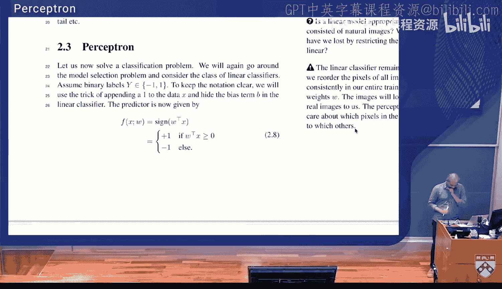
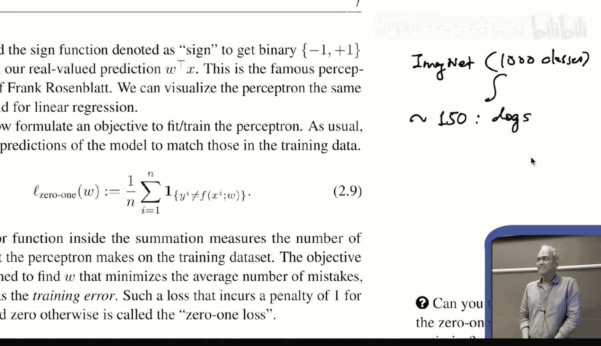

# 宾夕法尼亚大学《人工智能和机器学习基础（AI、数据科学、机器学习）AI and Machine Learning Essentials with Python》 p103 10_01_01_感知机.zh_en -BV16f421Q72q_p103-

Let us look at another very simple model。 This is an old model。 It is called a perceptron。

 It is the one where this guy called Frank Rosezen Black had built a machine to distinguish punch cards that are punched left and punch cards that are punched on the right hand side。

A perceptron is a classification machine unlike our regression， which was a regressor。

A perceptron predicts plus one or -1 given an input x。 Okay， so it's a classifier。

 It's a binary classifier and it does so in the following way。 So it takes our image X。 It is。

 let us say， a D dimensional vector。It takes w， which are D dimension parameters now。

It applies w transpo x。 so up to now it is doing the same thing as the linear regression。

 except that instead of predicting the value directly， it applies a sine function。

 a sine function is simply something that that outputs plus one if the argument is positive it outputs minus1 if the argument is negative Okay so it takes a sine of the argument。

This is our model for a classifier。 This is a perceptron。Nothing very complicated so far。Now。

 we would like to understand how should we find the right W for a perceptron。

 just like we focused on how to find the weights of linear regression。

 we would now like to find the weights of a perceptron Okay we fit the perceptron to the training dataset set。

 This is simply what the perceptor how the perceptron makes predictions。In this case。

 we have a much nicer way of saying when a prediction is correct or incorrect。

 If you predict an apple for an image that is an orange， then obviously youre wrong。

 There is no such thing as by how much you are wrong。If you predict the cost of the housing。

 there is some notion of how off you are from the true cost for apples and oranges。

 It is clear either you get it correct or you get it incorrect for a binary classifier， right。So。

 our objective。We can， we can think of it as a0 or a one loss。 You get a penalty of one。

 if you make an incorrect prediction， if the true label Y I is not the same as the true as the label that you predicted。

 remember that you are predict plus ones and minus ones。 So Y I is also plus ones for oranges。

 let's say minus ones for apples。 if these are not the same， then you get a penalty of one。

 if these are the same， then you get a penalty of0。

And what I would like to think of as an objective is the average mistakes。

 number of mistakes that you make averaged over the N training samples。

So nothing spectacular going on。 We are simply in a setting where we have a very natural notion of what correct means。

This has a name， it is called a 01 loss。What if I give you 1000 such classes instead of a binary classification problem to say you have 1000 classes？

Can you still use this objective。Yes， of course。 there is a notion of what is correct。

But then you can also think of like different kinds of objectives。

 Let's say that among these 1000 classes， so imagenet last time we talked about has 1000 classes。

And about 1，50 or so are our dogs。Now， most people in this room will not be very good at distinguishing between different breeds of dogs。

 And， in fact， some breeds of dogs look very similar to some other breeds of dogs。

 and it is debatable whether they are same or different to begin with。

So expecting that our model predicts the correct breed of dogs from among these 150 dogs or more more broadly the correct class after these 1000 classes is a little bit too harsh。

What can we do。

So I can think of predicting 100 real numbers or 1000 real numbers and say this is 90% that a cat。

 but then with another 10% probability it could be a dog。This is one way to think about it。呃。

How will I check this。I need an objective that I can evaluate if I give you an image from nature。

How can you say that this is 90% a cat。We know that dogs are similar to other dogs and cats are similar to other cats。

 but dogs and cats are different， and there is some overlap between the two。

 so if you mistake a dog for a cat， I will not penalize you that much。

 but if you mistake a dog for an aeroplane， then I will give you a large penalty。

This requires me to know something about the kind of objects that I that I have in my dataset。Okay。

 so what you said， I would need to sit down and write a nice distance between all these 1000 classes and then I can calculate your penalty。

About what you said， I would need to ask， let's say all of it in the class and show you all these images and see how many of you believe that this is a cat。

 how many of you believe that this is a dog， and then I get all my true values。😊。

And I can check whether the model takes those two values or not。 So when we have many， many classes。

 we need to think about how to make predictions in a slightly different way。For regression。

 we were looking simply at the cost。 if you have two classes， again， it is correct or wrong。

 if you have 1000 classes， a million classes， then you have to be much more careful about how you pick the losses。

