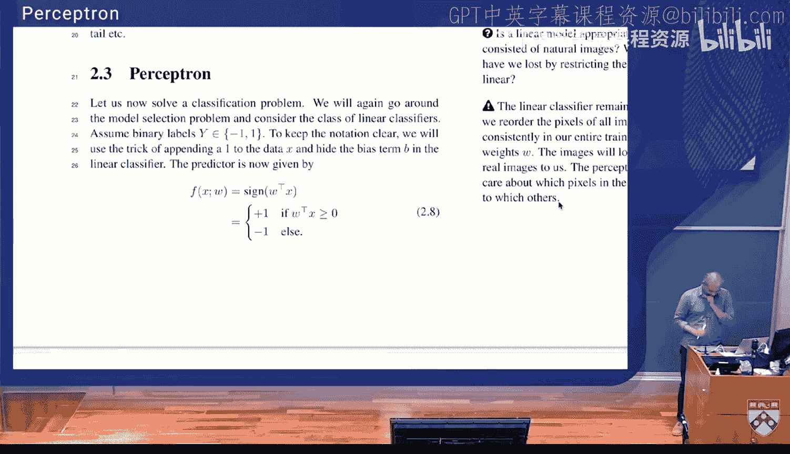
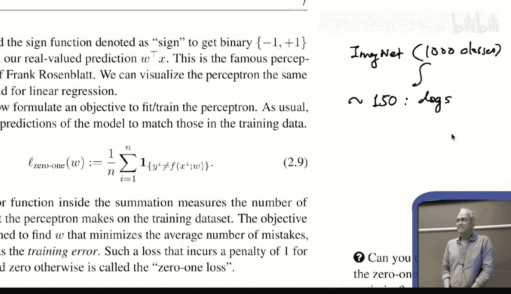

# 人工智能和机器学习基础：10：感知机模型 🧠

在本节课中，我们将要学习一个非常经典且简单的机器学习模型——感知机。感知机是神经网络和深度学习的基础，它是一种用于解决二元分类问题的模型。我们将了解它的工作原理、如何做出预测，以及它与我们之前学过的线性回归模型有何不同。

---

## 感知机简介

上一节我们介绍了用于预测连续值的线性回归模型。本节中，我们来看看一个用于分类的简单模型——感知机。

感知机是一个古老的模型。它最初由弗兰克·罗森布拉特（Frank Rosenblatt）提出，他建造了一台机器，用于区分左侧打孔和右侧打孔的穿孔卡片。

感知机是一个分类器，这与我们之前学习的回归模型（回归器）不同。

感知机接收一个输入 **x**，并预测输出 **+1** 或 **-1**。因此，它是一个二元分类器。

它的工作方式如下：假设输入 **X** 是一个 **D** 维向量。模型还有一组同样是 **D** 维的参数 **w**。它计算 **w** 的转置与 **x** 的点积（**w^T x**）。

到目前为止，它的计算步骤与线性回归相同。不同之处在于，感知机不会直接输出这个值，而是会应用一个 **sign** 函数（符号函数）。

**sign** 函数非常简单：如果输入参数为正数，则输出 **+1**；如果输入参数为负数，则输出 **-1**。因此，感知机输出的是参数的符号。

以下是感知机的预测公式：

**预测值 = sign(w^T x)**

这就是我们的分类器模型——感知机。到目前为止，它并不复杂。

---

## 如何训练感知机

现在，我们想了解如何为感知机找到正确的参数 **w**。就像我们专注于如何找到线性回归的权重一样，我们现在也想找到感知机的权重。我们需要将感知机“拟合”到训练数据集上。

以下是感知机做出预测的方式。在这种情况下，我们有一个更清晰的方式来定义预测是否正确。

如果你为一张橙子的图片预测了“苹果”，那么你显然是错误的。这里没有“你错了多少”的概念。这与预测房价不同，房价预测有“偏离真实价格多少”的概念。对于二元分类器，结果要么正确，要么错误。

因此，我们的目标可以看作是一个 **0-1 损失**。如果你做出了错误的预测，即真实标签 **y_i** 与你预测的标签不同，你会受到 **1** 的惩罚。如果你预测正确，则惩罚为 **0**。

我们希望优化的目标函数是平均错误率，即你在 **N** 个训练样本上犯错误的平均次数。

这里没有特别复杂的内容。我们只是在一个有非常自然的“正确”概念的环境中。

这个目标函数有一个名字，叫做 **0-1 损失**。

---

## 从二元分类到多类分类

如果我们面对的不是二元分类问题，而是有 **1000** 个类别的分类问题呢？你还能使用这个目标函数吗？

当然可以，因为“正确”的概念依然存在。但是，我们也可以考虑不同种类的目标函数。

以 ImageNet 数据集为例，它包含大约 1000 个类别，其中大约 150 个是不同品种的狗。对于人类来说，区分某些品种的狗已经很困难了，有些品种看起来非常相似。

因此，期望我们的模型从这 150 种狗（或更广泛地说，从这 1000 个类别）中准确预测出正确的品种，可能过于苛刻了。我们该怎么办？

一种思路是，模型可以预测 **100** 个（或 **1000** 个）实数，表示属于每个类别的概率。例如，输出“这张图 90% 是猫，但有 10% 的概率是狗”。

那么，如何评估这样的预测呢？我需要一个可以计算的目标函数。如果给你一张自然图片，你如何说它是“90% 的猫”？

我们知道，狗与狗相似，猫与猫相似，但狗和猫是不同的。如果模型把狗误认为猫，我们可能不会惩罚得太重；但如果模型把狗误认为是飞机，我们就应该给予较大的惩罚。

这要求我们了解数据集中对象类别之间的某种关系。因此，我们需要坐下来，为这 1000 个类别定义一个合适的“距离”或相似度度量，然后才能计算预测的惩罚。

另一种方法是，对于每个类别，收集许多人（比如全班同学）对一批图片的看法（多少人认为是猫，多少人认为是狗），从而得到“真实”的概率分布，然后检查模型的预测是否接近这个分布。

所以，当我们有很多类别时，需要以稍微不同的方式思考如何做出预测和定义损失。对于回归，我们只关注成本（误差）。对于两个类别，就是正确或错误。对于 1000 个甚至一百万个类别，你必须更加仔细地考虑如何选择损失函数。

---

## 总结

本节课中，我们一起学习了感知机模型。我们了解到：

1.  **感知机**是一个简单的二元分类器，其核心公式是 **预测值 = sign(w^T x)**。
2.  它使用 **0-1 损失** 作为训练目标，即只关心预测是否正确，而不关心错误的程度。
3.  当分类问题从简单的二元扩展到多类（如 1000 个类别）时，简单的 0-1 损失可能不再适用。我们需要设计更精细的损失函数，能够考虑类别之间的相似性，并对不同程度的错误给予不同的惩罚。

感知机是理解更复杂神经网络模型的重要基石。在接下来的课程中，我们将探索如何扩展这些概念，以处理更现实、更复杂的分类任务。