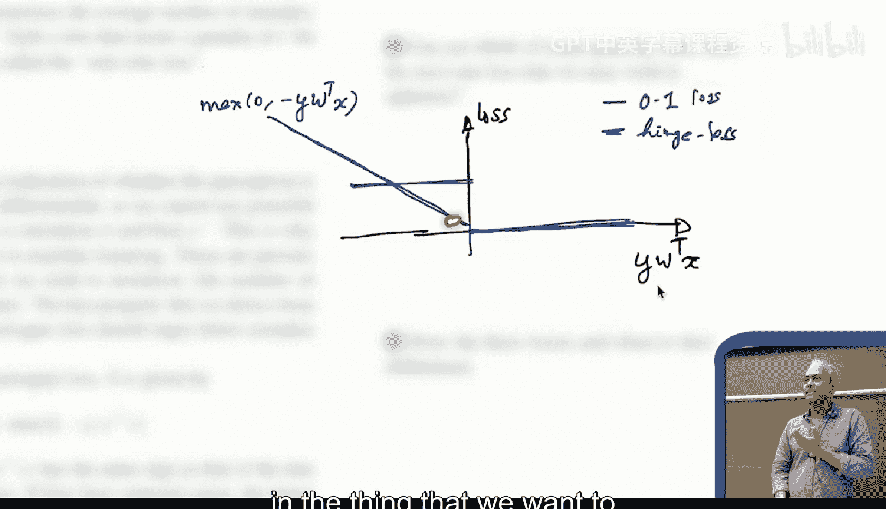
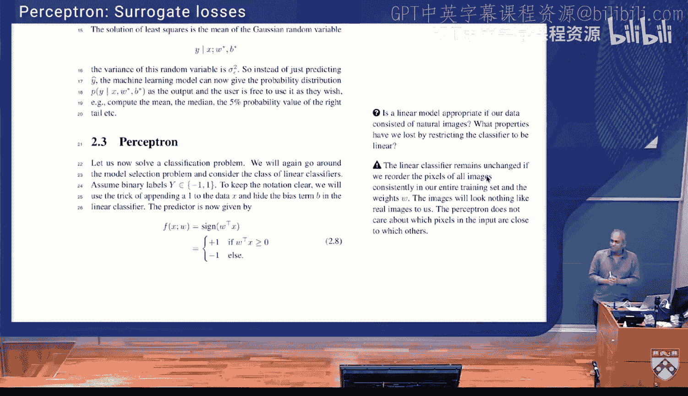

# 宾夕法尼亚大学《人工智能和机器学习基础（AI、数据科学、机器学习）AI and Machine Learning Essentials with Python》 p104 11_01_02_感知机替代损失函数.zh_en -BV16f421Q72q_p104-

One cool thing about this objective is that you can differentiate it。

You can take the derivative with respect to W， you can take the derivative with respect to B and then do all kinds of calculus using this。

😊，One bad thing about this objective is that you cannot differentiate it because it is either one for a mistake or and0 for the correct answer。

So we need some surrogate for this objective。 This is the objective that we want01 loss is the one that we want to minimize the number of mistakes。

 but we cannot minimize it because then we have all this machinery that we have developed in the field of optimization that works for different level objectives。

 it doesn't work for this one。 So either you cook up that machinery again all by yourself or you tweak your objective to make a different level and then now you have all that machinery at your disposal。

And this is why in machine learning， we use what are called surrogate losses。

These are losses that we think that are differentiable。

And are losses that we think are close to the 01 loss。

So let us draw a picture to think of how the 01 loss looks like。

I will draw a slightly weird quantity on the x axis。 you will see y very soon。

I will write down this as the quantity。W transpose x， if it is positive。

 then we know that the perceptron per x sub plus1。So if y is plus 1 and w transpose x is also positive。

Then y times w trans x is positive。So I am somewhere it on this side。Okay。

So should my perceptionceptron be penalized？No， because it is predicting the correct answer right so if you were to draw the 01 loss。

It is zero here because it is making correct predictions。

If y and w transpose x have the opposite signs， then the perceptron made an incorrect prediction。

 so the 01 loss is 1， you make a mistake。For that sample。So， let's see。 So this is。ゼロ？行。

Let me know details。This is not differentiable， as you can clearly see。This is another loss。

 it is called a hinge loss。The hinge loss， as you can expect。

 doesn't penalize you if youre making correct predictions。

Y should be if you are making incorrect predictions it penalizes you by the egregiousness of the incorrectness of your prediction if you are making really really incorrect prediction if w transpo x was very negative。

And why was positive， then you would be way far out on the left hand side of the origin， right？

So I give you a much larger loss。If you if w times plus x was a tiny bit negative and y was positive。

 then by improving the value of w， you can make it a tiny bit more positive and I expect you to I give you a slightly lower penalty。

Is this a natural intuitive？Okay。So the hinge loss。

 it is called the hinge loss because it looks like a hinge is given by this expression。It is the。

Maximum of0 and minus w transpose x。 So think about this expression little carefully。

 if w transpose x times y is。All is positive when minus y times w transpo x is a negative number。

So the maximum of a0 and a negative number is 0， so it is 0 on this side of the origin。

If y times w transpose x is negative， then this is a maximum of a0 and a positive number and it is this。

As you can see， this is a differentiable function， so I can take the gradient at any point and I can improve my w to reduce the loss。

This is an example of a surrogate loss。It is clearly different from the 01 loss。

 which is what we really want to do， but it is a good propxy to use because if we minimize the surrogate loss。

We are on the right hand side of the origin， in that case， we are good。

If we do not minimize the surrogate loss completely， or if we are somewhere。

 let's say close to the origin， but somewhere here， then we could have done something better。

Then there is a clear discrepancy in the thing that we want to minimize the  zero1 loss and the stuff that we are actually minimizing the surrogate。

😊。

There are many other losses。 So let's think of the exponential loss。呃。

E to the negative y times w transverse x。If the entire exponent is a large negative number。

So that means that y and W transpose x are both the same sign。

Then this loss is very close to  zero e to the negative large number is 0 right， So this this number。

Then an exponential loss goes like this。If this entire thing is 0， if y times w transpose x is 0。

 it is e to the negative 0， which is equal to 1。So this is one exactly。

 so you'll get an explosion bus that looks like this。It's e to the negative y w transversese x。Okay。

This is a slightly different loss than the hinge loss。 It is also clearly differentiable。

 Now you see a difference between the two。 The hinge loss is below the01 loss on the left of the origin。

 The exponential loss is not happy even if you push things to the right of the origin。

 It wants you to push things all the way to the infinity。 only then it is exactly 0。All until then。

 you will get tiny， tiny penalties from the exponential loss。Make sense。

There is nothing to say that this one is better than other and the other one is not as good。

 these are all different candidates you can use depending on the problem。啊。

You can go home and plot this one yourself。And see where it lies。 This is called the logistic loss。

 This is the one that you have used many times until until now in in by the name of logistic regression。

So just to recap， there are many situations when you may want to use a surrogate loss for even regression。

Have we seen an example already？This is the surrogate loss for classification for regression we said that we may not like the quadraatic error at all sit in all cases。

 sometimes we want to use the absolute value， the one norm。

 sometimes we want to use a combination of the one norm and the two norm。

 these are all surrogate losses you can use whichever one you wish。

Cool so to summarize this section there is a different model called the perceptron it predicts plus one and minus one。

 we cannot minimize that model easily because we it has the zero1 loss to work around this situation we invent this concept of surrogate losses there are many surrogate losses you can use which one you use depends on what the problem you are solving。

