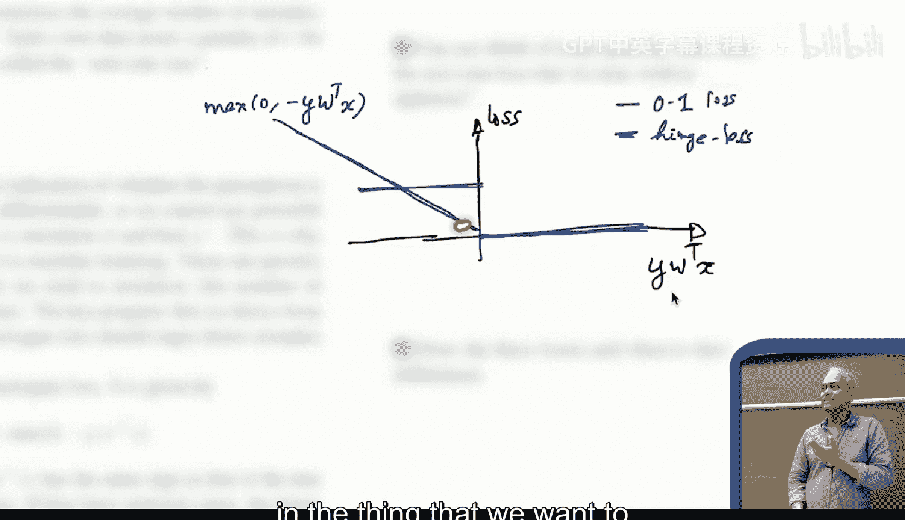
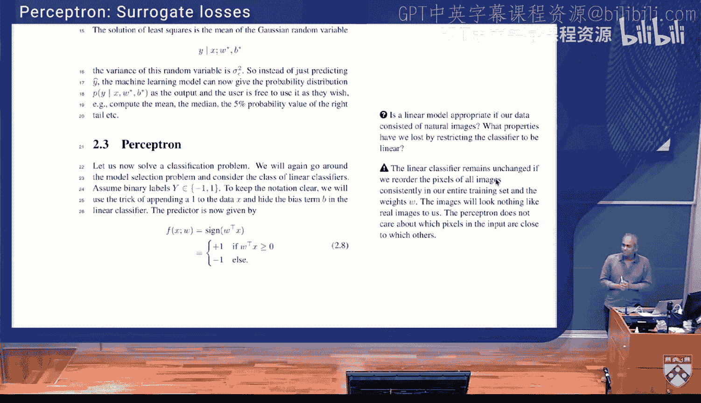

# 宾夕法尼亚大学《人工智能和机器学习基础》：11_01_02：感知机替代损失函数 🧠

在本节课中，我们将要学习感知机模型中的一个核心挑战——0-1损失函数不可微的问题，并探讨如何通过引入“替代损失函数”来解决这一难题，从而利用成熟的优化技术来训练模型。

## 概述

上一节我们介绍了感知机的基本原理。本节中我们来看看其训练过程中遇到的一个关键障碍：我们真正希望最小化的目标函数（0-1损失）在数学上难以处理。为了解决这个问题，机器学习领域引入了“替代损失函数”的概念。

## 0-1损失函数的局限性

感知机的目标是做出正确分类。一个直观的衡量标准是**0-1损失**：模型预测正确时损失为0，预测错误时损失为1。这个目标函数的好处是含义清晰。

然而，这个目标函数有一个严重的缺点：**它不可微**。因为它只在两个离散值（0和1）之间跳跃，我们无法对其求导，也就无法使用基于梯度下降等成熟的优化算法来最小化它。

因此，我们需要为这个目标函数寻找一个**替代品**。我们希望最小化错误的数量（0-1损失），但由于优化技术的限制，我们无法直接最小化它。所以，我们选择调整目标函数，使其变得可微，从而能够利用现成的优化工具。

## 替代损失函数的概念

这就是为什么在机器学习中，我们使用所谓的**替代损失函数**。这些损失函数具有两个特点：
1.  它们是**可微的**。
2.  我们认为它们在效果上**接近0-1损失**。

让我们通过图示来理解0-1损失的样子。我将以 `y * (w^T x)` 作为横轴（其中 `y` 是真实标签，`w^T x` 是感知机的加权输出）。当这个值为正时，表示预测正确；为负时，表示预测错误。

以下是0-1损失的图示：
*   在横轴的正半轴（预测正确），损失为 **0**。
*   在横轴的负半轴（预测错误），损失为 **1**。

正如你所见，这个函数在0点处有一个跳跃，是**不可微的**。

## 常见的替代损失函数

以下是几种常用的替代损失函数，它们都是连续且可微的。

### 1. 合页损失

合页损失是一种常用的替代损失。它的设计思想是：如果预测正确且有一定的“安全边际”，则不给予惩罚；如果预测错误，则根据错误的严重程度给予线性增长的惩罚。

合页损失的公式为：
`L_hinge = max(0, 1 - y * (w^T x))`

让我们分析这个表达式：
*   当 `y * (w^T x) >= 1` 时（预测非常正确），损失为 **0**。
*   当 `y * (w^T x) < 1` 时，损失为 `1 - y * (w^T x)`，这是一个线性函数。

这个函数是**可微的**（除了在 `y * (w^T x) = 1` 这个点），因此我们可以计算梯度并更新参数 `w` 来减少损失。它是0-1损失的一个良好代理。

### 2. 指数损失

指数损失是另一种替代损失函数。它的公式为：
`L_exp = exp(-y * (w^T x))`

它的特点是：
*   当 `y * (w^T x)` 为正且很大时（预测非常正确），损失趋近于 **0**。
*   当 `y * (w^T x)` 为0时，损失为 **1**。
*   当 `y * (w^T x)` 为负时（预测错误），损失会大于1并快速增长。

指数损失与合页损失有所不同。即使预测正确，只要 `y * (w^T x)` 不是无穷大，它仍然会给出一个微小的惩罚，它“鼓励”模型做出置信度极高的预测。

### 3. 逻辑损失

逻辑损失函数你可能已经非常熟悉，它在**逻辑回归**中被广泛使用。其公式通常与对数似然相关。

你可以回家自己绘制这个函数的图像，观察它与0-1损失的关系。

## 回归问题中的替代损失

需要强调的是，使用替代损失的思想并不仅限于分类问题。在回归问题中我们也见过类似的例子。

我们之前说过，我们可能并不总是喜欢使用平方误差（L2损失）。有时，我们会使用绝对误差（L1损失），或者结合L1和L2的损失（如Huber损失）。这些也都是**替代损失函数**，你可以根据具体问题选择使用哪一种。

## 总结

本节课中我们一起学习了以下核心内容：
1.  **感知机模型**的目标是最小化分类错误（0-1损失）。
2.  **0-1损失函数不可微**，导致无法直接使用基于梯度的优化算法。
3.  为了解决这个问题，我们引入了**替代损失函数**（如合页损失、指数损失、逻辑损失）。这些函数连续可微，且行为上近似0-1损失。
4.  选择哪种替代损失取决于具体要解决的问题，没有绝对的好坏之分。
5.  使用替代损失的思想也适用于**回归任务**，如选择L1、L2或Huber损失。

通过引入替代损失函数，我们成功地将一个难以优化的离散目标，转换为了一个可以利用成熟优化技术解决的连续问题，这是机器学习算法得以有效训练的关键一步。