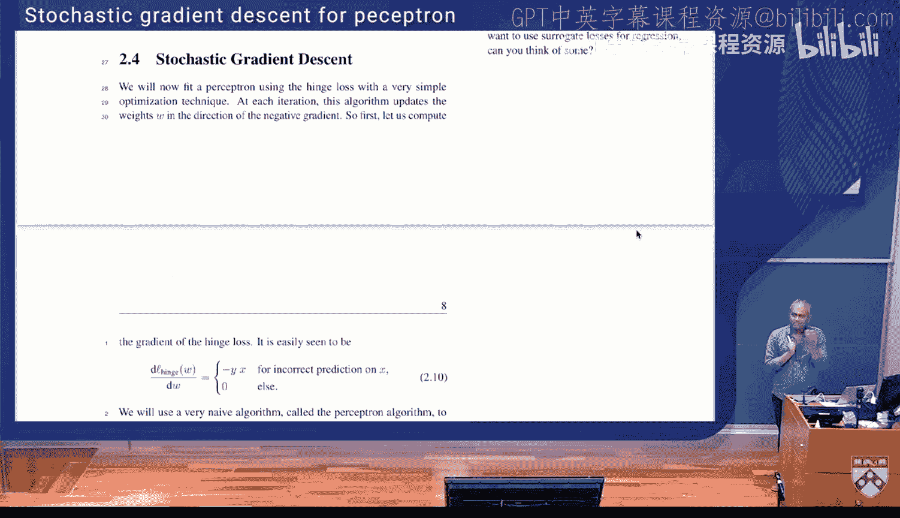
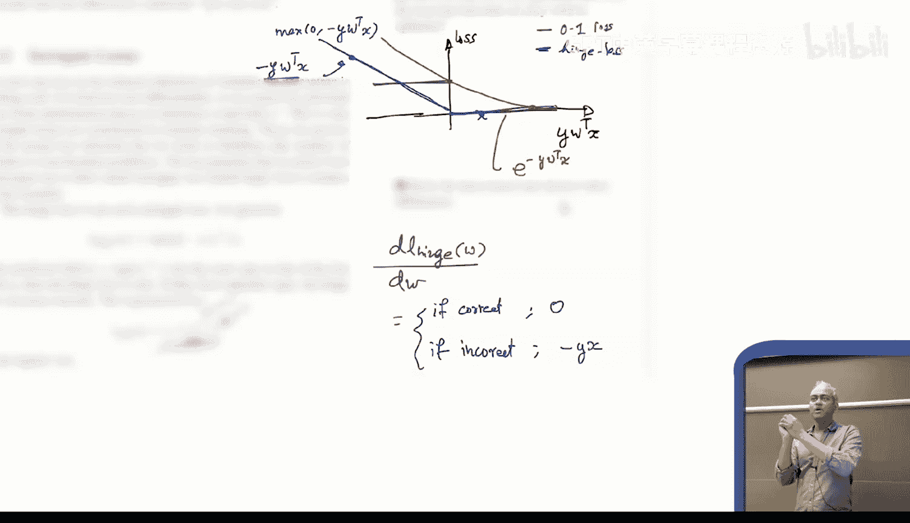

# 宾夕法尼亚大学《人工智能和机器学习基础（AI、数据科学、机器学习）AI and Machine Learning Essentials with Python》 p106 13_02_01_感知机的随机梯度下降-第一部分.zh_en -BV16f421Q72q_p106-

How do we minimize a loss？Any guesses？I have a W。

I would like to improve my loss。What should I do？Let's say I have I have only one image so I can plot the entire data set on one page。

 my loss is currently somewhere here。Because my WO is such that it is predicting something that is a lot negative。

 what should I do？So I have the loss and if I move in this direction， then I reduce the loss， right？

So， we would simply like to differentiate this loss with respect to w W is our variable that we get to change y and x are fixed because are they are the outputs and the inputs respectively so I calculate the derivative of this loss with respect to W。

And change my w from this value to this value。 And now I have achieved a location that is a slightly smaller loss。

 so I'm making a tiny bit more correct predictions。Makes sense。

This is something called as gradient descent， you descend in the direction of the negative gradient。

You always minimize the loss。When do you stop？When you reach here right in this case for the hinge loss。

 you would stop somewhere here because there is no more gradient to use to descends。

For the exponential loss， where would you stop？You see it is infinity because there is a tiny gradient no matter how far out on the axis you look at。

So the name of the game in fitting a perceptron is to update the weights w in the direction of the negative gradient。

What is the negative gradient here？I would like to calculate D as a hinge。As a function of W by Dw。

 what is it？Let's look at the picture。What is the gradient here？

This function at this point is what it is minus y times w w trans x side because we are the maximum of those two quantities is exactly minus y times w trans x。

 the gradient is 0 here。So I can think of two cases if there is if the perceptron is making correct prediction。

 if y and w transpose x have the same sign。Then， it is 0。The gradient。

Because you are on this side of the X axis。If the perceptron is making a mistake。

Then what is the gradient。The value of the function is this。What is the cred。Okay。If incorrect。

It is minus y times x。Now for any location you have the gradient so you take the sample let's say that your data set had only one sample。

 you know how to calculate the gradient you can initialize your w to any location on the entire x axis if you got lucky and you initialize here there is nothing to do if you initialize over here you can update your W。

To the original value plus some negative gradient right？The gradient is minus y times x。

 the negative gradient is y times x， so you can do w equal to the old W。Plus y times x。

 and this will reduce your loss a tiny bit。It will not make it entirely zero。

 it will reduce your loss a tiny bit。