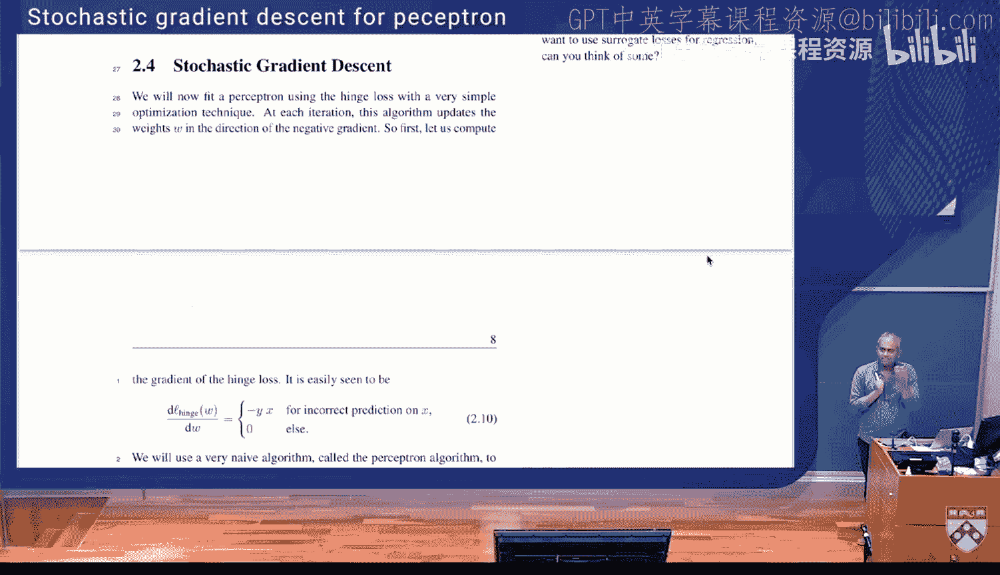
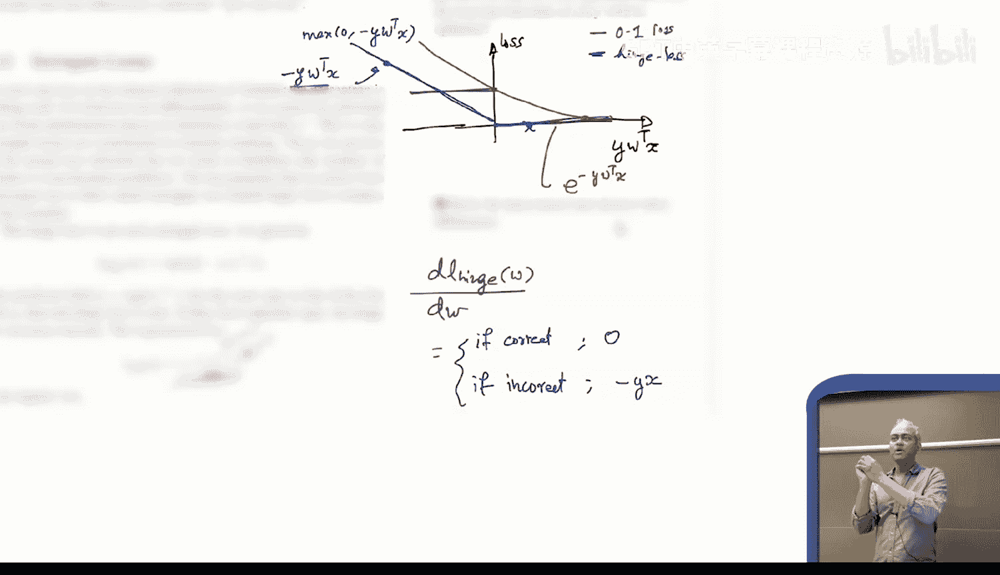

# 人工智能和机器学习基础：13_02_01：感知机的随机梯度下降 - 第一部分 🧠

在本节课中，我们将要学习如何通过一种名为“梯度下降”的优化方法来最小化感知机的损失函数。我们将从直观的图像理解开始，逐步推导出更新权重的具体公式。

## 概述

我们面临的核心问题是：如何最小化损失函数？假设我们有一个权重向量 **W**，它决定了感知机的预测。我们的目标是调整 **W**，使得损失值降低。

## 理解梯度下降

上一节我们介绍了损失函数的概念，本节中我们来看看如何通过计算来优化它。

假设我们的数据集中只有一个样本，因此我们可以将整个损失函数图像绘制在一张图上。当前，由于权重 **W** 的初始值不合适，我们的损失值可能处于一个较高的位置（例如，预测结果严重为负）。为了减少损失，我们需要沿着能够降低损失的方向移动 **W**。

这个过程的核心思想是计算损失函数关于权重 **W** 的导数（即梯度）。**W** 是我们需要改变的变量，而输入 **x** 和真实标签 **y** 是固定的。通过计算梯度，我们可以知道 **W** 应向哪个方向调整以减小损失。

具体步骤如下：
1.  计算当前 **W** 下的梯度。
2.  将 **W** 向梯度的反方向（即负梯度方向）移动一小步。
3.  更新后的 **W** 将对应一个稍小的损失值，意味着预测稍微更准确了一些。

这种方法被称为**梯度下降**。你总是沿着负梯度的方向“下降”以最小化损失。

那么，何时停止呢？对于合页损失函数，当损失降到0时，梯度也为0，此时没有进一步下降的空间，因此可以停止。而对于指数损失函数，损失曲线渐近于0但永不为0，理论上存在微小的梯度，因此需要设定一个停止条件（如迭代次数或损失阈值）。

## 计算感知机的梯度

现在，我们来具体计算感知机合页损失的梯度。我们需要求解损失函数 **L** 关于权重 **W** 的偏导数 **∂L/∂W**。

观察合页损失函数的图像，我们可以分两种情况讨论：

以下是两种情况的总结：
*   **情况一：预测正确**
    *   当感知机预测正确时，即 **y** 与 **wᵀx** 同号，损失值为0。此时，损失函数在该点的梯度为 **0**。
*   **情况二：预测错误**
    *   当感知机预测错误时，即 **y** 与 **wᵀx** 异号，损失值为 **-y * (wᵀx)**。此时，损失函数关于 **W** 的梯度为 **-y * x**。

因此，对于任意一个样本，我们都可以根据其预测正确与否来计算梯度。

## 权重更新规则

假设我们的数据集中只有一个样本。我们可以将权重 **W** 初始化为任意值。

以下是更新权重的步骤：
1.  如果初始化幸运地落在了预测正确的区域（梯度为0），则无需更新。
2.  如果初始化落在了预测错误的区域，我们可以根据计算出的梯度来更新 **W**。

具体的更新公式为：
**W_new = W_old + η * (y * x)**

其中：
*   **W_old** 是旧的权重。
*   **η** 是学习率，控制每次更新的步长（在当前的简化推导中，我们暂时将其视为1）。
*   **(y * x)** 是负梯度（因为梯度是 **-y*x**，负梯度就是 **y*x**）。

执行这个更新操作后，损失会减少一点点，但通常不会直接变为零。我们需要多次迭代这个过程，逐步降低损失。

## 总结

本节课中我们一起学习了感知机训练的核心——随机梯度下降法的基本原理。我们了解到，通过计算损失函数关于权重的梯度，并让权重向负梯度方向更新，可以逐步降低模型的预测误差。我们推导出了在合页损失下，权重更新的具体规则：**W = W + y * x**（当预测错误时）。这为下一节我们将要讨论的在完整数据集上进行迭代优化奠定了基础。