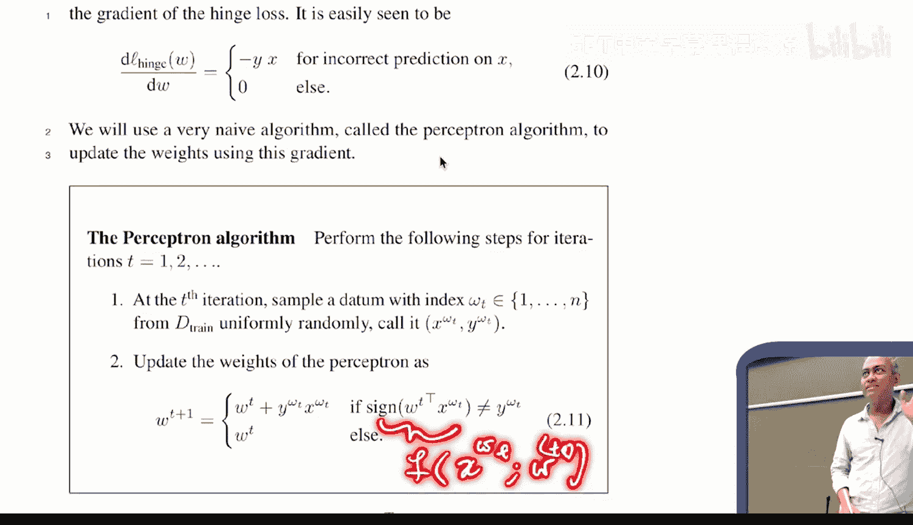
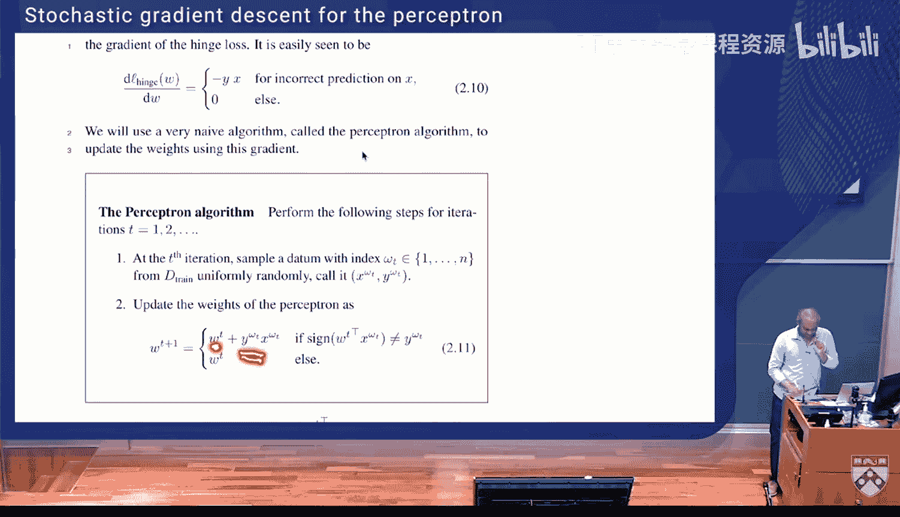
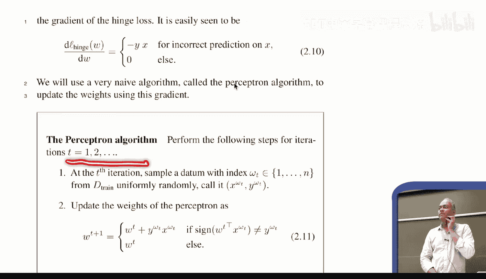
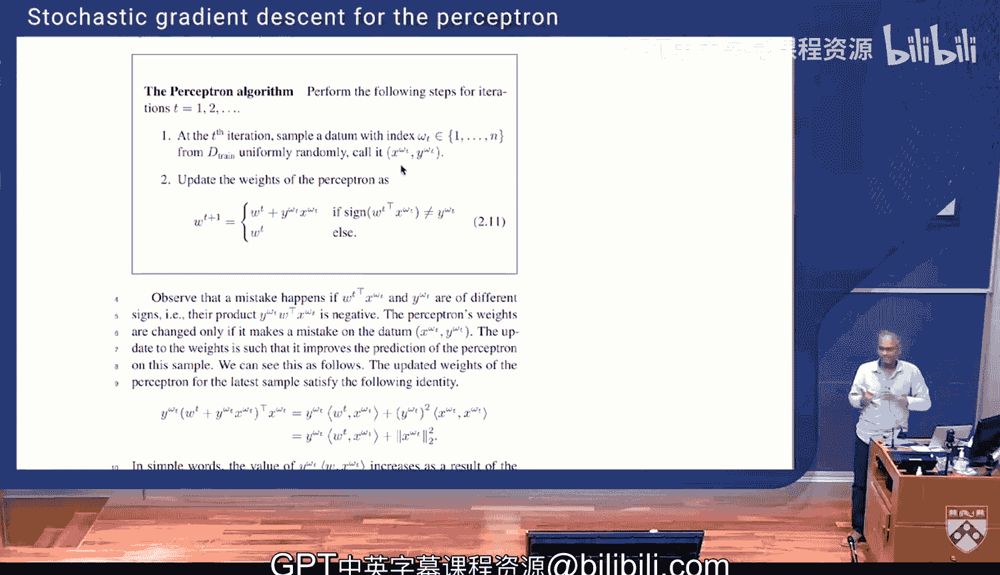

# 宾夕法尼亚大学《人工智能和机器学习基础（AI、数据科学、机器学习）AI and Machine Learning Essentials with Python》 p107 14_02_02_感知机的随机梯度下降-第二部分.zh_en -BV16f421Q72q_p107-

Next we talked about grid and descent， how to minimize the loss， we said look。

 we know that the logistic loss is like this on the reference side of the origin。

 it is zero on the right hand side of the origin。If。Your perceptron is getting that example correct。

 then it is presumably sitting somewhere to the right of the origin， right。

The loss is zero in that case， the derivative of this function with respect to W is 0。

If the perceptron is getting making a mistake， it is presumably sitting somewhere on the left of the origin。

 In that case， the derivative is what。Is the deator of this guy。Respect to W。

 which is equal to minus y times x。Okay。So this gives you a very natural algorithm to train the receptorceptor。

 Here is how it works。 You take your data。And for every iteration， you do many， many iterations。

 you initialize your weights of the perceptron， lets say to0， okay initialize it to anything。

At the teeth iteration， you sample an index， we have n samples in our training data。

 we sample one of them randomly， uniformly， randomly。And let us call that sample x omega t y omega T。

 so in this entire course I will always denote random variables or samples as omegas just to keep everything very pedantic and clear。

So omega is some number between 1 to n x omega and y omega is that particular sample on my training data set。

I run the perceptron on this sample if the perceptron predicts correctly。

 I don't change the weight at all， Why should I。If they perception makes a mistake， then。

And you can check that the perceptron is making a mistake by watching the output y omega T and the prediction of the perceptron。

 which is simply your current weights， w T。Time x omega T with the sine function of pla to it。

 Okay so this the left hand side is our function of x omega T。With the weights WT。

 if they are not the same that means that there is a mistake being made by the receptorceptor。

This much is clear to everyone。 That means that we are on the left hand side of the origin。

 So let's say that we make a mistake。 Now， I will update my old weight。

In the direction of the negative gradient so we know that the hinge loss looks like this。

 if I move the weight a little bit to the right then I mean reduce the loss a little bit so presumably I make a slightly better prediction on this new sample。

So I take my old weight， this old weight is wt， this gradient is y times x omega t y omega t and then I sum them up。

 so I am moving a little bit to the right。Of my old weight that means I am improving the loss on this particular sample now。

 like she said， I don't have to move by the exact magnitude of the gradient I could move 05 times y times x or point or 1。

5 times y times x so in general I could move with respect to some scalar constant let us call it the learning rate。

 like she said， times the gradient。Okay。In this expression。

 I have set the learning rate so called to1， so let's not worry about it for now。

 let's say that we move by one unit gradient to the right hand side。

We'll worry about the learning that in a bit。Is it clear to everyone that moving the weights so will improve the error of the perceptron if you are sitting somewhere very close to the origin here then moving like this will move you to the right of the origin and now you get that particular example correct after such an update。

Will such a movement improve the perceptance performance on some other examples。

A slightly less complicated way of saying this is the w the weights W are one number one vector right they are the same weights for all these samples。

 we improve the performance on this particular sample and it will improve the performance on samples that are similar to each all of let us say that there are some other samples which are also sitting at this loss level and once we move the weights a little bit to the right those samples will automatically improve。

There could also be samples that sitting a little bit to the right and whose error deteriorates when you move the weight to the right。

What is right for one sample is not or what is the correct weight for one sample is may not be the same for some other sample so the perceptron when it samples image and a particular label uniformly randomly from the data it improves its performance on that sample this may improve the performance on some other sample this mayiorate the performance on some other samples but the entire point is that it does this add infinum。

Okay。

Will this process stop。So we will talk about what linear level data means。

 but the rough understanding is that if there exists a w such that all these examples are correctly classified if there exists a w star such that the error of the perceptron on the train data set is0。

 then。This method will find that W star okay and this is a simple proof that we'll do in a bit and that is what it means for data set linear if there exists a solution then you will find it you will stop this shuttling round of errors after a finite number of iterations if that does not exist a W star in the sense that if all the oranges are here and all the apples are here and there is some overlap of oranges and apples。

 then there does not exist a W star that separates these two point clouds cleanly。And in that case。

 you will not if the perceptron will keep on shuttling between the errors like this。

 it will never stop。Okay。This is called the Perceptron algorithm。

 and this is what Frank Rosenbl implemented in the 60s。We will know it by a slightly different name。

 where we know it by the name of stochastic gradient and descent。

And it is called stochastic gradient descent because we are using the gradient。

At each iteration to make the updates， it is called stochastic， grid and descent， because。

We take pick one particular sample from the entire data to calculate the gradient and only update the waves using that sample。

So when we update the update the weights once we do not really know what it is doing to all the other samples。

 we only know what it iss to this particular sample and there is some notion of randomness in here because we choose the sample that we want to improve upon randomly all of this is we dig much deeper into this but for now this is our simplest possible implementation of stochastic gradient descent。

Okay。As you see it is nothing complicated so long as you have an objective that you can take derivatives off and so long as you have a data set from which you can sample uniformably you can implement SGD that is why it is both the simplest method to use and also the most general method to use。

