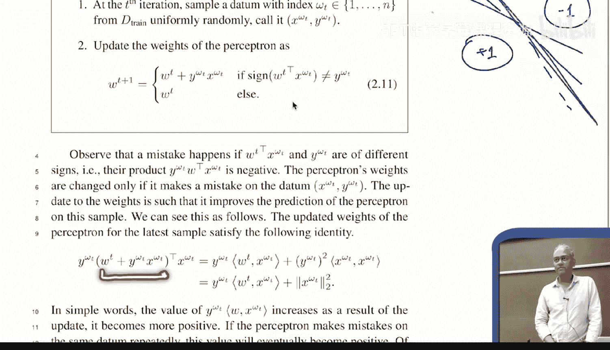
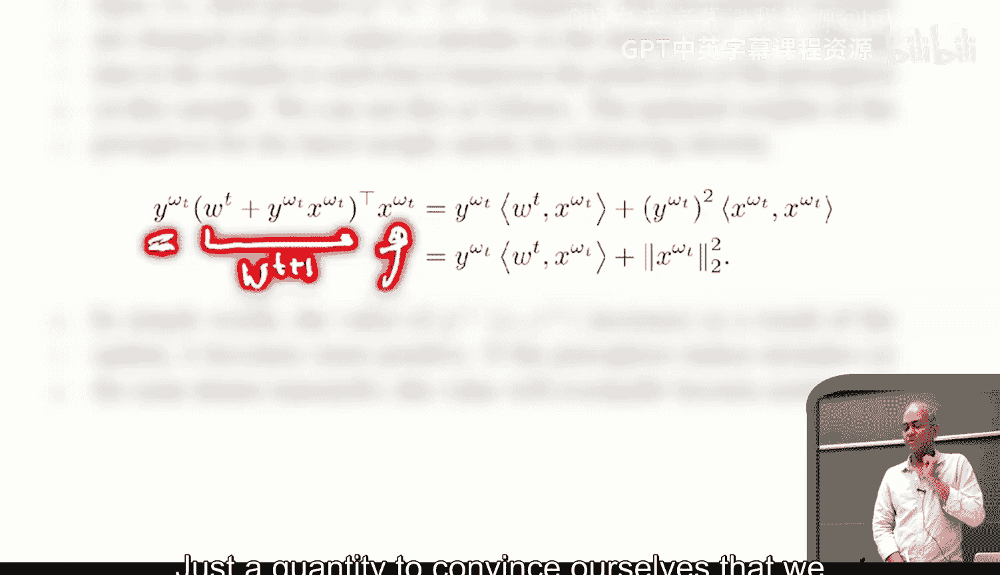
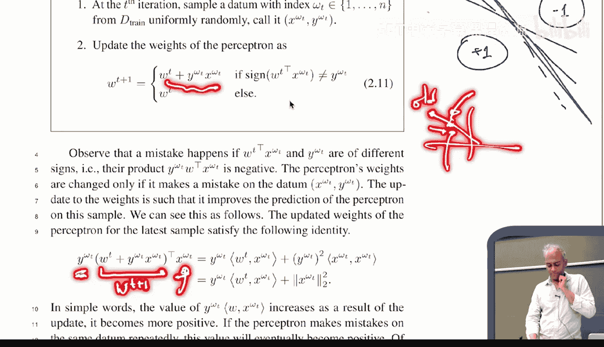
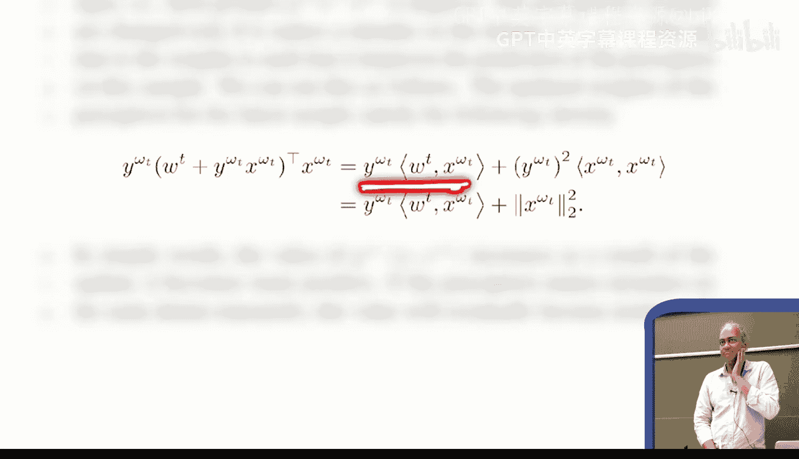
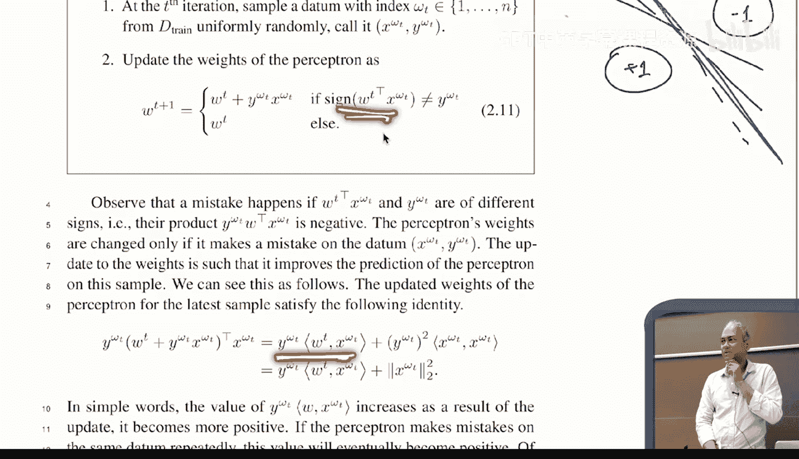
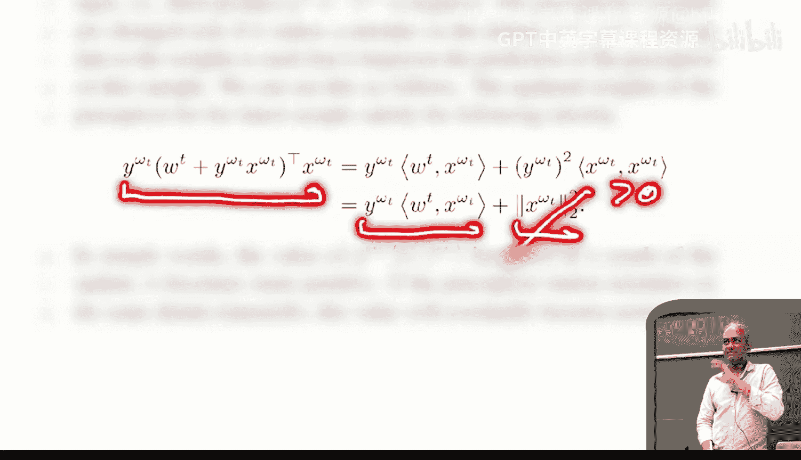
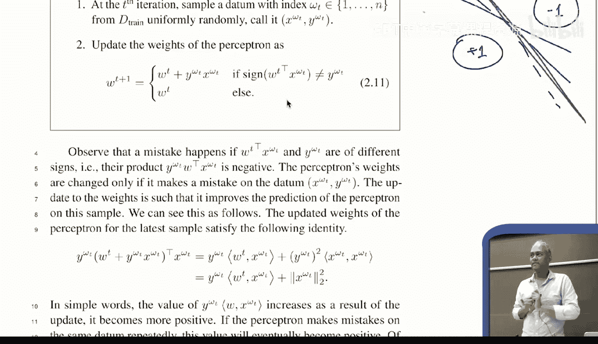

# 宾夕法尼亚大学《人工智能和机器学习基础（AI、数据科学、机器学习）AI and Machine Learning Essentials with Python》 p108 15_02_03_理解SGD为何在感知机中收敛.zh_en -BV16f421Q72q_p108-

We talked about how to update things。 Let us talk about why this stuff works。

I convinced you by pictures that if you are at this location and you made a mistake。

 if your weights are here and you made a mistake， then updating using the gradient will improve the loss on that particular sample。

 we can write this statement down in mathematics。W T plus y times x is the new weight value， right。

 It is exactly equal to this one。

Y times the new weight value wt plus 1 times this x is the prediction of the of the new perceptron on the sample that you recently chose。

Okay so at the teeth iteration you got this particular sample incorrect。

 you updated the weights and now the left hand side is saying what do the updated weights predict on this recently chosen sample。

Okay， just the quantity to convince ourselves that we indeed improve the loss after the updates。

This is this particular value。This was the old value。

Now you can expand this out， it is y times wt times x plus y square times x transpose x okay what is y square。

Y is either plus 1 or minus1， so y square is always 1 no matter what the true level of the sample is。

This quantity is the prediction of the perceptron before it was updated on this sample。

Is the last iterations first is the exact same condition that we use to check whether it made a mistake or not so one way to read this equation is that the prediction of the perceptron after the update equals the prediction of the perceptron before the update plus x square or x non squared。

And this one is always greater than zero because it is a norm。So as you can see。

 you are moving right towardss on the x axis， you are improving the prediction on the sample which you made a mistake upon。

Makes sense。

Yeah， at every iteration。Every time you get a sample incorrect you always improve things for that sample。

 this doesn't mean you improve things for all the other samples that much I think is clear。

 but you certainly improve things for this particular sample。

Okay。So as we said during through pictures， if the training data linear re sub level then this process will stop after some time because you will improve all the incorrect samples one by one if there are conflicts within the samples。

 if there is one plus one here and then this entire cloud is of minus ones and then there is one minus one here and this entire cloud is of plus ones then you will never be able to get them get the samples correct because every time you fix the minus one here。

 all these other samples get unhappy， every time you fix the minus one there。

 all these samples get happy。嗯啊好。So we'll talk about this in a bit and you'll also think about it later when you go home but as I said this is really the simplest version of stochastic Grand descent and the funny pit is that rose inbl worked on the percentceptron in the mid-60s。

 stochastic Grand descent was when known as an algorithm even in the early 50s so this is the oldest paper which talks about stuff like SGD。

 Robinson Monroe in 1951 this was more related to operations research literature after the war but even then people did not realize that this was the same method。

