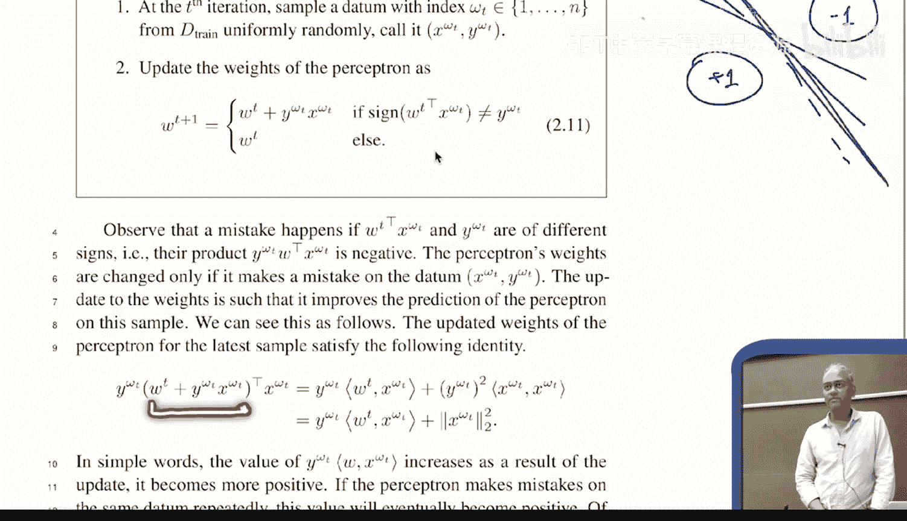
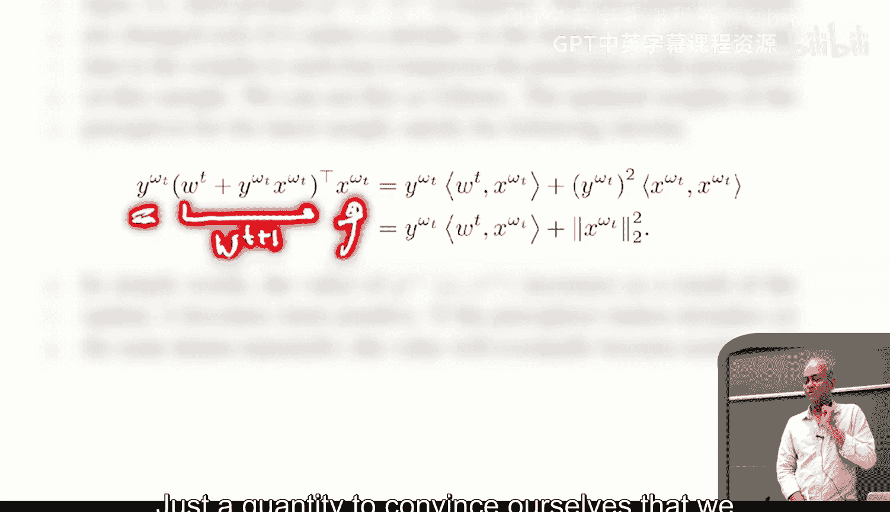
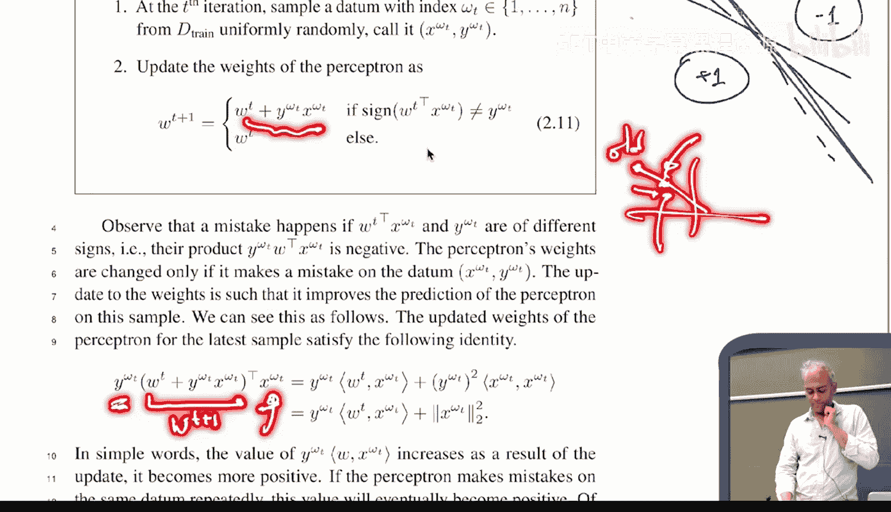
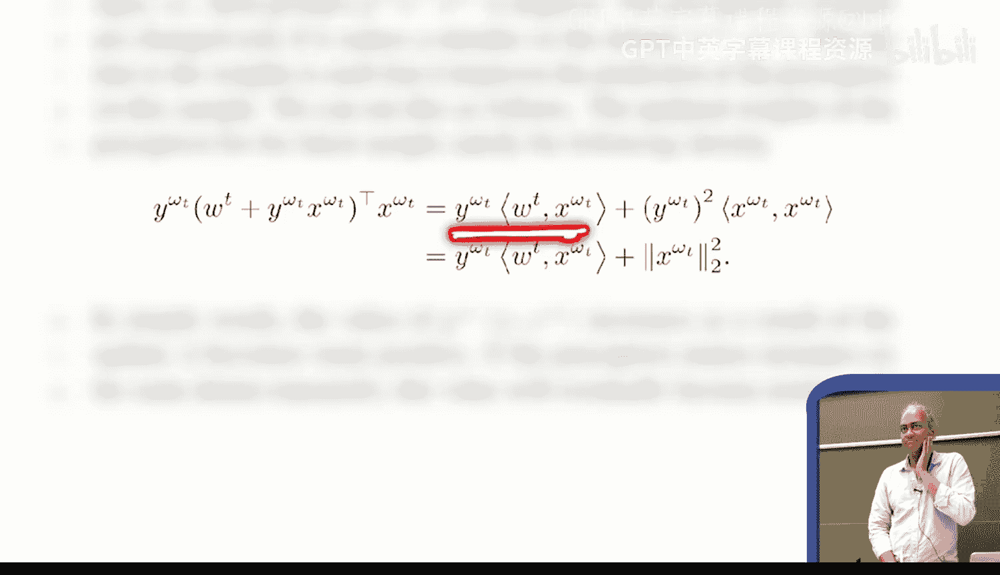
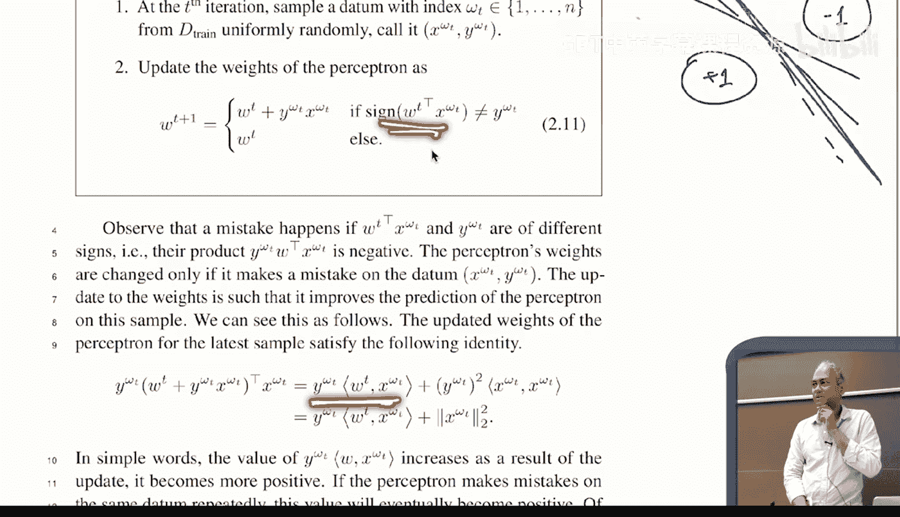
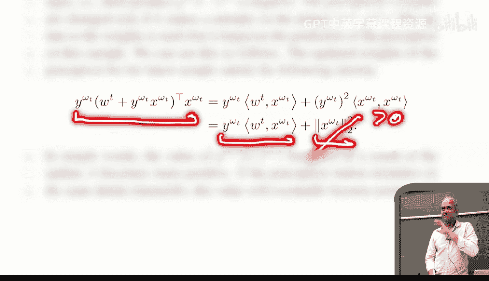
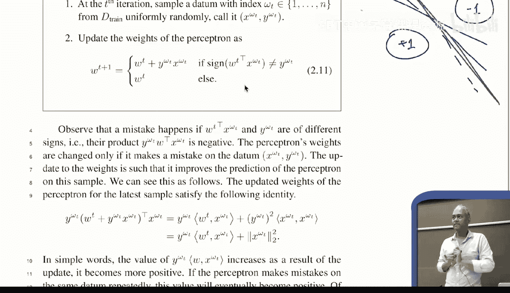

# 人工智能和机器学习基础：15_02_03：理解SGD为何在感知机中收敛 🧠

在本节课中，我们将要学习随机梯度下降（SGD）算法在感知机模型中为何能够收敛。我们将通过数学推导来理解，每次权重更新是如何改善模型在误分类样本上的表现的。

上一节我们介绍了感知机的权重更新规则，本节中我们来看看这个更新过程为何有效。

## 权重更新与预测改善

我们之前通过图示说明了，当权重处于某个位置且模型对某个样本分类错误时，沿着梯度方向更新权重可以改善该样本上的损失。我们可以将这个陈述用数学语言表达。

设 `W_t` 为第 `t` 次迭代时的权重向量。当模型对一个样本 `(x, y)` 分类错误时（其中 `y ∈ {+1, -1}`），我们按照以下规则更新权重：
`W_{t+1} = W_t + y * x`

这个新权重 `W_{t+1}` 在刚刚被误分类的样本 `x` 上的预测值，可以通过计算 `y * (W_{t+1} · x)` 得到。这个值代表了更新后的感知机对该样本的“置信度”。

## 数学推导：证明预测得到改善

为了证明更新确实改善了模型在该样本上的表现，我们来比较更新前后的预测值。

更新后的预测值计算如下：
`y * (W_{t+1} · x) = y * ((W_t + y*x) · x)`

将其展开：
`= y * (W_t · x) + y * (y * (x · x))`
`= y * (W_t · x) + y^2 * ||x||^2`

由于 `y` 的取值为 `+1` 或 `-1`，因此 `y^2` 总是等于 `1`。同时，向量 `x` 与其自身的点积 `||x||^2` 是它的范数平方，这个值总是大于零的。

因此，公式可以简化为：
`y * (W_{t+1} · x) = y * (W_t · x) + ||x||^2`

在这个等式中：
*   `y * (W_t · x)` 是更新前模型在该样本上的预测值。根据感知机的错误判断条件，如果模型分类错误，这个值 **小于等于 0**。
*   `||x||^2` 是一个 **恒大于 0** 的标量。

所以，更新后的预测值 `y * (W_{t+1} · x)` 等于一个小于等于零的数加上一个正数。这意味着，**每次对误分类样本进行SGD更新后，模型在该样本上的预测值（置信度）都会严格增加**。

从几何意义上理解，权重向量被朝着使该样本正确分类的方向推动，且推动的幅度与样本自身的范数有关。

## 收敛的保证与局限

根据上述推导，在每一次迭代中，只要模型对一个样本分类错误，更新后就一定能改善模型对这个特定样本的分类情况。

然而，这并不意味着同时改善了所有其他样本的分类结果。模型的收敛依赖于一个关键前提：**训练数据必须是线性可分的**。

如果数据线性可分，SGD算法可以逐步修正所有误分类的样本，最终找到一个能够完美分类所有训练数据的超平面，此时算法停止。

如果数据不是线性可分的（例如，存在矛盾的样本，一个正类样本被包围在负类样本中，或者反之），那么SGD可能永远无法收敛。因为修正一个样本的错误可能会导致其他样本被错误分类，算法会陷入无限的振荡之中。

## 历史背景

值得一提的是，感知机算法由罗森布拉特在20世纪60年代中期提出。而随机梯度下降（SGD）作为一种优化方法，其思想甚至可以追溯到更早。例如，罗宾斯和门罗在1951年的一篇论文中就已经讨论了类似的方法，尽管它当时更多地出现在运筹学文献中，人们并未立即意识到它与后来机器学习中SGD的本质联系。

本节课中我们一起学习了SGD在感知机中收敛的原理。我们通过数学公式证明了每次更新如何提升误分类样本的预测值，并讨论了算法收敛的前提条件（数据线性可分）及其在非线性可分数据上的局限。这是理解更复杂优化算法的基础。