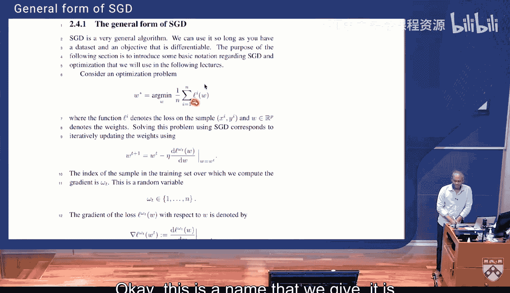
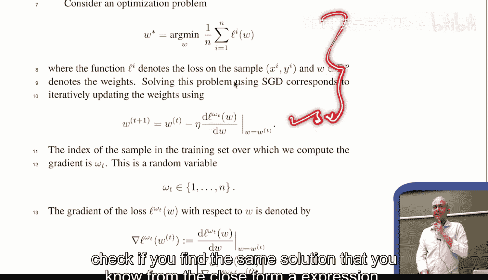
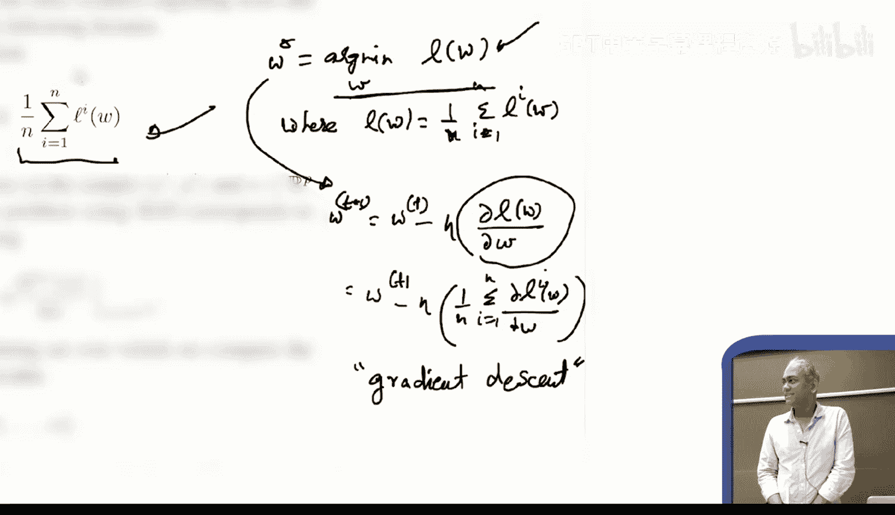
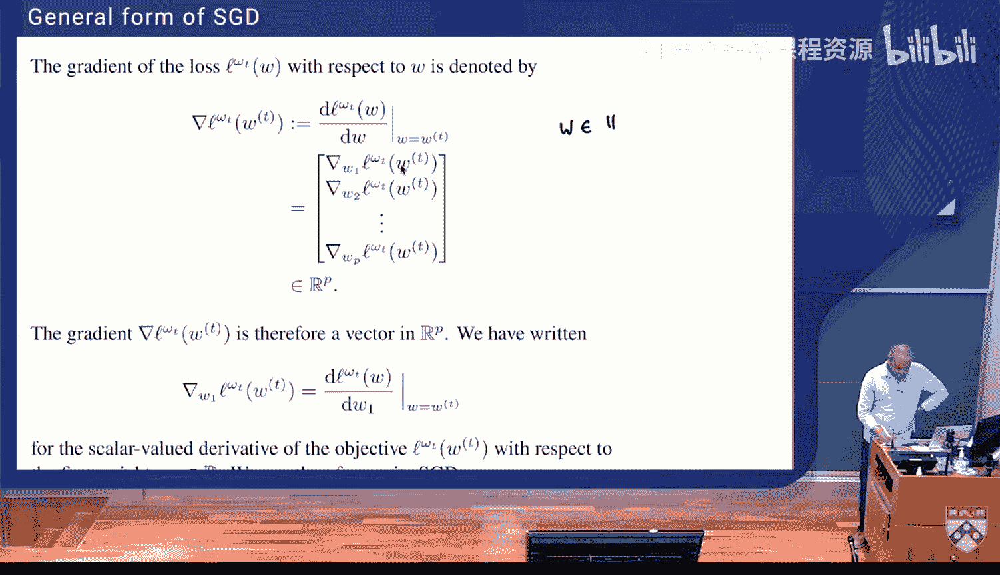
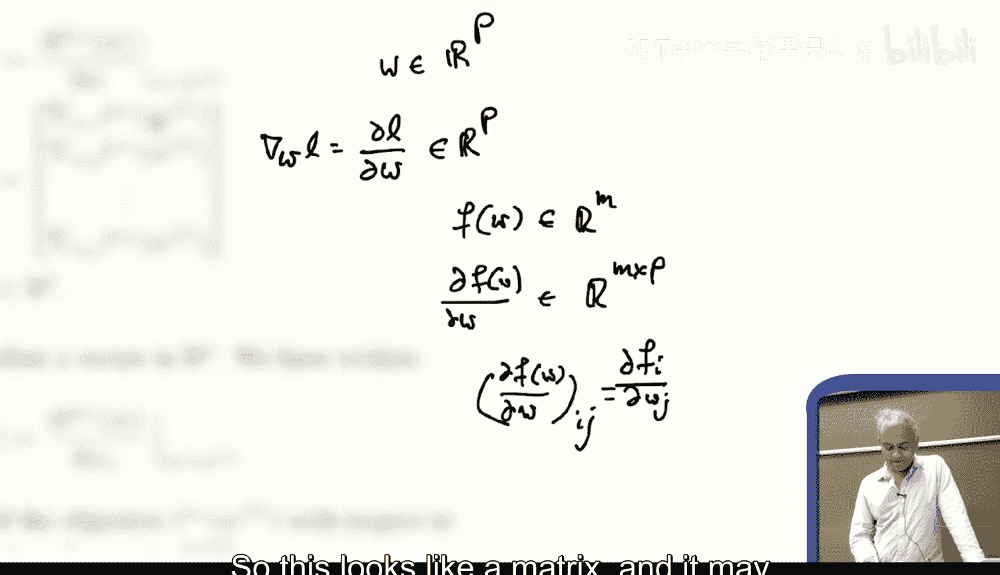
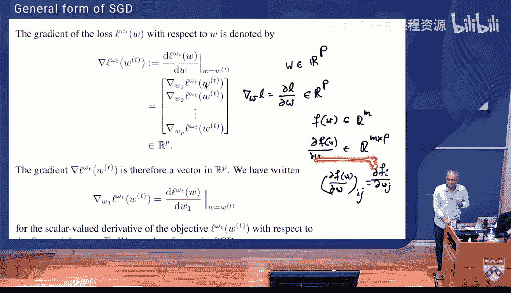

# 宾夕法尼亚大学《人工智能和机器学习基础（AI、数据科学、机器学习）AI and Machine Learning Essentials with Python》 p109 16_02_01_SGD的通用形式.zh_en -BV16f421Q72q_p109-

Let us talk about simply rewriting this business in a slightly more general language and we'll use it henceforth。

 as I said， given any objective。I'm in that I would like to solve。

 So let us say that L superscript I is some loss of some model。

On the eighth image or in our data set， okay， this is a name that we give。

 It is some surrogate loss that you choose。

Fitting our machine learning model amounts to you minimizing the average loss over your entire data set。

We would like to find W star that minimizes this objective。

As let us assume that this objective is differentiable。

 so we can take derivatives of L superscript I with respect to doubling。

This brings SGD into the business we can sample images from our data uniformly randomly at each iteration we have our weight wT actually let me go to this version。

Yes， I am writing W T in brackets to denote that it is the weight of the teeth iteration。

At each iteration we sample an image randomly let us call that index omega2 we calculate the derivative of that particular loss with respect to w。

At our current weight vector WT， and then we update the weight vector WT in the direction of the negative gradient。

And like she said， in general， instead of simply updating their weights by one unit gradient。

 we can scale the gradient by some scalar parameter Eta Eta called is something that is greater than 0。

 it is called the learning rate。You will see later why it is important so ends up。

 but for now it is just a scale that we apply to the agreement。This is SGD。

And these two equations are in some sense， a very， very general way to fit models right anytime you have a model for which there is a legitimate loss。

 you have a data set within n samples， you can run this method to fit the model。看。

We have done this for perceptron if you are curious go home and do this for linear regression。

 you know the solution of linear regressionggression。

 you can run this method for linear regression and check if you find the same solution that you know from the close from expression。

You should get the same answer。We we descend in the direction of the negative gradient so this is a function。

 the derivative of this function is pointing in this direction right so we descend in the direction of the negative gradient you don't have to pick one particular sample omega t。

 you could pick 10 samples。 you could pick hundred samples in general。

 you can pick the entire data to calculate the gradient。

Right。I can rewrite this。So this problem， I have to rewrite it I don' have to write it like this。

 I can write it as w star is argument min over w of L of w。Where L of W is。The average。

Of all my little losses。And this equation now I can solve with gradient and descent。

 not stochastic glcent， there is no concept of summation in this objective。

 I can simply take the derivative which is wt plus 1 equal to wt minus the load rate times the derivative of L。

呃NW。What is the derivative of the summation of different functions？

The derivative of a sum is the sum of the derivatives right so that the derivative of the average of a bunch of quantities is the average of the derivatives of all those quantities。

So in this case， this will be equal。2 minus eta。This is called gradient descent。

 this is not called stochastic end descent because we did not sample anything。

 We are taking all these samples and averaging the gradient。😊。

This is another way to fit the perceptron。 you can try this at home。

 you will see that it works a little worse。

Okay。Cool， so just some nomenclature or rewriting of things， as I said omega t is a random variable。

 it takes values from one to n， it tells you which index， which image we sample from the dataset。

It is traditional to write this DL by DW as this expression Nabla of L。

 just the name for the same quantity。The important thing， however， to remember。

 is that the gradient of a scalar with respect to a vector is a vector。

The loss is a real valued number。When you take the derivative of the loss with respect to weights。

 you are trying to ask yourself， how does this scalar change if I perturb my weights in some way？

If you per up the first element of the weights then you get this term。

 it is the derivative of the loss with respect to the first weight。

 if you pertu the second weight then you get this term it is the derivative of the loss the second weight and so on。

 so the gradient of the loss with respect to a bunch of weights with respect to a w that is a vector is also a vector。

It looks very trivial right now， but when you implement your back。

 I promise half of you will make this mistake。So in simple words。

 if our weights are p dimensional vectors。

Then the derivative of the loss is also a P dimension vector。This is true if L is a scalar。

 what happens if L is a vector？I can also take the derivative vector with respect to another vector。

It will be a matrix so derivatives of vectors and matrices are really dumb quantities in some sense I shouldnt say dumb actually there is very simple quantities in some sense and the only way of thinking about this is that if F of w is a function in RM。

 then dfw the w is a function in RM crosspy。And the IJth quantity or IJth entry。

Of this function is exactly Dfi by DwG。 it is the eighth element of your function of the numerator of the derivative。

With added differentiated respect with the J weight。So。

 this looks like a matrix and it may look like the something complicated。

 it is the derivative of a vector with respect to a vector。

 but fundamentally it is just all the little scalar derivatives arranged as a matrix。

