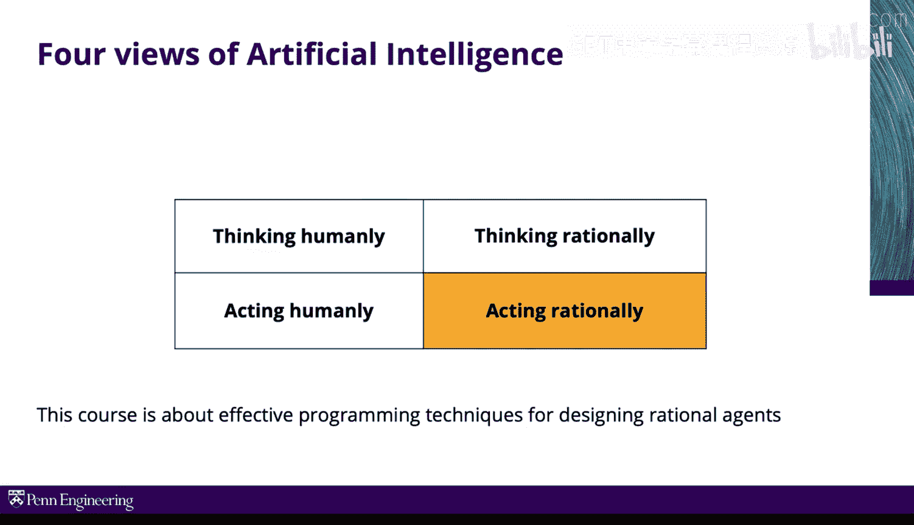
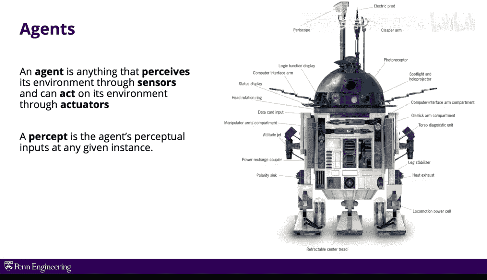
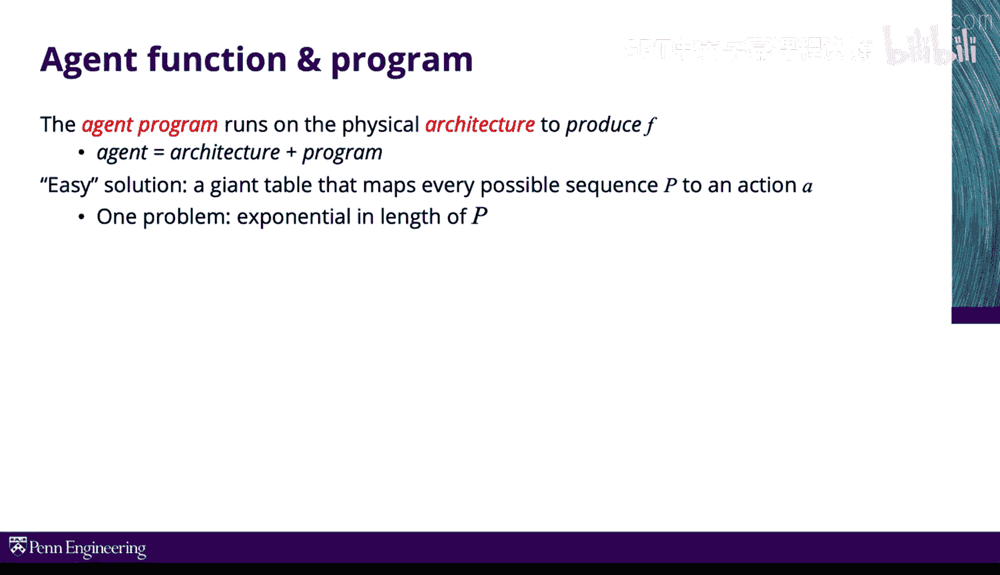
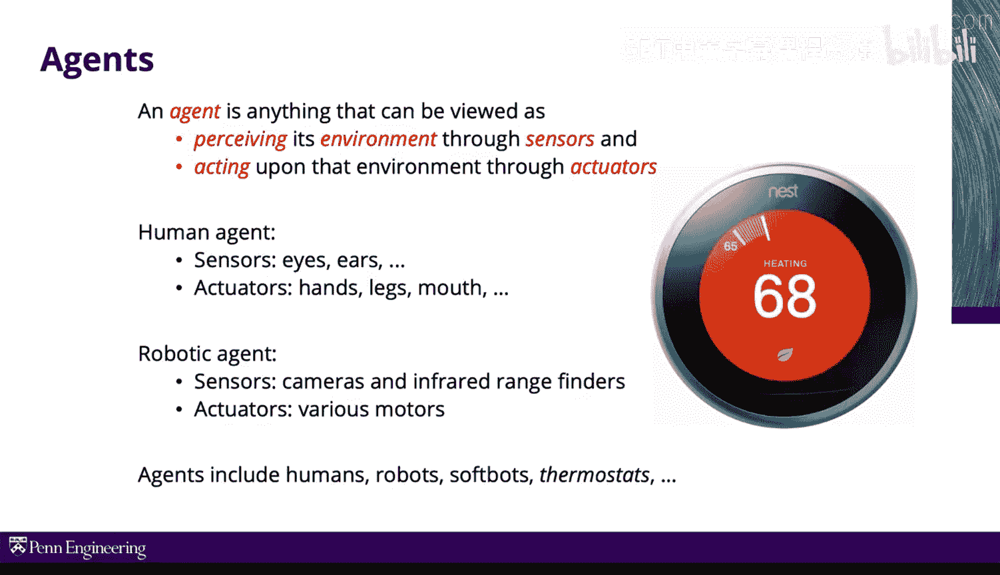
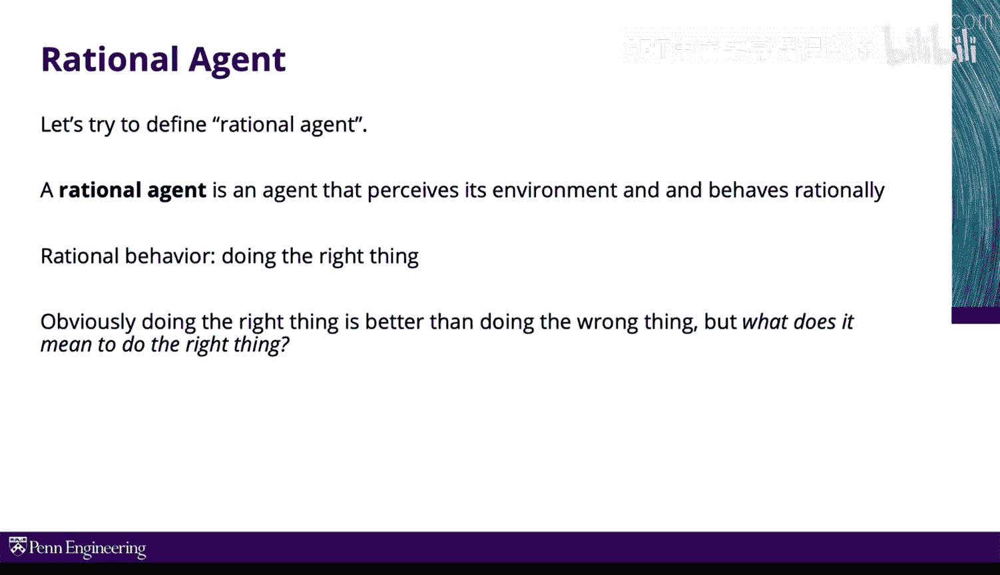
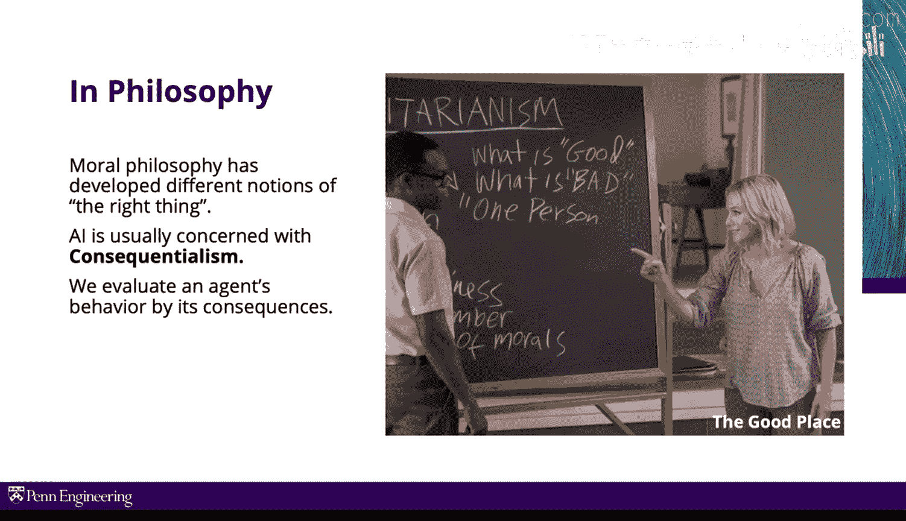

# 宾夕法尼亚大学《人工智能和机器学习基础（AI、数据科学、机器学习）AI and Machine Learning Essentials with Python》 p11 11_02_01_理性智能体-I.zh_en -BV16f421Q72q_p11-

One way that we might approach designing an artificially intelligent system is to build agents that act rationally。

Before doing so， we must answer the question。 what is a rational agent and what does it mean to act rationally。

These are questions addressed by disciplines like economics or philosophy。

We will review several ways of defining rational behavior through the lens of these different disciplines and how they relate to the definition for rational agents that we use in artificial intelligence。

Recall that there are several different views on what we might consider to be artificial intelligence。

We discussed agents that could think or act like humans。Or think or act rationally。 In this course。

 we're going to focus on the notion of acting rationally。The overarching theme of this class will be。

 how can we write effective programs and efficient algorithms that will allow us to design rational agents。

Let's decompose the phrase rational agent into its two pieces。

We'll first define what we mean by an agent， and then we'll define what we mean by rational。

An agent is defined as anything that can perceive its environment and act on it。

The parts of an agent that are used to perceive the environments are called its sensors。

 the parts of the agent that allow it to act on the environment are called as auators。

The signal that the agent receives from its sensors is called a percept。

 A percept will represent an agent's perception for an instant in time。

It could be represented as a vector of all the inputs that the agent receives through its sensors。

In addition to thinking about actuators and sensors。

 we can think about the relationship between the agent and the environment。In fact。

 we can define a mathematical representation of what the agent and the environment look like。

For the various topics in this class will give different formal definition of the elements of the problem space。

 which is often governed by the environment that the agent is acting in。For example。

 we will define what inputs and outputs the agent has access to and what the set of actions are that an agent can take。

Our model of the environment will change over the course， as well。For now。

 we can create a mathematical abstraction that is as broad as possible。

 We can say that an agent is specified by a function called the agent function that takes in as input。

 a sequence of percepts and then maps that sequence onto a sequence of actions。

The actions are going to be drawn from a set of possible actions that the robot could do via its actuators。

 For example， the actions could be something like increase the speed of rotation of its wheels or turn on a light or make some sound。

The actual set of actions is going to depend on the actuators that the agent has。

We will make a distinction between this mathematical abstraction of the agent function and the program that we write to implement that agent function。

The agent program will be a concrete implementation running on some physical system。

 An agent function can be implemented using all sorts of programs。

 It could be a sophisticated program that incorporates the algorithms that we'll learn about later in this course。

 but there's nothing inherent about the agent function that requires that it be particularly sophisticated algorithmically。

All it has to do is produce an action， given a particular percept。

The simplest solution to this could be a lookup table that associates every possible percept sequence with the best action to take。

 given that sequence。Of course， that kind of simple agent program might be infeasible since we're talking about sequences。

If the sequences are of unbounded length or if there's an exponential number of possible combination of percepts。

 then our lookup table might simply be too large， or it might be too difficult to explicitly enumerate the best action for every input sequence。

Instead of using simple table lookups， we are going to start developing more sophisticated algorithms for picking the best action。

Note that our definition of agent is actually quite generic。

 it includes anything that can perceive its environment through sensors and act on it through actuators。

Agents can therefore include a huge range of things。It could be a physical thing like a robot。

 but it could equally well be a software thing， like an intelligent agent that monitors the stock market from a stream of input data。

 like from Yahoo finance， and then operates on its environment by doing things like making trades。

That is an intelligent agent， even though it's not physical。

And the environment that it operates on is not a physical environment。

The agent can still perceive and act on its environment。Humans also satisfy the definition of agents。

 You can think of our senses as our senses， like our vision， our hearing and our sense of touch。

 Our actuators could be the things that we use to manipulate the environment like our arms or our legs or our fingers or our mouths。

 or our voices。Our definition of agents could even be satisfied by something as simple as a thermostat。

It perceives the environment in the room with a thermometer and then acts to alter it if it falls beneath a certain temperature。

It does this by adjusting the boiler to increase the temperature in the radiators and therefore the room。

Once it senses the temperature has exceeded the threshold， it acts again to turn the boiler off。

That's the working definition that we'll use for an agent。

Next， let's turn to the idea of rational behavior。What we really care about is not just building any agents。

 but building rational agents。 So let's start out by asking， what do we mean by rational？

We'll start with one definition and then iteratively refine it until we get a final definition that we're satisfied with。

Let's start simple。 A rational agent is some sort of agent that perceives the environment。

 and then behaves rationally。Let's define rational behavior as doing the right thing。

Since it's obviously better to do the right thing than it is to do the wrong thing。

But that begs the question， what does it mean to do the right thing and how do we define what the right thing is when we're talking about behaving rationally。

What does it mean to do the right thing， That's actually a very interesting and complex question。

 We could go down the philosophical route。There's this really fun TV show that's all about moral philosophy called the Good Place。

The show explicitly addresses how you should behave in order to be a good person using a range of perspectives from different moral philosophers。

If you're interested in learning more about what it means to do the right thing from a philosophical perspective。

 than I definitely recommend watching this show。 I bininged the good place during the pandemic。

 It's wonderful。 It's light and it's thoughtful at the same time。😊。

Moral philosophy has divine several different notions of what it means to do the right thing or what the right thing is。

AI typically fixates on a philosophical argument called consequentialism。

The idea of consequentialism is that we should evaluate the behavior of an agent or a person based on the consequences of the action that it takes。

When you plop an agent into an environment， then it's going to generate a sequence of actions based on what it perceives。

The actions of the agent are going to affect the environment around it。So what we'd like to say is。

 are the effects that the agent has on the environment around it desirable or not。

 we might want to define doing the right thing as having the agent choose actions that are going to result in desirable consequences。

That's one potential way of starting to refine our definition of what rational behavior means。

It could mean doing the things that will have the best consequences。

Does consequentialism require omnisitionence？If we should pick the action that will have the best outcome。

 then doesn't that mean that we should have the ability to foresee exactly what the outcome of our actions will be。

It doesn't seem possible to know with certainty what the result of a choice will be when we commit to an action。

Imagine this situation。 You see your friend on the sidewalk so you stop and say hello。

Then a window air conditioning unit falls out of the apartment above you and squashes you flat。

Was your decision to stop and say hi to your friend irrational because stopping had a bad consequence？

Trying to pick actions that will have good consequences。Like staying alive are clearly desirable。

 but it's not fair to say that you acted irrationally because there's no way that you could have anticipated that outcome。

What we want is to make sure that our definition of a rational agent should not require omniscience。

It should not have to be able to see in the future and to see what every outcome of every action will actually be。

Rationality can't require godlike abilities to foresee that if I choose this action。

 then this will be the ultimate result。