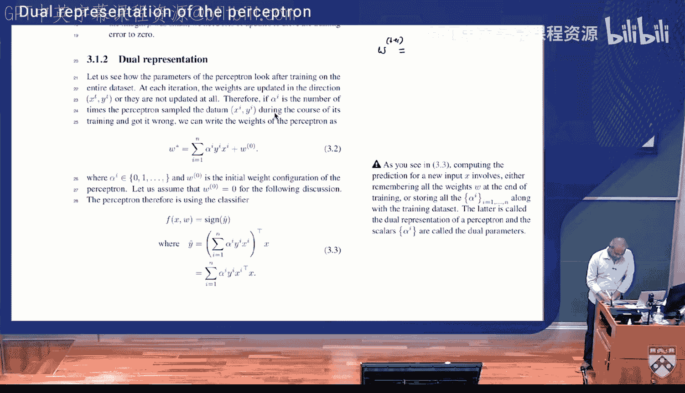
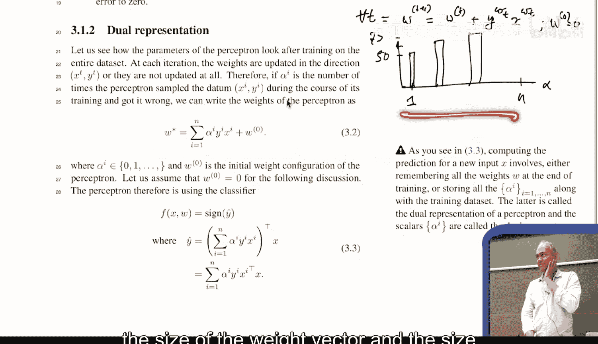
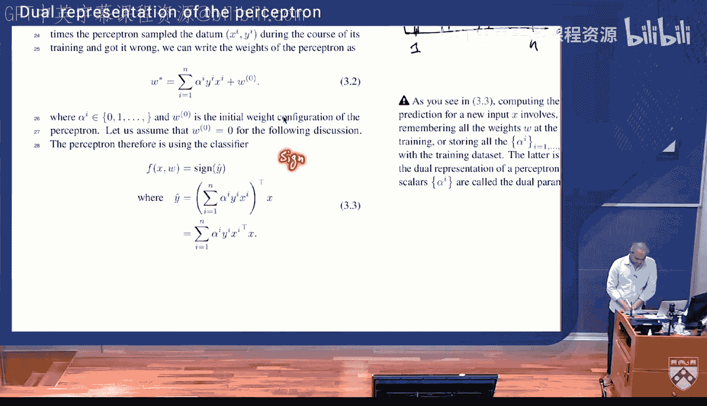
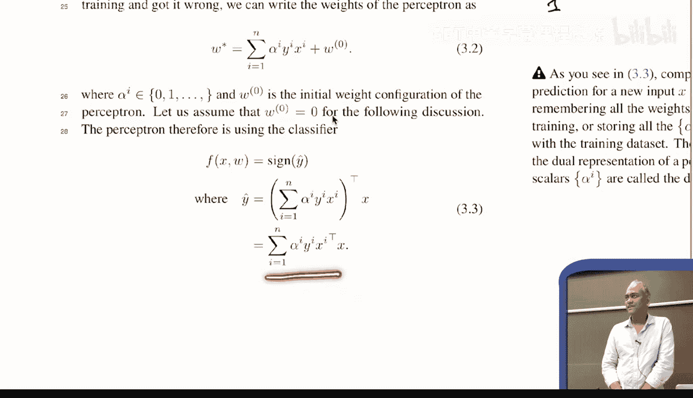
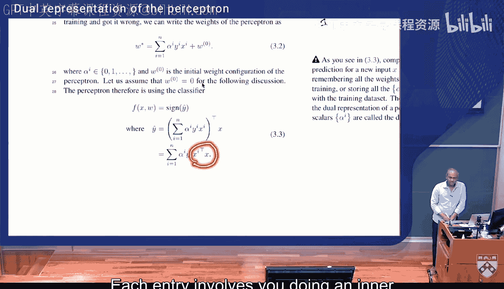
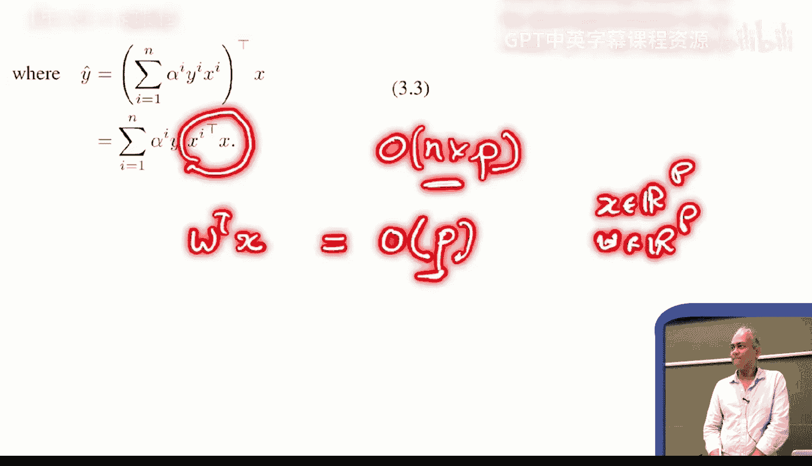

# 宾夕法尼亚大学《人工智能和机器学习基础（AI、数据科学、机器学习）AI and Machine Learning Essentials with Python》 p110 17_02_02_感知机的对偶表示.zh_en -BV16f421Q72q_p110-

What we will talk about is something called as the dual representation of a perceptron let us write the equations again。

诶。W T plus 1 is wT I again set the learning rate to be exactly1 and it is y omega t x omega t。

For all。Let us imagine that w 0 is equal to0。 So we start from w that is 0。

 and then we keep running SG。Is it clear to everyone that WT is a linear combination of all the mistakes that you have made？

If w0 is0， then w1。W1 is0 plus the first mistake， then w2 is w1 plus the second mistake even if in between you sample a few images where you are getting things right in this way the final w that you find。

Is always a linear combination of all the mistakes that you have made。

So I can write it like this Y Xi is the I samples output and the I sample X。

Alpha I are the total number of mistakes that I made on the I sample before I start。

This is a slightly complicated content to think about I run the perceptron for let's say。

1 million iterations。Let us say n is 100 samples on the first sample I make a mistake 50 times on the second sample I make a mistake 73 times on the third sample I make a mistake 157 times okay so Al I are all these numbers。

 5073，157 etc。This expression is correct because I started off from zero every time I make a mistake I add this particular number to it y I Xi if that sample was I and that is why I can just sum up I can just write this solution like this。

Is this intuitive to people？It is a very weird way of writing WTs until now we have been writing WTs like this for one iteration and suddenly here I wrote the entire answer。

Of course， I have。It is not as if I've done magic here the the。We the numbers， alpha I is。

 we don't really know。We know them only after training the perceptron， right。

 we don't know them a priori。They are the mistakes that I made while training the perceptron。

 so after I run it for 1 million time steps I simply check how many mistakes I made on every sample and then those are my little real numbers actually in tger Als。

How many alphas are there。Exactly equal to the number of samples， right。

Some of them may be zero because you may never have made a mistake on that sample。

Some of them may be zero because you may have never sampled that sample。

But let us imagine that you run for a very very long time and you sample every sample many many times and these are the final alpha is that you converse to if your data is linearly sable if there exists a w that splits your data cleanly into zero error then these alpha is will converse is that obvious to people。

Because the perceptron stops updating its weights， so it stops making mistakes。

 so it stops incrementing alpha I' for all samples。So this is one way to check when to stop。

You record your alpha I as a big vector， let us say this is alpha。

 it takes values from1 to or it has n different entries for some it is let's say 50 for some others it is 73 for some others it is some other number as soon as this vector stops changing you know that you fit the perceptron and there is nothing more to do。

These variables Als are called the dual representation of the perceptron。

 you can either store the weights on your hard disk or you can store the values alpha one in the same thing。

Weight is also a real valued number， it has P different entries。Alpha is a bunch of integers。

 it has lies on ZN， right it has n integers you can store whichever when you want。

If you have a very large number of weights in which by that。

 I mean if you have a very high dimensional images， then you may want to store the alphas。

Because the alphas might be smaller when the number fits。 This is a kind of a moot point。

 but I just want to impress upon you the fact that。

The size of the weight vector and the size of the alpha vector are different things。

Okay cool so let us just write it write things again clearly like he said we have our function F F before was what it was sign of a w transpose x this was our perceptron but then now we said that my solution w star is exactly this expression so I can substitute this expression per w star and write this expression。

， I have done nothing。 I have simply substituted the value that I claim to be the answer using the dual representation into our predictor app。

Okay。And this is this is the expression。 Now one thing to always remember in these kinds of formula is this very special term X I transpose X I。

 It is the outer product of your sorry it is the inner product of your images。Okay， X I is a vector。

 X I transpose X I is a real number。Anytime you see such an inner inner product of your inputs。

 you can do something very nice and we'll see very soon what that nice thing is。

But for now let us remember that the weights are equal to this formula and let us say that we said this to zero and just is a choice that we make and because of this you can write down this entire expression using alphas。

 but then like he said now given any new image x。You have to calculate the entire summation。

Every time you make a prediction。Okay， how many entries are there in the summation？And， and please。

Each entry involves you doing an inner product of P dimensional vectors or D dimension vectors。

So that is order n times P flops。Okay， to to calculate this function。If you are doing w transpose x。

What would be the number of flops？If x is a p dimensional vector。

Then W also has to be a p dimensional vector， So the number of flops is what。嗯。It is P numbers。

So P multiplications。So just like it was n times p here， it is p here。

 so obviously at each inference time you are spending a lot of energy calculating this objective。

We are calculating the predictions。

