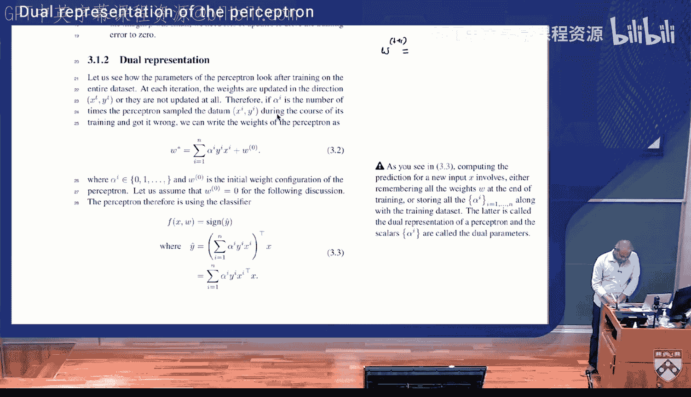
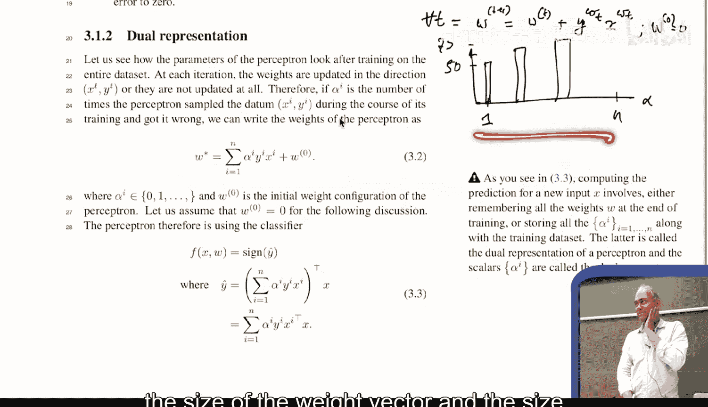
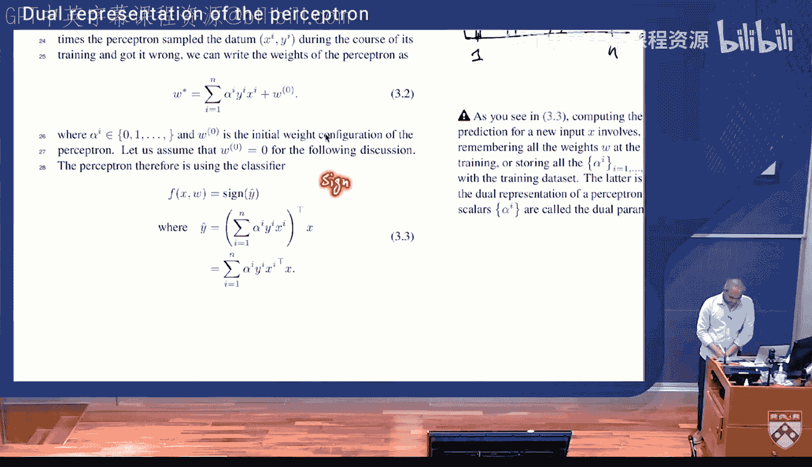
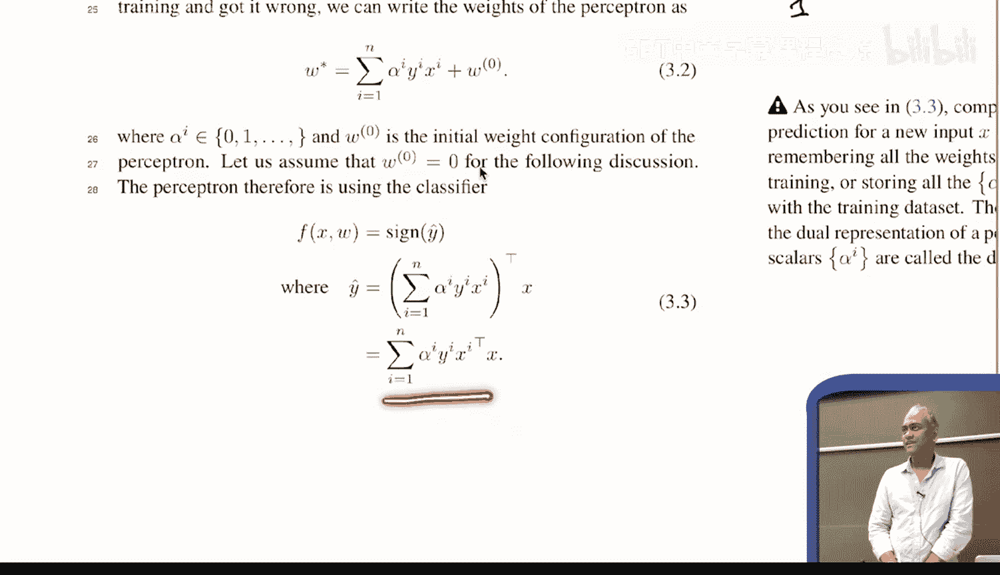
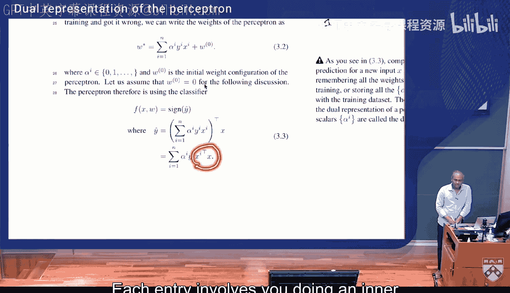
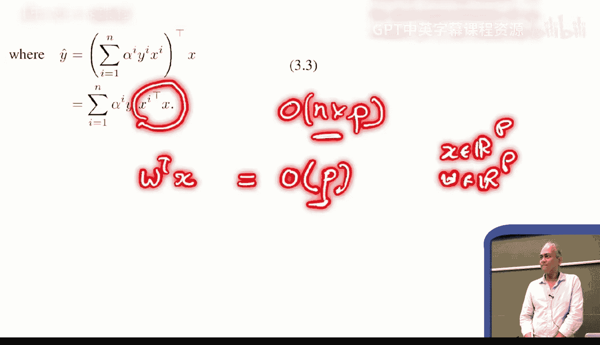

# 宾夕法尼亚大学《人工智能和机器学习基础》：17_02_02：感知机的对偶表示 👁️‍🗨️

在本节课中，我们将要学习感知机算法的另一种表达形式，称为“对偶表示”。我们将从回顾感知机的权重更新规则开始，逐步推导出对偶形式，并分析其含义与计算特性。

## 概述

我们将讨论的内容被称为感知机的对偶表示。首先，让我们再次写出感知机的权重更新方程。

## 权重更新方程的回顾

我们设定学习率恰好为1。权重更新规则可以写作：
**`w_{t+1} = w_t + y_i x_i`**
其中，`(x_i, y_i)` 是在第 `t` 次迭代中被错误分类的样本。

为了简化推导，我们假设初始权重向量 **`w_0 = 0`**。我们从零向量开始，然后持续运行随机梯度下降（SGD）算法。

## 权重的线性组合表示

一个关键的观察是：最终的权重向量 **`w_T`** 是所有错误分类样本的线性组合。

如果 `w_0 = 0`，那么：
*   `w_1 = 0 + y_1 x_1` （第一个错误）
*   `w_2 = w_1 + y_2 x_2` （第二个错误）

即使中间有样本被正确分类，最终找到的权重 **`w`** 始终是所有错误样本的线性组合。因此，我们可以将其写作：
**`w = Σ_{i=1}^{n} α_i y_i x_i`**

在这个公式中：
*   `y_i` 是第 `i` 个样本的真实标签（+1 或 -1）。
*   `x_i` 是第 `i` 个样本的特征向量。
*   **`α_i`** 是一个非负整数，代表在训练过程中，模型在第 `i` 个样本上犯错的次数。

## 理解系数 α_i

这是一个需要仔细思考的概念。假设我们运行感知机算法100万次迭代，共有100个样本（n=100）。在训练过程中：
*   在第一个样本上，我们可能犯了50次错误。
*   在第二个样本上，我们可能犯了73次错误。
*   在第三个样本上，我们可能犯了157次错误。
那么，对应的 `α_i` 值就是50， 73， 157，等等。

这个表达式是正确的，因为我们从零向量开始，每次犯错，我们就把对应的 `y_i x_i` 加到权重上。因此，最终的解可以写成这种求和形式。

**`α_i` 的值是在训练完成后才知道的**。我们无法预先知道它们。它们是在训练感知机过程中，在每个样本上累积的错误次数。

`α_i` 的数量正好等于训练样本的数量 `n`。其中一些可能为零，因为你可能从未在该样本上犯错，或者从未采样到该样本。

假设我们运行非常长的时间，并且每个样本都被采样了很多次。**如果数据是线性可分的**（即存在一个超平面 `w` 能将数据完美分开，达到零错误率），那么这些 `α_i` 值最终将收敛（停止增长）。这是因为感知机停止更新权重，也就停止了犯错，从而停止了 `α_i` 的增加。

这提供了一种判断训练何时停止的方法：你可以将 `α_i` 记录为一个向量。一旦这个向量停止变化，你就知道感知机已经拟合完成，无需继续训练。

## 对偶表示的定义

这些变量 **`α_i`** 被称为感知机的**对偶表示**。在模型存储时，你可以选择存储权重向量 `w`，也可以选择存储对偶变量 `α`。
*   权重 `w` 是一个实数向量，有 `p` 个维度（特征数量）。
*   对偶变量 `α` 是一组非负整数，有 `n` 个值（样本数量）。

你可以根据情况选择存储哪一个。如果你处理的是非常高维的数据（例如 `p` 很大），而样本数量 `n` 相对较小，那么存储 `α` 可能更节省空间。这强调了权重向量的大小和对偶向量的大小是不同的概念。

## 对偶形式的预测函数

现在，让我们清晰地重写公式。我们之前的感知机预测函数是：
**`f(x) = sign(w^T x)`**

现在，我们说最终的解 `w*` 恰好是上面的线性组合表达式。我们可以将这个表达式代入预测函数中的 `w*`：

**`f(x) = sign( (Σ_{i=1}^{n} α_i y_i x_i)^T x )`**

根据线性代数，我们可以将求和移到内积内部：

**`f(x) = sign( Σ_{i=1}^{n} α_i y_i (x_i^T x) )`**

我们并没有做任何魔法变换，只是将对偶表示声称的答案代入了我们的预测器 `f`。

在这个公式中，需要特别注意一项：**`x_i^T x`**。这是你的输入向量之间的**内积**。`x_i` 是一个向量，`x_i^T x` 是一个实数。任何时候你看到输入之间的这种内积，都可以做一些非常巧妙的事情（我们很快会看到）。但现在，请记住权重可以用这个公式表示。

## 计算复杂度分析

现在，给定任何新图像 `x` 进行预测时，你必须计算整个求和式。

以下是计算这个求和式所需的操作：
*   求和中有多少项？有 `n` 项（样本数量）。
*   每一项涉及什么操作？计算一个 `p` 维向量（或 `d` 维向量）的内积 `x_i^T x`。

因此，计算这个函数的时间复杂度大约是 **`O(n * p)`** 次浮点运算（flops）。

如果我们使用原始的权重形式进行预测 `f(x) = sign(w^T x)`，需要多少次浮点运算？
*   如果 `x` 是 `p` 维向量，`w` 也是 `p` 维向量。
*   那么需要 `p` 次乘法运算，即 **`O(p)`** 次浮点运算。

显然，在每次进行预测（推理）时，使用对偶形式 `O(n*p)` 比使用原始权重形式 `O(p)` 要消耗更多的计算资源。

## 总结

本节课中，我们一起学习了感知机的对偶表示：
1.  我们推导出，最终的感知机权重可以表示为所有错误分类样本的线性组合 **`w = Σ α_i y_i x_i`**，其中 `α_i` 是样本 `i` 上犯错的次数。
2.  系数 **`α_i`** 构成了感知机的对偶表示，与原始的权重表示 `w` 是等价的，但维度不同（`α` 的维度是样本数 `n`，`w` 的维度是特征数 `p`）。
3.  我们得到了对偶形式的预测函数 **`f(x) = sign( Σ α_i y_i (x_i^T x) )`**。
4.  我们分析了对偶形式在预测时的计算复杂度为 `O(n*p)`，高于原始权重形式的 `O(p)`。这种计算上的代价是将计算负担从训练阶段（学习 `α`）转移到了推理阶段。

对偶表示的重要性将在后续学习支持向量机（SVM）时得到充分体现，因为它是理解核方法（Kernel Method）的关键基础。