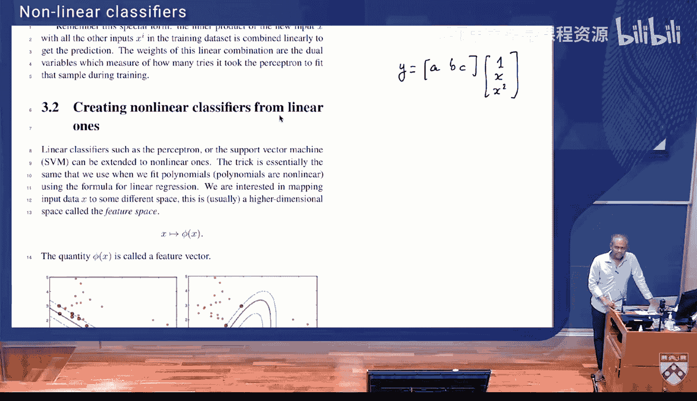
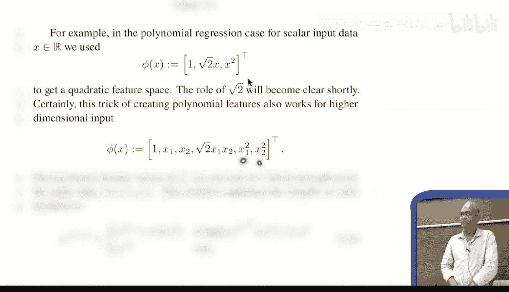
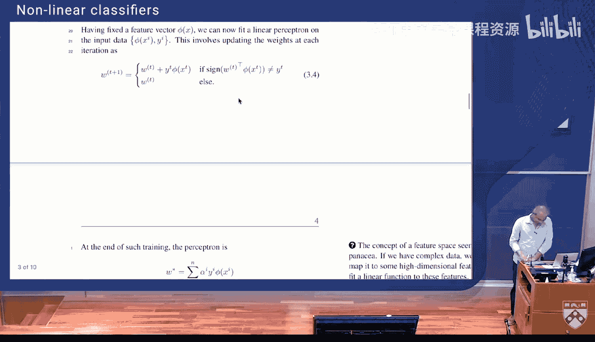

# 宾夕法尼亚大学《人工智能和机器学习基础（AI、数据科学、机器学习）AI and Machine Learning Essentials with Python》 p111 18_02_03_非线性分类器.zh_en -BV16f421Q72q_p111-

Does anyone know how to fit polynomial regression？You have done this in high school， probably。

So I have a y equal to sum function。Of1 x。嗯。How can I fit a quadratic polynomial to my data？

I have inputs that that are real valued， I have outputs that are real valued。

 and I would like to fit a linear regression。To this problem or actually I should correct myself I would like to fit a quadratic polynomial to this data how can I fit a quadratic polynomial well I take my inputs x and I convert them into this very peculiar vector1 x x square and now I have three parameters in my model and my y is a times 1 plus b times x plus c times x square so it is a generic。

呃。Codratic polynomial。Okay but as you can see I can fit this expression by treating this as w and treating this other vector as some linear vector z so I had scalar valued inputs but I converted them into three dimension inputs now I have three dimension weight vector and I can do linear regression。

All of you have done this before， right。Okay。In simple words。

 we can fit a polynomial by expanding the inputs to look like these mononomial terms。

And then we can fit a nonlinear function， this is a nonlinear function no longer a linear regression。

 but we can still cheat by having these x x square and1 as three different dimensions of a new fake input。

Okay。This is how we fit polyennomial regression。 You can do this for any order of polynomials。

 This is the oldest trick in the book where we take stuff that looks complicated， and then we。

Increase the dimensionality of the input space so that we can use a simpler model to fit upon it。

in this case we only knew how to fit linear regression we wanted to fit a quadratic but we can rewrite the quadratic as a linear model by pretending that these are the features the features don't have to be independent of each other features are whatever you choose okay。

So this concept is general in general you can take your inputs x and then convert them into a feature space。

And let us call these features phi of x and then fit a model that is w transpose phi of x。Okay。

Can you tell me now how I would fit this particular problem。

 so let's say I have I'm doing classification。You can do the same thing for a perceptron。

 just like we did perceptron is sine of w transverse x， you can now do sine of w transverse phi of x。

 no big difference。Let us say our pluses were all near the origin。

 Our minuses were all at around the same distance away from the origin。

 There is no linear hyperplane that separates the tube。What would you do。This is， let's say。

 two dimensional data。So you can do a Gausian transformation or write these things in polar coordinates。

In terms of r and theta and then when you look at the two point clouds such are at a clearly different radius from the origin right so you will see a hyperplane that separates them in the first dimension of the polar coordinates so you will fit a circle but in order to fit the circle using linear regression you have to first transform the inputs in some way。

The circle is a nonlinear function。 The circle is x1 square plus x2 square equal to some constant C。

This is a clearly a nonlinear function of X1 and x2。

 but let us say that we only wanted to use linear regression to fit this you would first have to convert X1 and x2s into some new coordinate frame。

In。And ensure that the circle looks like a plane in that coordinate frame。

 and one example of such a coordinate frame is polar coordinates。

The circle is play in full coordinatements， right？So。

 this is a very visual way to remember the kernel trick any time stuff where you cannot fit a hyperplane cannot fit a linear model to separate the two point clouds。

If you transform the inputs to look like they belong to some other coordinate frame。

 then you can fit a linear model in the new coordinate frame。啊。This is another pictorial example。

 these are our blue points， these are our red points clearly there does not exist a hyperplane that separates the two but if you imagine converting them into some other function space in this case it is a more complicated function space than just quadratics or polar coordinates。

 it is some other function space in this case this function is a linear function in that space。

Let us look at some calculations。Just like we did for the quadratic polynomial what we are really doing is we are creating a feature space for ourselves phi of x which is three dimensional1 comma square of 2 x a square root 2 is not very important it is just for a nice citiesities when you multiply the two things together and you get a two instead of something else and then it is x square so if x was a real valued input then phi of x is a three dimensional input now your w will also have to be three dimensionsal but you can fit a linear model。

You can also do this for higher dimensional things。

 so if you have two dimensional input x if x is itself two dimensional then phi of x a quadratic feature can be something like this so these are all the different monoomers that you get when you expand if must be whole square。

1， x 1 x 2 square root 2 x1， x2， x1 square， x 2 square。

As I said。You can transform the inputs into P of x and now again run perceptioncept run no worries at all。

Like before there is also a dual representation for the perceptron with the features。

 the alphas are the same alphas are simply the mistakes now simply every time you say x in your perceptron algorithm or SDGD you replace it with phi of x without any changes whatsoever。

Again， we can write the predictor as the sine function applied to the sumation of all these things。

 you again see the inner product phi of xi which are all your inputs and p of x which is your test datum so if x is your test datum instead of simply doing sine of w transpose x now you can do this entire business。

Okay， first， you take the test data。Use whatever function youre used for p and create P of x。

Haveve all your training data and their respective v of x size and then calculate this sum and this is how you make predictions okay until now we have done nothing very complicated we simply introduced the concept of this feature space and replaced everything that we saw in the linear model by phi of x。

We don't know how to calculate p of x。 I gave you a few examples where you were able to use your intuition to calculate p of x。

 but in general。You don't know how to calculate fear of X。

