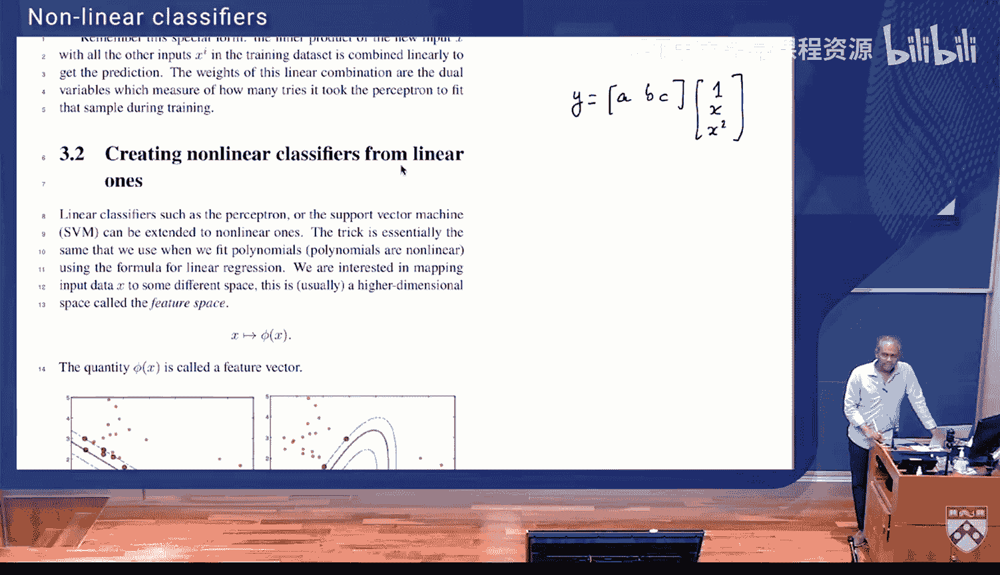
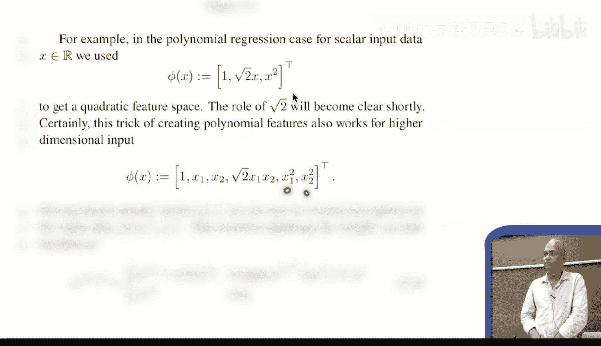
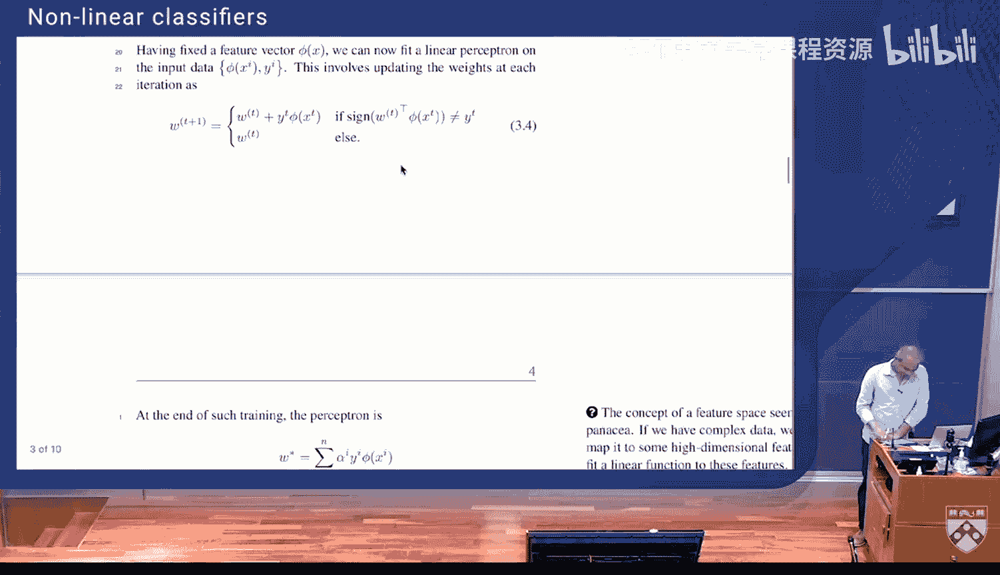

# 人工智能和机器学习基础：18_02_03：非线性分类器 🧠

在本节课中，我们将要学习如何通过特征映射（Feature Mapping）将非线性问题转化为线性问题，从而使用我们熟悉的线性模型（如线性回归、感知机）来解决。核心思想是：通过一个函数 **φ(x)** 将原始输入数据映射到一个新的、更高维的特征空间，在这个新空间中，原本非线性可分的数据可能变得线性可分。

## 从多项式回归说起

上一节我们介绍了线性模型。本节中我们来看看，当数据关系是非线性时，我们该如何处理。

你是否知道如何拟合多项式回归？你在高中时很可能已经做过类似的事情。

假设我有一个函数 **y = f(x)**。如何为我的数据拟合一个二次多项式呢？

我的输入是实数值，输出也是实数值。我想为这个问题拟合一个线性回归模型。或者，更准确地说，我想为这些数据拟合一个二次多项式。

如何拟合一个二次多项式呢？我取我的输入 **x**，然后将它们转换成这样一个特殊的向量：**[1, x, x²]**。现在我的模型中有三个参数，我的 **y** 可以表示为：**y = a * 1 + b * x + c * x²**。这就是一个通用的二次多项式。

但正如你所见，我可以将这个表达式视为 **w**（权重向量）与某个线性向量 **z** 的点积。我原本是标量输入，但将其转换成了三维输入。现在我有一个三维权重向量，就可以进行线性回归了。你们以前都做过这个，对吧？

简单来说，我们可以通过将输入扩展为这些单项式项的形式来拟合多项式。然后，我们就可以拟合一个非线性函数。这不再是一个线性回归，但我们仍然可以通过将 **x**、**x²** 和 **1** 视为一个新“虚构”输入的不同维度来“作弊”。

这就是我们拟合多项式回归的方法。你可以对任何阶数的多项式进行此操作。这是最古老的技巧：我们将看似复杂的东西，通过增加输入空间的维度，使得我们可以使用一个更简单的模型（在这里是线性模型）来拟合它。

在这个例子中，我们只知道如何拟合线性回归，但我们想拟合一个二次函数。我们可以通过假装这些是特征（features）来将二次函数重写为一个线性模型。特征之间不必相互独立，特征是你选择的任何东西。

## 特征空间的一般概念

这个概念是通用的。通常，你可以取你的输入 **x**，然后将它们转换到一个特征空间。让我们称这些特征为 **φ(x)**，然后拟合一个模型：**ŷ = wᵀ φ(x)**。

现在，你能告诉我如何拟合下面这个特定的分类问题吗？

假设我正在做分类。你可以对感知机做同样的事情。就像我们之前做的感知机是 **sign(wᵀ x)**，你现在可以做 **sign(wᵀ φ(x))**，没什么大区别。

假设我们的正类样本（+）都靠近原点，而负类样本（-）都分布在离原点大致相同距离的位置。不存在一个线性的超平面来分离这两类数据。你会怎么做？

这是二维数据。你可以做一个高斯变换，或者用极坐标（r 和 θ）来表示这些点。当你观察这两团点云时，会发现它们距离原点的半径明显不同。因此，在极坐标的第一个维度上，你会看到一个能将它们分开的超平面。所以，你将拟合一个圆。但为了使用线性回归来拟合这个圆，你必须首先以某种方式转换输入。

圆是一个非线性函数。圆的方程是 **x₁² + x₂² = C**（C为常数）。这显然是 **x₁** 和 **x₂** 的非线性函数。

但是，假设我们只想使用线性回归来拟合它，你必须首先将 **x₁** 和 **x₂** 转换到某个新的坐标系中，并确保在这个新坐标系中，圆看起来像一个平面。极坐标就是这样一个坐标系的例子。在极坐标中，圆就是一个平面，对吧？

这是一种非常直观的方式来记住核技巧（Kernel Trick）：任何时候，当你无法拟合一个超平面（即无法用线性模型分离两团点云）时，如果你将输入转换到另一个坐标系中，那么你就可以在新的坐标系中拟合一个线性模型。

## 另一个图示例子

这些是我们的蓝色点，这些是我们的红色点。显然，不存在一个能分隔两者的超平面。但如果你想象将它们转换到某个其他函数空间（在这个例子中，它比二次项或极坐标更复杂），那么在这个新空间中，分隔函数就是一个线性函数。

## 具体计算

就像我们对二次多项式所做的那样，我们实际上是在为自己创建一个特征空间 **φ(x)**。例如，如果 **x** 是实值输入，那么 **φ(x)** 可以是一个三维向量：**[1, √2 x, x²]**。这里的 √2 并不关键，只是为了在计算点积时得到整洁的结果（例如得到 2 而不是其他值）。现在你的 **w** 也必须是三维的，但你可以拟合一个线性模型。

你也可以对更高维的输入做同样的事情。所以，如果你有一个二维输入 **x**（即 **x** 本身是二维的），那么一个二次特征映射 **φ(x)** 可以是这样的：这些是展开 **(x₁, x₂)²** 时得到的所有单项式。

以下是可能的特征向量构成：
*   1
*   √2 x₁
*   √2 x₂
*   x₁²
*   x₂²
*   √2 x₁x₂

正如我所说，你可以将输入转换为 **φ(x)**，然后就可以毫无顾虑地运行感知机算法。

与之前一样，带有特征映射的感知机也有对偶表示。α 值（阿尔法）是相同的，它们仍然代表错误分类的次数。现在，每当你在线性感知机算法或 SGD 中看到 **x** 时，只需将其替换为 **φ(x)**，无需任何其他更改。

我们可以将预测器写为应用于以下求和结果的符号函数：
**sign( Σᵢ αᵢ yᵢ φ(xᵢ)ᵀ φ(x) )**

你再次看到了内积：**φ(xᵢ)ᵀ φ(x)**。这里 **φ(xᵢ)** 是你所有的训练输入，**φ(x)** 是你的测试数据点。

因此，对于测试数据 **x**，预测步骤如下：
1.  首先，取测试数据 **x**，使用你为 **φ** 定义的任何函数，创建 **φ(x)**。
2.  拥有你所有的训练数据及其对应的 **φ(xᵢ)**。
3.  计算上述求和。
4.  这就是你进行预测的方法。

到目前为止，我们还没有做任何非常复杂的事情。我们只是引入了特征空间的概念，并用 **φ(x)** 替换了线性模型中看到的所有 **x**。

## 一个关键问题

我们不知道如何计算 **φ(x)**。我给了你几个例子，你可以利用直觉来计算 **φ(x)**（例如多项式展开、极坐标变换）。但在一般情况下，你并不知道如何计算 **φ(x)**。这正是核方法（Kernel Methods）要解决的核心问题，它允许我们在不知道 **φ(x)** 显式形式的情况下，直接计算内积 **φ(xᵢ)ᵀ φ(x)**。这将是后续课程的重要内容。

## 总结

本节课中我们一起学习了非线性分类的核心预处理思想——特征映射。我们了解到，通过一个函数 **φ(x)** 将数据从原始空间映射到高维特征空间，可以在新空间中用线性模型解决原始空间中的非线性问题。我们以多项式回归和圆形决策边界为例，具体说明了如何构造特征映射。最后，我们指出了直接设计 **φ(x)** 的困难，这为引入强大的核方法奠定了基础。