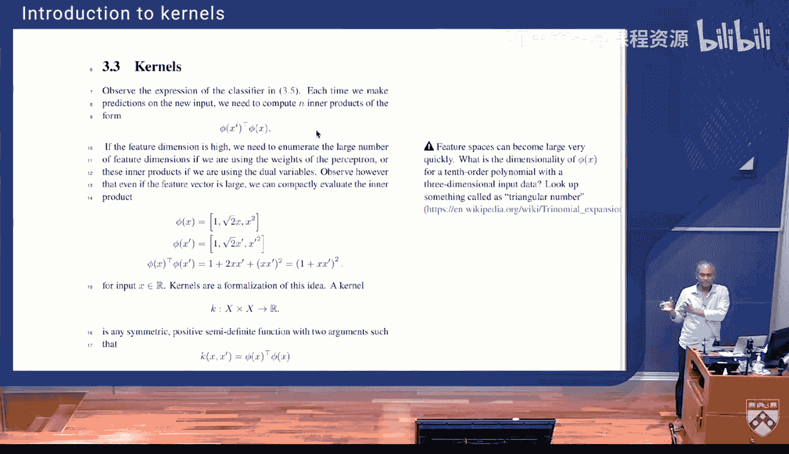
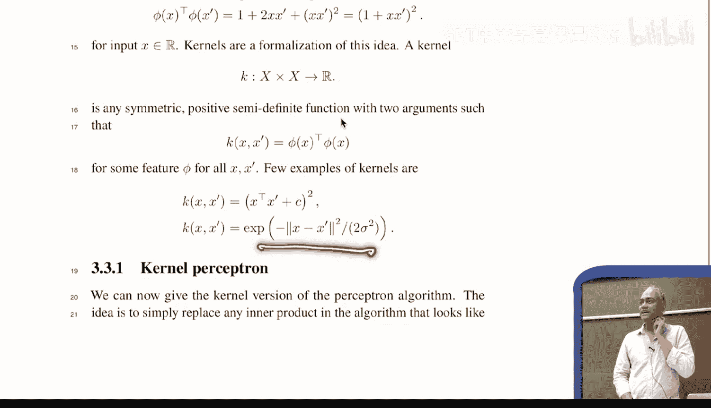
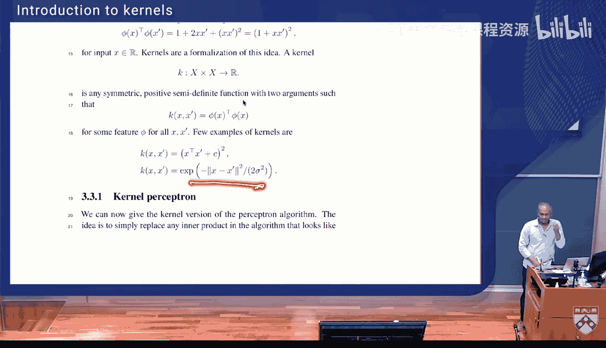

# 宾夕法尼亚大学《人工智能和机器学习基础（AI、数据科学、机器学习）AI and Machine Learning Essentials with Python》 p112 19_02_01_核方法入门.zh_en -BV16f421Q72q_p112-

Before we go on to how to calculate p of x， let me take a slightly。

Let me tell you a little bit about kernels， this will be useful in understanding how convolutional kernels work。

 convolution kernels are a special kind of kernels and these are the more general kind of kernels。😊。

When we wrote down these expressions， we always saw these inner products。

 Phi transpose Phi or x transpose x。The concept of a kernel machine exactly exploits this inner product。

 Any time you see an inner product， you will be able to write it down using you will be able to。

Reduce the amount of flops necessary to calculate the summation。By using a kernel machine。

And here is how it looks。So phi of x is， let's say， our quadratic 1 square root 2 x x squared。

Fhi of some other x prime x prime is let just some other image in our data。

 it is one square root to x prime x prime whole square。

When you take the inner product p of x transpose phi of x prime。

 you are really multiplying these two things together and so you will get1 times1 plus 2 times x times x transpose plus xx transpose ver square。

sorry， I shouldn answer transfer X， ors school， all of these are real numbers。

If you think about this carefully， you will notice that this is equal to 1 plus x times x prime whole square。

This is a very important point， the inner product of these two feature vectors is a nice function like this。

This function is what is called a kernel。It is called a kernel and a simple intuitivetutu way of remembering this is to say that this particular quantity is large if x and x prime are similar to each other。

If x is plus 1 and x prime is minus1， then this one will be 0。But if x is plus 1 and x prime is 2。

 then this number is something large it is equal to。3 square， which is9。

Clonnel functions are functions which intuitively measure the similarity between two inputs。

You can cook up any function you want that measures the similarity between two inputs in this case。

 this is mine。So， kernels are simply a formalization of the idea。

 it is a function that takes in two inputs。As the argument and returns a real number so x and x prime are two inputs for us and what comes out is a real number。

 the similarity between x and x prime so if you have some intuitive way of understanding when two inputs are the same let us say both are images that are essentially orange both are images that are essentially black then you can write down a kernel using simply a python function that checks when two images are similar right any which intuitive understanding that you have of what makes two things similar you can write down write it down as a function you no longer need to cook up a feature space。

In this case， in this expression， there is no p of x。 P of x is implicit。

 you can give me this function， and I will pretend as if I know what p of x is。Good。

 so quadratics are always not the only kind of kernels there are many other kinds of kernels。

 this is the vector version of the quadraratic x transpose x prime plus c equal square。

Is this a real number？Let us say x is a vector in p dimensions， x transpose x prime is a real number。

All right。It is the inner product between two vectors， so this is a real number。

Clonnelnals always are real numbers。 There is no questions about it。 Okay， Theyre taken in as input。

 anything。But they have to return an real number。This is another example of a kernel。

E to the negative x minus x prime whole square。

If x and x prime are very different from each other。Then what is this what is this kernelnal return？

Something that is very close to 0， right， It is era raised to negative of some very large number。

If x and X prime are very similar to each other， if let us say they are identical。

 then what does this function return1？So kernelels are simply similarity functions any way to measure the similarity。

