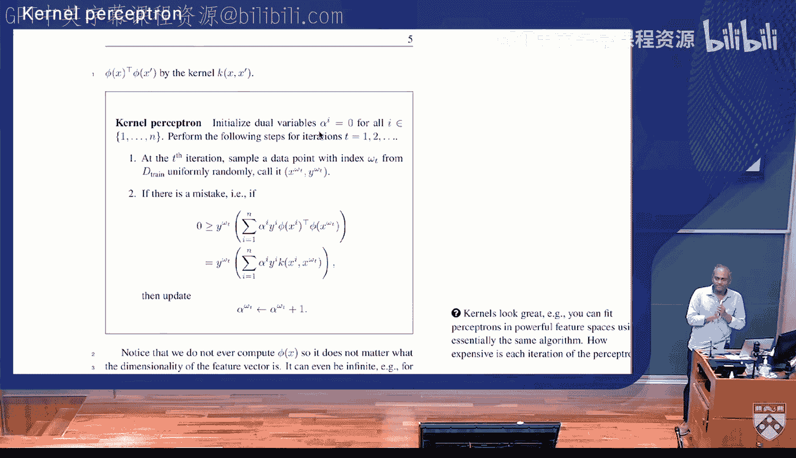
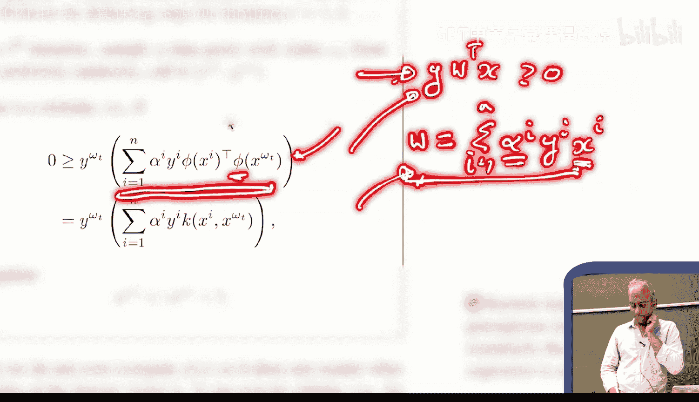
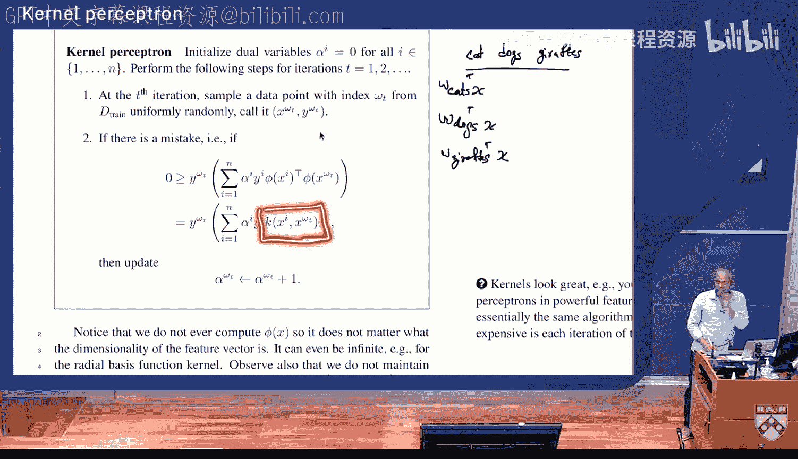
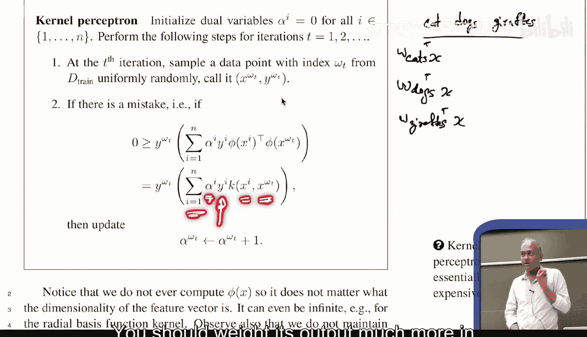
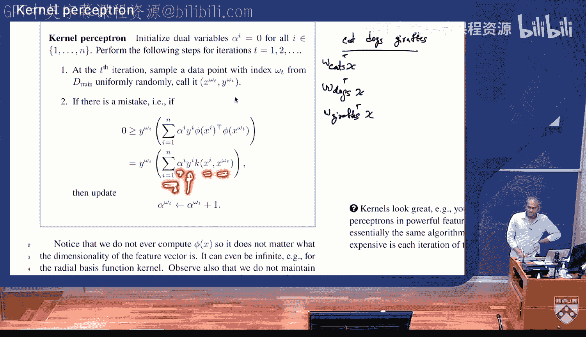

# 宾夕法尼亚大学《人工智能和机器学习基础（AI、数据科学、机器学习）AI and Machine Learning Essentials with Python》 p113 20_02_02_核感知机.zh_en -BV16f421Q72q_p113-

Now we will write down what is called a kernel perceptron it is exactly identical to the perceptron with feature space。

 we will simply write it down in a different way。😊。

As before we will initialize our dual variables to 0 before you started training you haven't made any mistake on any sample yet。

 so all the alpha I' are 0。😊，At each iteration， you sample an image and it is corresponding a label randomly from the data。

And let us say that this is our dataset set and you call this particular sample x omega t and y omega t。

How do we check if there is a mistake， Well， this entire expression has to be positive right before we are doing y times w transpose x has to be greater than 0。

 But now our w is equal to alpha I Y I X， I， I goes from one to n。

 this is our w at the teeth iteration Al I keep changing after every iteration。

 But given the current value of alpha I， this is the w that we are maintaining as our perceptron。

 So checking whether the perceptron next a mistake is simply equivalent to calculating this summation。

😊，Is that clear to everyone？We are not doing anything other than rewriting expressions simply substituting the value of w into this expression and this is what you get except that I wrote down it wrote it down in terms of excess here I have written it down in terms of fees。

So this is what a mistake means if there is a mistake， what do you do。

 you simply increment alpha right incrementing alpha is like changing w。Just like we updated w。

 if there is a mistake where in SGd in the dual version of the perceptron， there is no w。

 there is only alphas， so you see a mistake you improve its you increment its alpha by 1。😊。

Next iteration you sample a new data point， you calculate a entire sum again again if you see a mistake you increment at alpha by one and as you keep running this for many iterations your alphas will increase for all samples and at some point they will stop increasing that is when you fit at the verceptron。

😊，Is this clear to everyone this is a way of fitting the perceptionceptron without actually having to remember what the weights are you only remember what the dual variables are。

😊，Back to this。This algorithm， not surprisingly， is called the kernel percept one algorithm。

It is perceptron because we are fitting a perceptron It is kernel perceptron because we are using this function phi transpose phi is you can write it down as a kernel right This is exactly what we said a kernel is the kernel is something that is an inner product of the two feature vectors instead of writing down what the feature vector is you can write down what the kernel is and this is one function you can call up this function takesing two inputs and it returns a real number that measures a similarity between these two inputs。

So， in order to implement the kernel perceptron， notice that you don't need the weights and that that is because they are using the dual representation。

 but notice that you also do need to know what p is。You can only write down this function k。

 the kernel， and then just run the kernel perceptron algorithm。

It is capturing whether omega T and I are similar to each other。

 X I is the eighth image in your training dataset set。

 X omega T is the one that is sampled in this iteration。

So you are estimating the output of your newly sampled image as a function of how similar it is to all the other images in your training dataset。

Think about this a little more slowly， for instance。

 if X I and x omega T are very similar to each other。

 if x1 and x omega T are very similar to each other and x alpha 1 is very large in that case you will use y1 a lot when you make predictions on omega T。

😊，Is this easy to understand。If one of the images in your training dataset is very similar to your recently sample image。

 and in the past you made lots and lots of mistakes on that image。

 then you know that you should use its output it should weigh its output much more in this sumation to get the correct output of omega T we are representing the output that we predict for x omega T as the weighted sum of all images that are similar to omega T weighted by their mistakes。

