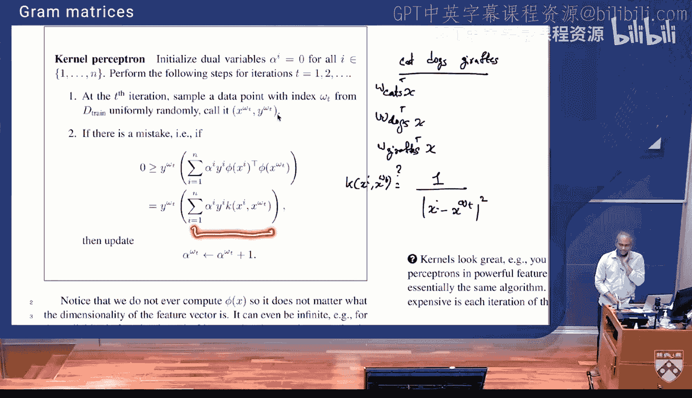
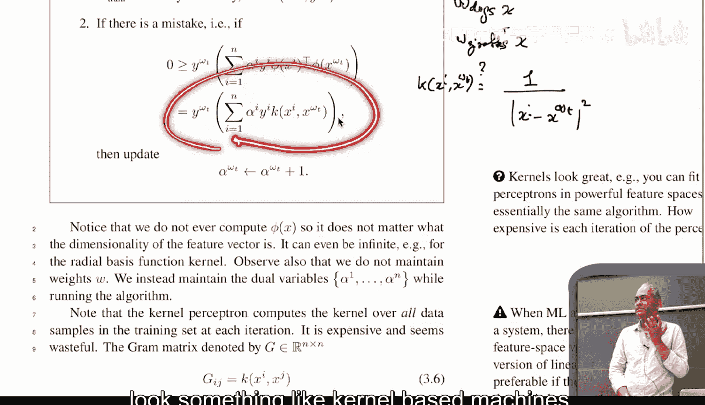
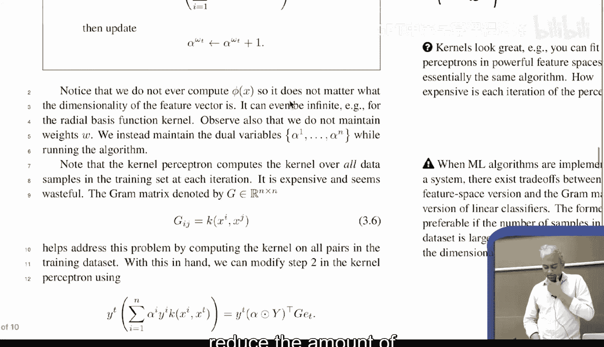
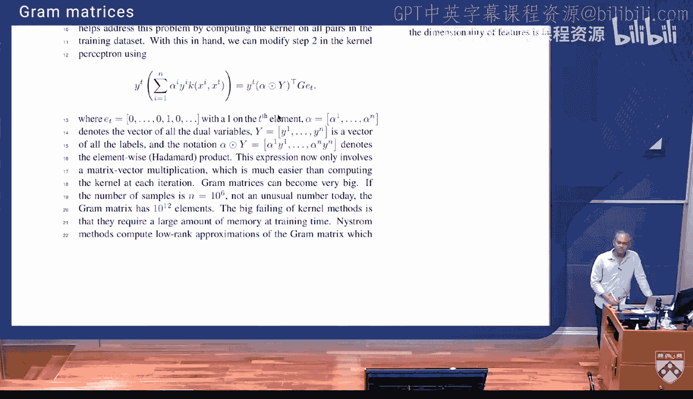

# 宾夕法尼亚大学《人工智能和机器学习基础（AI、数据科学、机器学习）AI and Machine Learning Essentials with Python》 p114 21_02_03_Gram矩阵.zh_en -BV16f421Q72q_p114-

So now we know how to run the kernel perceptron， as I said a few times now it is not terribly cheap to run the kernel perceptron because I to keep calculating these inner products all the time or calculating the character the kernel all the time。

But remember that x omega t is one of the samples of your training data set right so if you could pre calculateculate your kernel for all pairs of samples。

 then you wouldn't have to do it again and again。So you can take your data。

Re calculateculate all these terms x1 a k of x1 comma x2 k of x2 comma x3 and all such pairs。

 then you can always just plug in these things and write this entire business as a matrix vector multiplication The vector is the vector of alphas。

 The matrix is a matrix of all the kernel entries。

Okay。This matrix has a name。It is called the gram matrix。

 so gram matrix is a matrix whose i Jth entry is kernel applied to the Ih input and the Jth input together。

So it is just a matrix with all the kernel values inside。And as I said。

 once you have calculated the grand matrix， they can write this entire summation as a matrix vector product where the matrix is G and the vector is alpha times y in this case。

Alpha keeps changing after every iteration that is something important to remember the number of mistakes you would make keep keeps on changing after every iterationeration it is important to appreciate that gram matrices are not small objects。

 so if you have a million images，The number of entries in your gram matrix is 10 this to 12。

which is a very large number of entries okay so even if this looks like some very simple model with linear functions and stuff。

 it is a pretty heavy thing to run in fact， until about 2010。

 2012 or so essentially every machine learning algorithm in the industry would look something like kernel based machines。

So there have been lots and lots of techniques in how to reduce the amount of flops required to calculate these kinds of summations for instance this is a matrix factor product so you can write down this matrix as a LUDcomposition or some other factorization and update this factorization in time and so on and so so。

These methods go under the name of nicetro methods。

 and you can read a little more on Wikipedia or something about it。

