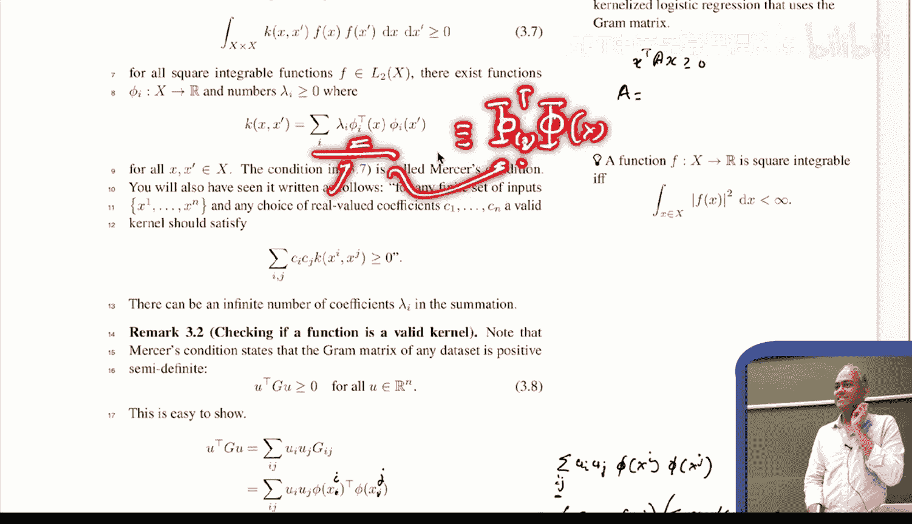
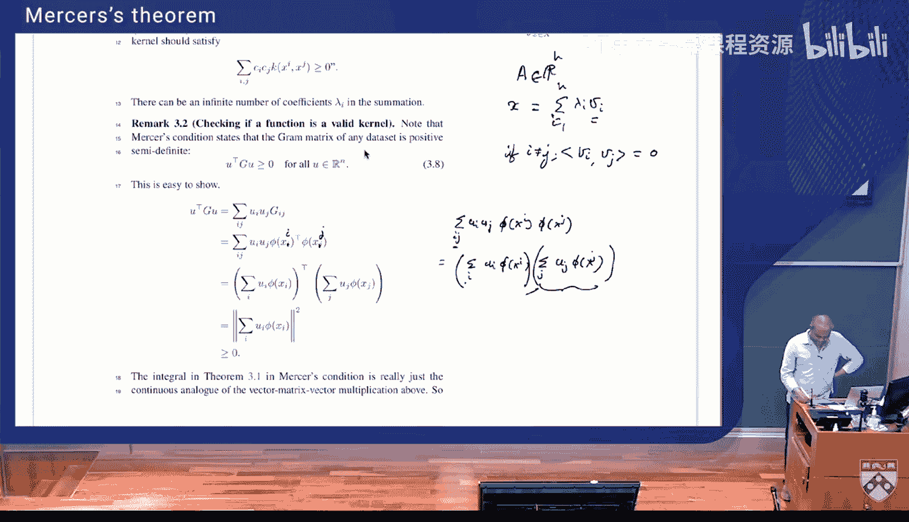
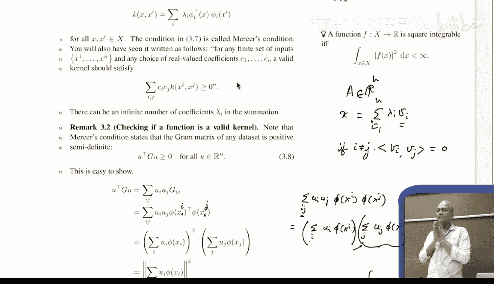

# 宾夕法尼亚大学《人工智能和机器学习基础（AI、数据科学、机器学习）AI and Machine Learning Essentials with Python》 p115 22_02_04_Mercer定理.zh_en -BV16f421Q72q_p115-

The next thing that I want to talk about is what makes a kernel so until now weve been saying that kernel is something that measures the similarity between inputs。

 but not all functions are kernels so if you write down in your code some python function to estimate a similarity you would like to convince yourself that this function is a legitimate kernel so you would like to understand what makes a function a kernel function as opposed to any other function。

And this is what is called so Mercer's theorem is one way to understand it。

 it lets you say that so long as your kernel satisfies some regulatory properties and the regulatory properties are not terribly important so long as your kernel satisfies these properties then it can be written down as the inner product of some feature space in other words。

 if your kernel satisfies the conditions of Mercer's theorem。

Then you can be assured that there is some feature vector whose inner product is the kernel。

You may not know what the feature factor is because you only wrote down the current function。

 but you can check the current function for these conditions and convince yourself that you are not doing anything incorrect。

And here is what the condition means， so you remember that kernel is a function of two inputs x and x prime。

For any symmetric function k kernels are always symmetric functions。

 if I replace x and x prime if I interchange their order then the similarity should be the same so that is your condition number one。

 kernels should be symmetric in its arguments。For any symmetric function if。

This kernel satisfies a condition like this， so this integral is true for all functions f for any function f that you give me if I integrate over the entire domain capital x comma x prime your kernel function。

 then I should get something that is larger than 0。

Intuitively this is pretty similar to an outer product of a matrix okay we say that a matrix is positive semideinite if the outer product x transpose a times x is greater than0 for all x right this is basically the same condition except that everything is happening in space of functions。

You can think of F of x prime or F ofX as a large vector。For every possible value of x。

 it's an infinite dimensional vector。but it is a conceptually the exact same condition that says a matrix is semideinite if the expression x transpose x is greater than 0 for all x here for all functions f this integral is exactly like our summation double summation in the cross product in the quadratic product right。

Okay， so this is like some condition upon this function K。If our function k satisfies this condition。

 then k can be written down as a summation of inner products of feature vectors。

And this is exactly what we are after， so if you can somehow check this condition for your kernel。

 then you can be assured that there exists a feature vector。Whose inner products are the kernel？

This feature vector is a little more complicated than just phi of x in general it is an infinite summation of different feature vectors。

 lambda i times phii times phii transpose and again just like we write down x transpose ax is greater than 0 and we can write down a in terms of its singular vectorctors or eigenvectors these are the eigenvectors of the kernel。

These are the eigenvalues of the curtain。看。Just like a matrix can be decomposed into its you can do an igen decomposition for a matrix。

 you can also do an iconigen decomposition for a function so long as your function is like this。

And these eigenvectors are exactly our features。Youくら。

Fought a lot to cook up these feature vectors yourself。

 but that is not easy Coming up with a kernel function is much。

 much easier given to images you can cook up many kernel functions。

 We just need now some way to check this particular condition。Let us look at this one first。

This integral goes over the entire domain。We have only n images in our data。

That are from this domain， so in some sense， we only care about checking if the kernel is a valid kernel for our N images。

We also hope that it is valid for the test images， but we only need to check this kind of a condition for RN images。

And that is one way to understand this calculation， so G is our gram matrix。

 so Gj is kernel of X times and Xj， this is the increase。We can check if G is positive semidefinite。

 if G the gram matrix is positive semidefinite， then you can be assured that your kernel is a valid kernel。

How do we or why is this true， a matrix is positive semi definite if for all you all vectors u u transpose G is greater than equal to 0。

You can expand your transpose G as this particular expression。

 Ui times Uj times G Ij summed up over i comm J。We know that GIj is a phi of X and phi of Xj。

 I think this should be x superscript I next superscript J。So if our kernel was a legitimate kernel。

 then there exists some functions fee that whose inner product gives us the output of the kernel so you can replace this GIj by phi of XI and phi of Xj and now you can just rewrite UI times VI and Uj times Vj separately as two summations and because these are the exact same things。

The only difference between the two brackets is the variable i over which we sum。

This is our expression。 I can rewrite this expression as。UI P of X。UJ。P of xj。

 these quantities don't depend on I so I can move the summation of over j inside right。Okay。

I can put brackets around it and now these are exactly our same these two brackets are identical because it is J goes from1 to n here。

 i goes from1 to n here， UI goes from U1 to U UJ goes from U1 to U。

So this is equal to summation of Ui phi of X。Noome squared。

Because it is the norm squared of some quantity， it is always greater than0。

 So what have we shown here we have shown that for any U。

Any vector u u transpose G is greater than equal to 0。 if g is a gram matrix。

So if you cook up a kernel function， you calculate。

This quantity and you find that for some u it is not greater than equal to 0。

 then you know that your kernel is not valid。How can you check this？

I give you a gram matrix G how can you check if u transpose G is greater than0 for all use yeah so you want to calculate the eigend decomposition of the matrix if all the eigenvalues are greater than 0 or get an equal to0 then you know that your kernel is valid if you find some negative eigenvalues then you know that your kernel is not valid。

Okay so this way you can check take your data， take a kernel function and run your kernel function for this data and check if the kernel is correct or not。

 the kernel is a valid kernel or not。What does it mean for a kernel to be valid。

 a kernel is valid if can if the output of a kernel can be written down as an inner product of some feature vectors。

 you can do like a orthogonal decomposition of these vectors VI。

And write write them in such a way that PI transpose Pj integrates out to zero。

 so they can be orthogonal functions in which case you will be able to simply concatenate all of them and think of a large feature vector。

Does that make sense？So， these functions， I have written it down as an infinite sum。

 but so what I really wanted is some phi transpose Vx， right？

I said that a kernel is written down as an inner product of two feature vectors I have given you sum of function sum of feature vectors which give you the kernel but I do not give you one feature vector that gives you the kernel you can go from here to here quite easily by。

Basically doing a reduction of these functions fee and then cooking up the big function capital fee。

 big fit elevator capital fee， it is not that it's a little technical thing。

 but they both mean one and the same thing。

嗯。Let's say that I have a full rank matrix a。And some vector x， I can write down x as a。

summation of the eigenvectors of the matrix right？And let's say there are N eigenlectctors。Now。

 when we say these are the eigenvectors， we are implicitly saying that the inner product between two eigenvectors。

Is zero。 So these are orthogonal vectors。 You can also think of orthogonal functions。In which case。

 the relevant condition is that phi of x and phi prime of x dx equal to 0。

 these are well orthogonal functions。So just like we do the inner product here。

 which is a summation over all the elements， it is the summation over all the entries in the domain。

To reduce this sum， which is over functions VI， we need to modify this functions VI to look like these orthogonal functions such that no VI has an overlap with another VI。

 in which case， they can imagine an even larger function capital fee such that this entire business looks like some capital fee transpose X and capital fee transpose X。

It's a capital defeat camp square。So， this is what it means to change the functions。

 it is not very important， but take it from me that the kernel is a valid kernel if it can be written down as this infinite sum。

