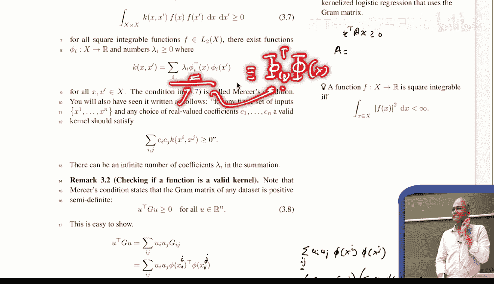
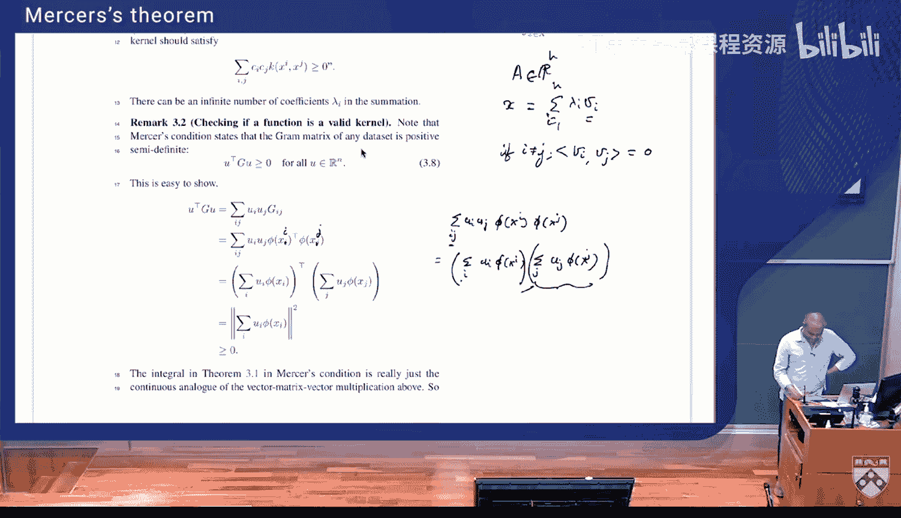
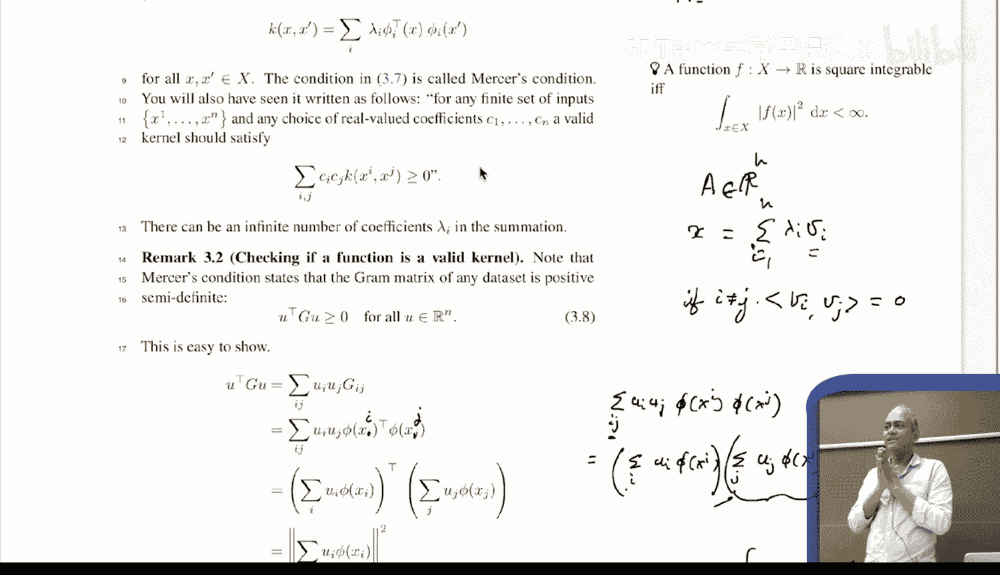

# 机器学习基础：第22章：Mercer定理与核函数验证 🔍

在本节课中，我们将要学习如何判断一个函数是否是一个合法的核函数。核函数是衡量输入之间相似度的工具，但并非所有函数都能作为核函数使用。我们将通过Mercer定理来理解核函数的数学条件，并学习如何在实际中验证一个核函数的有效性。

## 核函数的基本要求

上一节我们介绍了核函数是衡量输入相似度的工具。本节中我们来看看，一个函数要成为合法的核函数，需要满足哪些条件。

核函数是一个关于两个输入 **x** 和 **x'** 的函数。首先，核函数必须是对称函数。这意味着交换两个输入的顺序，函数值保持不变。

**公式：** `k(x, x') = k(x', x)`

## Mercer定理的核心条件

除了对称性，核函数还需要满足一个更本质的条件，这由Mercer定理描述。该定理指出，如果一个对称函数 **k** 满足特定的正则性条件，那么它可以被表示为某个特征空间中的内积。

直观上，这个条件类似于矩阵的正半定性。对于一个矩阵 **A**，如果对于所有向量 **x**，都有 **xᵀAx ≥ 0**，那么 **A** 是正半定的。Mercer定理将这个概念推广到了函数空间。

对于核函数 **k**，其条件表述为：对于定义域 **X** 上的任意函数 **f**，以下积分必须非负。

**公式：** `∬ k(x, x') f(x) f(x') dx dx' ≥ 0`

你可以将 **f(x)** 和 **f(x')** 想象成无限维的向量，这个积分条件就类似于无限维向量空间中的二次型非负条件。

## 从理论到实践：Gram矩阵验证

理论上我们需要验证上述积分条件，但在实际机器学习任务中，我们只有有限的数据点。因此，我们可以通过检查由数据构造的Gram矩阵是否正半定，来验证核函数在给定数据集上的有效性。

以下是验证步骤：
1.  给定数据集 **{x¹, x², ..., xⁿ}** 和一个候选核函数 **k**。
2.  计算Gram矩阵 **G**，其中每个元素 **Gᵢⱼ = k(xⁱ, xʲ)**。
3.  检查矩阵 **G** 是否为正半定矩阵。

为什么这有效？如果核函数 **k** 是合法的，那么存在某个特征映射 **φ**，使得 **k(xⁱ, xʲ) = φ(xⁱ)ᵀ φ(xʲ)**。由此可以证明，对于任意向量 **u**，都有 **uᵀGu ≥ 0**，这正是正半定矩阵的定义。

**代码逻辑：**
```python
# 假设已计算得到Gram矩阵 G
import numpy as np

# 计算G的特征值
eigenvalues = np.linalg.eigvals(G)

# 检查所有特征值是否非负（考虑数值误差）
is_positive_semidefinite = np.all(eigenvalues > -1e-10)

if is_positive_semidefinite:
    print("该核函数在给定数据上是有效的。")
else:
    print("该核函数不是有效的。")
```

## 核函数的特征分解视角

如果一个核函数满足Mercer条件，那么它可以被分解为一系列特征函数（无限维的特征向量）的加权内积之和。

**公式：** `k(x, x') = Σᵢ λᵢ φᵢ(x) φᵢ(x')`



其中，**λᵢ** 是特征值，**φᵢ** 是相互正交的特征函数。这类似于矩阵的特征值分解。这些特征函数 **φᵢ** 就构成了我们寻找的隐式特征空间。



虽然我们可能不知道这些具体的特征函数 **φᵢ** 是什么（因为我们只定义了核函数 **k**），但Mercer定理保证了它们的存在。我们可以将所有 **φᵢ(x)** 拼接成一个（可能是无限维的）大特征向量 **Φ(x)**，从而使得核函数可以表示为 **Φ(x)ᵀ Φ(x')**。这从概念上连接了核函数与特征空间内积的本质。

## 总结



本节课中我们一起学习了核函数合法性的验证方法。我们了解到，一个合法的核函数必须是对称的，并且其对应的Gram矩阵对于任何数据集都应是正半定的。Mercer定理从数学上保证了满足这些条件的核函数，必然对应着某个高维（甚至无限维）特征空间的内积。在实际应用中，我们可以通过计算数据Gram矩阵的特征值来快速验证一个核函数的有效性，这比直接构思复杂的特征映射要简单得多。