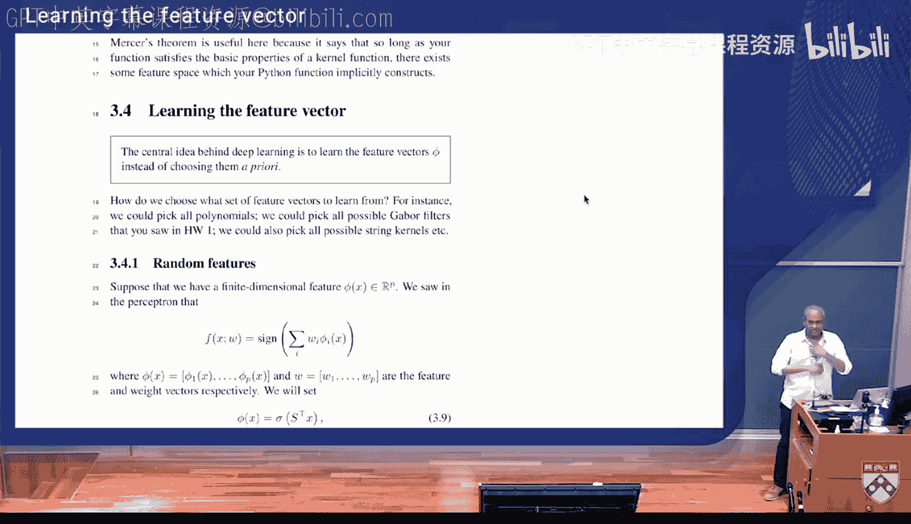
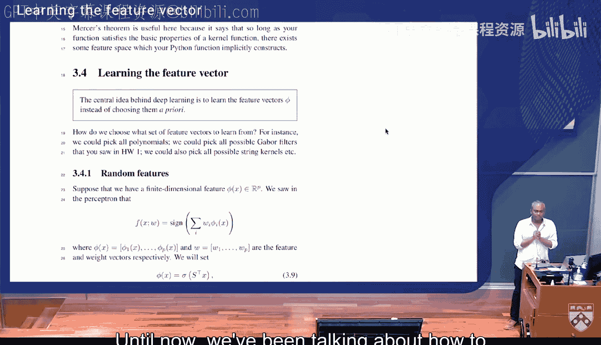

# 宾夕法尼亚大学《人工智能和机器学习基础（AI、数据科学、机器学习）AI and Machine Learning Essentials with Python》 p117 24_03_01_学习特征向量.zh_en -BV16f421Q72q_p117-

Cternels are easy to come off with。 And that is why they are nice， Much nicer than feature vector。

 So if I give you two strings like this。And you。How many feel that they are similar I mean I try to make them similar so I guess they are somewhat similar So this is our legitimate string from English and this is something scrambled so people might have heard of how if you take the same word and then keep the first and the last letter the same you can basically guess what the word is so this is what I tried to do and I created this string so you and I would agree that they are somewhat similar to each other then let's say some others bunch of characters like this。

Can you give me one example of how you will write a kernel for this？so given this string。

 you can think of some method that changes this string into this other string。

 people might have heard of something called as edit distance， edit distance。

 the shortest number of characters I need to change to change string A to string B。

This is an algorithm you can code it up using dynamic programming and you can write on a Python function that takes in two strings and then calculates their edit distance。

 How many things should I change okay。It doesn't look like any function that we can write down mathematically。

 but you can code it up in your Python code， you can check whether the gram matrixes has per non negative eigenvalues and you can verify whether this is a legitimate kernel。

 thats what it is because it is a metric。So kernels can be very complicated things。

 depending on how you come up with them， they may not look like these nice analytical functions that you write down on paper。

Going from kernels to deep learning is pretty easy you simply learn the feature vector fee until now weve been talking about how to come up with new feature vectors in deep learning we'll be interested in learning the feature vectors automatically。

Okay， so in one sentence， this is the definition of deep learning。

