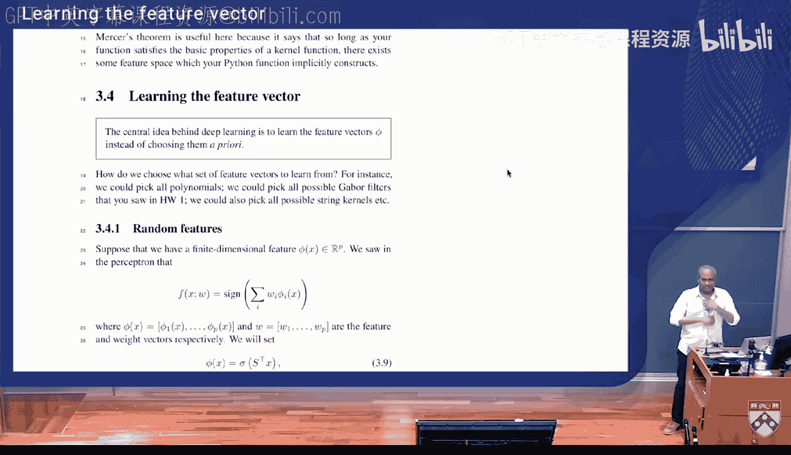
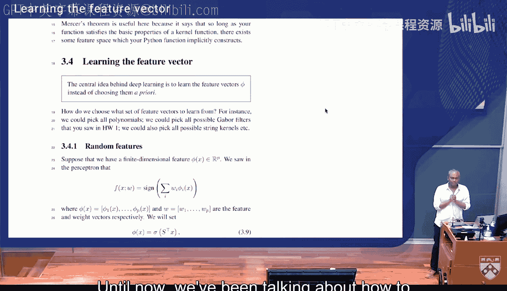

# 宾夕法尼亚大学《人工智能和机器学习基础》课程：第24章第3节第1讲：学习特征向量 🧠

在本节课中，我们将要学习核函数与特征向量之间的关系，并探讨深度学习如何自动学习特征向量。我们将从核函数的优势开始，逐步过渡到深度学习的核心思想。

## 核函数的优势

上一节我们介绍了核函数的基本概念。本节中我们来看看核函数相比特征向量的优势。

核函数易于构造。这正是核函数的优点，它比直接处理特征向量要方便得多。

## 核函数与相似性度量

接下来，我们通过一个例子来理解核函数如何衡量相似性。

假设我给你两个这样的字符串。你认为它们有多相似？我试图让它们相似，所以我猜它们有些相似。这是一个合法的英文单词，而另一个是经过打乱的。你可能听说过，如果保持单词的首字母和尾字母不变，你基本上可以猜出这个单词。这就是我尝试做的事情，并创建了这个字符串。你和我都会同意它们彼此有些相似。再比如另一串完全不同的字符。

## 如何为字符串编写核函数

那么，如何为字符串编写一个核函数呢？以下是思考步骤。

给定这个字符串，你可以想出某种方法，将这个字符串转换为另一个字符串。人们可能听说过一种叫做编辑距离的方法。编辑距离是指将字符串A更改为字符串B所需的最少字符更改次数。

这是一个你可以用动态规划编写的算法。你可以编写一个Python函数，接收两个字符串并计算它们的编辑距离。

我需要更改多少个字符？这看起来不像我们能写下的任何数学函数。但你可以在Python代码中实现它。你可以检查格拉姆矩阵是否具有非负特征值，并验证这是否是一个合法的核函数。

这就是核函数，因为它是一种度量。因此，核函数可以是非常复杂的东西。取决于你如何构造它们，它们可能看起来不像你在纸上写下的那些漂亮的分析函数。

## 从核函数到深度学习

从核函数过渡到深度学习相当容易，你只需学习特征向量φ。到目前为止，我们一直在讨论如何构思新的特征向量。在深度学习中，我们将对自动学习特征向量感兴趣。

用一句话概括，这就是深度学习的定义。

## 总结

本节课中我们一起学习了核函数在衡量复杂数据（如字符串）相似性方面的应用，并理解了其相对于手工设计特征向量的优势。最后，我们探讨了深度学习的核心思想：**自动学习有效的特征表示**，而无需手动设计核函数或特征映射。